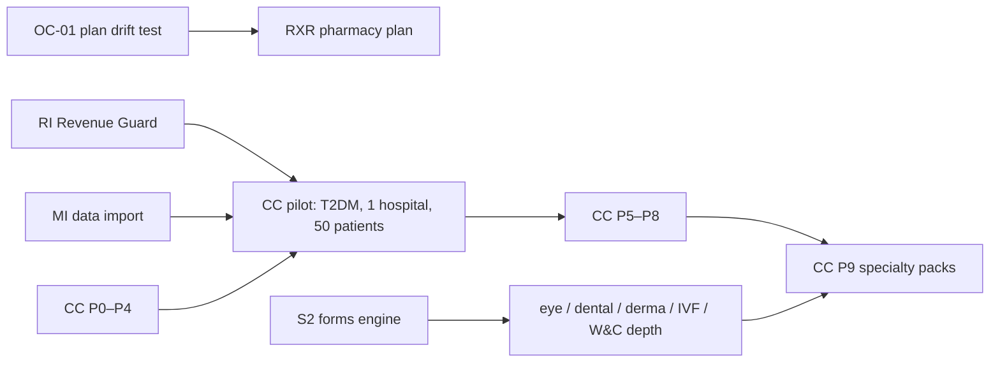

# Kriya — Next Build Roadmap (Nov 2026)

> One page that ties the new lanes together. Each lane has its own tracker; this file never holds task state.

## Why this order
The product already covers a full hospital (OPD, IPD, OT, pharmacy, lab, radiology, ABDM, WhatsApp, voice). The
questions that decide success now are adoption, real usage and **proof in rupees**. So we build only the gaps that help
sell or prove results:

| Lane | What | Why | Tracker |
|:-|:-|:-|:-|
| **CC** | Kriya Continuous Care — Find → Reach → Measure → Decide → Act → Verify for chronic patients, on WhatsApp and voice | the differentiator; turns follow-up into repeat visits, labs and refills | [continuous-care/status.md](continuous-care/status.md) |
| **RI** | Revenue Guard — nightly unbilled-charge check | small; shows ₹ recovered within a week | [revenue-integrity/status.md](revenue-integrity/status.md) |
| **MI** | Data import from old systems | removes the biggest reason hospitals refuse to switch; seeds CC | [data-import/status.md](data-import/status.md) |
| **RXR** | Standalone pharmacy plan (medical stores, chains) + owner-console Pharmacies section | a second market for the finished Pharmacy OS | [pharmacy-os/RETAIL-PLAN.md](pharmacy-os/RETAIL-PLAN.md) |
| **A11Y** | Panel-wide contrast fix (approved) — fill tokens, `--text3`, light amber, OPD stage colours, one invisible title | every page passes WCAG AA; new lanes inherit it — land first | [design/A11Y-CONTRAST-PLAN.md](design/A11Y-CONTRAST-PLAN.md) |
| **SP** | Specialty depth: eye, dental, derma, IVF, women & child (+ shared blocks S1–S9) and owner console | what specialty hospitals buy specialty software for | [specialty-os/README.md](specialty-os/README.md) |

Deferred until a customer asks: AI scribe, review requests (dental already has them).

**Before building:** read [continuous-care/VERIFICATION.md](continuous-care/VERIFICATION.md) (design review round 1:
16 defects fixed in the docs, loopholes, zero-impact matrix — binding for every lane) and [MARKET-EDGE.md](MARKET-EDGE.md)
(what buyers will still find missing, and where Kriya can lead). Every screen in every lane follows
[design/NEXT-LANES-UI-SPEC.md](design/NEXT-LANES-UI-SPEC.md) (tokens, icons, motion, contrast, blueprints, UI gates).

## Migration ledger (final, as taken in build order — 2026-11-25)
| No. | Lane | File | State |
|:-|:-|:-|:-|
| 143 | RI — Revenue Guard | `143_revenue_guard.sql` (+ rollback) | built + tested (working tree) |
| 144 | MI — Data import | `144_data_import.sql` (+ rollback; owns `kriya_guard_refs()`) | built + tested |
| 145–149 | CC — Continuous Care | `145_cc_foundation` · `146_cc_enrollments_plans` · `147_cc_measure` · `148_cc_act` · `149_cc_verify_outcomes` (+ rollbacks) | built + tested |
| 150 | RXR — standalone pharmacy | `150_retail_pharmacy.sql` (+ rollback) | built + tested |
| 151 | SP — S1 media vault + S2 forms engine | `151_sp_media_forms.sql` (+ rollback) | built + tested |
| 152 | SP — S3 packages / instalments, S5 estimates, S6 imaging links, S9 camps | `152_sp_packages_estimates.sql` (+ rollback) | built + tested |
| 153 | SP — eye optical jobs, dental lab orders, compliance dates | `153_sp_eye_dental.sql` (+ rollback) | built + tested |
| 154 | SP — IVF couples / cycles / embryos / hash-chained witnessing (derma uses 151–152) | `154_sp_derma_ivf.sql` (+ rollback) | built + tested |
| 155 | SP — ANC, immunisation, `sp_purge_clinic` / `sp_purge_patient` | `155_sp_womenchild_purge.sql` (+ rollback) | built + tested |
| 156 | SP — deliveries → newborns, WHO growth, birth registration, RCH / U-WIN ids, NICU, optical stock, IOL → IPD, purge v2 | `156_sp_wc_optical.sql` (+ rollback) | built + tested |
Latest on disk: 156. All 143–156 verified from a fresh empty cluster (migrations 001–156 from scratch, 2026-11-26; gate
counts in [specialty-os/README.md](specialty-os/README.md) §6). **Apply 125–156 on Supabase in order** (DX / RX owner
action for 125–142 still pending).

## Rules every lane shares
Production system, zero regression tolerance: every new module is owner opt-in and OFF by default; never via the
enterprise wildcard; new tables only, no trigger on existing tables; every existing test passes unedited; zero-LLM for
anything clinical (AI reaches and listens, code decides risk, the doctor decides treatment); clinic-owned WhatsApp
credentials only; IST everywhere. See [../AGENTS.md](../AGENTS.md) §1.
