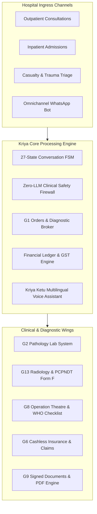
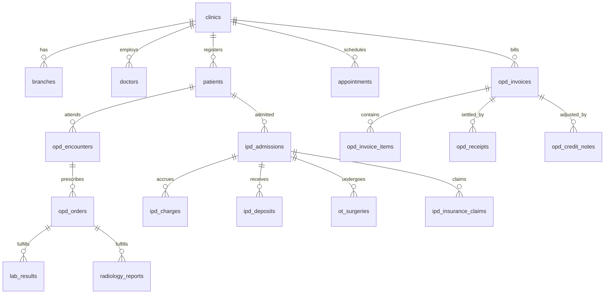
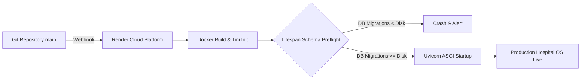

# KRIYA HOSPITAL OS — Comprehensive Technical Project Documentation
**System Identity**: Kriya AI (Enterprise Healthcare Operating System & Multimodal Hospital Management System)  
**Version**: 2.0.0 | **Target Audience**: College Project Submission, Technical Thesis, Engineering Viva & Architecture Review  
**Date**: November 2026 | **Deployment**: Production Cloud (Render + Supabase PostgreSQL 16)

---

## Table of Contents
1. [Executive Summary & Abstract](#1-executive-summary--abstract)
2. [Problem Statement & Domain Analysis](#2-problem-statement--domain-analysis)
3. [System Goals & Key Functional Objectives](#3-system-goals--key-functional-objectives)
4. [Complete Technology Stack Inventory](#4-complete-technology-stack-inventory)
5. [High-Level Architectural Design](#5-high-level-architectural-design)
6. [Database Schema & Data Modeling Engineering](#6-database-schema--data-modeling-engineering)
7. [Core Subsystems & Functional Module Breakdown](#7-core-subsystems--functional-module-breakdown)
   - [7.1 Inpatient OS (IPD)](#71-inpatient-os-ipd)
   - [7.2 Outpatient OS (OPD) & Queue Management](#72-outpatient-os-opd--queue-management)
   - [7.3 Investigation & Procedure Orders Engine (G1)](#73-investigation--procedure-orders-engine-g1)
   - [7.4 Pathology Lab Information System - LIS (G2)](#74-pathology-lab-information-system---lis-g2)
   - [7.5 GST-Aware Billing & Legal Credit Notes (G4)](#75-gst-aware-billing--legal-credit-notes-g4)
   - [7.6 Inpatient Finance, Advance Deposits & Packages (G5)](#76-inpatient-finance-advance-deposits--packages-g5)
   - [7.7 Insurance, TPA & Cashless Claims OS (G6)](#77-insurance-tpa--cashless-claims-os-g6)
   - [7.8 Emergency / Casualty OS, Rapid Triage & Statutory MLC (G7)](#78-emergency--casualty-os-rapid-triage--statutory-mlc-g7)
   - [7.9 Operation Theatre (OT OS) & WHO Surgical Checklist (G8)](#79-operation-theatre-ot-os--who-surgical-checklist-g8)
   - [7.10 Clinical Documents & NMC Discharge Summary Engine (G9)](#710-clinical-documents--nmc-discharge-summary-engine-g9)
   - [7.11 Central Masters, Tariffs & WHO ICD-10 Search (G12)](#711-central-masters-tariffs--who-icd-10-search-g12)
   - [7.12 Radiology RIS & Statutory PCPNDT Form F (G13)](#712-radiology-ris--statutory-pcpndt-form-f-g13)
   - [7.13 WhatsApp Patient Front-Desk & 27-State FSM](#713-whatsapp-patient-front-desk--27-state-fsm)
   - [7.14 Kriya Ketu Multimodal Voice Assistant](#714-kriya-ketu-multimodal-voice-assistant)
   - [7.15 Deterministic Zero-LLM Clinical Safety Firewall](#715-deterministic-zero-llm-clinical-safety-firewall)
8. [Security, Privacy & Indian Regulatory Compliance](#8-security-privacy--indian-regulatory-compliance)
9. [Software Testing, Verification & Quality Engineering](#9-software-testing-verification--quality-engineering)
10. [Cloud Deployment & Operational Topology](#10-cloud-deployment--operational-topology)
11. [Conclusion & Project Evaluation Summary](#11-conclusion--project-evaluation-summary)

---

## 1. Executive Summary & Abstract

**Kriya AI (Hospital OS)** is a unified, enterprise-grade, multi-tenant healthcare operating system engineered to automate the clinical, financial, administrative, and diagnostic workflows of Indian clinics, specialty nursing homes, and multi-specialty hospitals (10 to 500 beds). 

Historically, hospital computing in India has suffered from severe fragmentation: outpatient queues run on desktop software, inpatient records are handwritten on physical clipboards, laboratory and imaging systems run in isolated silos, and billing staff manually re-type test codes and drug names across counters. Furthermore, patient communication relies on chaotic phone calls, while regulatory compliance (National Medical Commission telemedicine rules, Digital Personal Data Protection Act 2023, PCPNDT Act 1994, and GST Notification No. 04/2022) is managed with high liability on physical paper registers.

Kriya AI solves this by introducing a **single unified clinical and financial ledger** backed by an omnichannel architecture:
1. **Patient-Facing Omnichannel Layer**: WhatsApp Cloud API integration driven by a deterministic 27-state Finite State Machine (FSM) enabling automated multi-doctor booking, slot locking, payment link settlements, and automated delivery of lab/radiology reports and discharge summaries.
2. **Staff-Facing Clinical Console**: A high-density, zero-build Single-Page Application (SPA) supporting OPD queues, IPD bed boards, electronic medication administration records (MAR), operative surgery tracking, laboratory worksheets, and dual-debtor insurance claims.
3. **Voice-First AI Operational Layer (Kriya Ketu)**: A multimodal voice assistant supporting English, Hindi, and Telugu that allows doctors, nurses, and cashiers to execute operational workflows (recording vitals, admitting patients, booking OT slots, capturing payments) hands-free via voice, with deterministic validation and preview-confirmation safeguards.
4. **Verifiable Financial & Clinical Engine**: Built on PostgreSQL 16 with 124 migrations, enforcing integer-paise financial integrity, gapless document numbering, compare-and-set concurrency controls, and a strict **Zero-LLM Clinical Firewall** ensuring artificial intelligence never diagnoses or prescribes autonomously.

The system is tested against an automated hermetic test suite exceeding **7,600 test cases**, incorporating AST-based tenant isolation linters, real-PostgreSQL concurrency fixtures, and adversarial security matrices.

---

## 2. Problem Statement & Domain Analysis

### 2.1 Domain Challenges in Indian Healthcare Systems
- **The "Paper Chasm"**: A consulting doctor advises investigations (e.g., *"CBC, Chest X-Ray, ECG"*). The patient carries this paper slip to the billing counter where the cashier must re-read handwriting and manually select billing codes. The patient then walks to the lab where a phlebotomist re-enters the patient's name. This causes transcription errors, missing charges, and extended patient turnaround times.
- **Inpatient Revenue Leakage & Bad Debts**: Patients admitted to nursing homes accumulate bed charges, nursing fees, medications, and diagnostics. Without a real-time running bill and automated advance deposit tracking, hospitals frequently face bad debt at discharge when the patient is presented with an uncollateralized lump-sum bill.
- **Statutory Regulatory Liabilities**:
  - *NMC Regulations (National Medical Commission)*: AI models that generate autonomous medical advice or prescriptions violate Indian law. Systems must deterministically prevent AI from functioning as an unlicensed medical practitioner.
  - *PCPNDT Act, 1994*: Prenatal sex determination is a non-bailable criminal offense. Ultrasound machines and records are audited by state authorities; missing **PCPNDT Form F** records lead to immediate facility sealing.
  - *GST Act (Notification No. 04/2022-CT)*: While general healthcare is exempt (SAC 999312), non-ICU room rent exceeding ₹5,000/day attracts 5% GST without input tax credit. Issued tax invoices can only be legally adjusted via Section 34 Credit Notes.
  - *DPDP Act 2023 (Digital Personal Data Protection)*: Mandates clear patient consent capture, 30-day session purges, and enforceable right-to-be-forgotten capabilities.
- **Cashless Health Insurance & TPA Complexities**: 60–80% of multi-specialty hospital revenue originates from Third Party Administrators (TPAs) and government schemes like Ayushman Bharat (PM-JAY). Hospital software must support dual-debtor split invoicing (separating patient co-pays from insurer receivables), pre-authorisation enhancements, and dispute deductions.

---

## 3. System Goals & Key Functional Objectives



1. **Omnichannel Triad Integration**: Unify OPD, IPD, and Emergency intake under a single persistent Patient Master Record (MRN).
2. **Deterministic Clinical Safety**: Ensure 100% deterministic, zero-hallucination clinical paths using structured masters (ICD-10, NHA drug codes) while restricting LLMs exclusively to conversational understanding and administrative text summarization.
3. **Sub-15ms Inbound Webhook SLA**: Ensure Meta WhatsApp webhooks return HTTP 200 within 15ms to satisfy Meta’s strict 20-second timeout and eliminate cascading delivery retry loops.
4. **Verifiable Multi-Tenant Architecture**: Connect to the database using privileged service roles while guaranteeing 100% application-level multi-tenancy isolation across tables, branches, and staff accounts.
5. **Atomic Financial Invariance**: Guarantee integer-paise precision, compare-and-set status transitions, and immutable append-only receipts, credit notes, and deposit ledgers.

---

## 4. Complete Technology Stack Inventory

| Layer / Subsystem | Technology / Library | Version / Specification | Architectural Purpose & Rationale |
| :--- | :--- | :--- | :--- |
| **Backend Runtime** | **Python** | 3.11 / 3.12 | Core programming language offering rich asynchronous capabilities, mathematical precision, and rapid healthcare protocol parsing. |
| **Web Framework** | **FastAPI** | `>=0.115.0, <1.0` | Asynchronous ASGI framework providing native Pydantic validation, OpenAPI documentation, high-throughput concurrency, and dependency injection. |
| **ASGI Web Server** | **Uvicorn** | `0.27.0 [standard]` | Lightning-fast ASGI web server configured with multi-worker concurrency and uvloop event loops. |
| **Database Engine** | **PostgreSQL** | `16.x` via **Supabase** | Object-relational database hosting 124 migrations, PL/pgSQL stored procedures, triggers, composite foreign keys, and `pg_trgm` GIN indexing. |
| **Database SDK** | **Supabase Python SDK** | `2.31.0` + Custom Monkey Patch | PostgREST client patched with custom off-loop `sb()` executor in a dedicated thread pool to prevent blocking the async event loop. |
| **Data Validation** | **Pydantic & Pydantic-Settings** | `v2.9.0` | Strict type enforcement, environment variable parsing, and sanitization of clinical and financial payloads. |
| **Background Scheduler** | **APScheduler** | `3.10.4` | In-process background job scheduler executing 24 recurring sweeps (appointment reminders, follow-ups, bed-day charges, DLQ retries). |
| **Distributed Locking** | **PostgreSQL Advisory Locks** | Custom RPC (`acquire_scheduler_lock`) | Distributed CAS lease locking preventing race conditions and duplicate cron execution across multi-container worker clusters. |
| **Artificial Intelligence** | **OpenRouter API Gateway** | Multi-Model Routing | Hybrid LLM routing utilizing `deepseek/deepseek-chat` (primary) and `google/gemini-2.0-flash-001` (low-latency fallback). |
| **Speech-to-Text (STT)**| **Groq Whisper & Sarvam AI** | Cloud API Integration | Real-time multilingual voice transcription optimized for Indian accents, regional dialects, and clinical terminology. |
| **Messaging Channel** | **Meta WhatsApp Cloud API** | Graph API `v22.0` | Official WhatsApp Business API providing interactive buttons, list messages, document transmission, and template messaging. |
| **Payment Gateways** | **Razorpay & PhonePe** | SDK `1.4.0` / Webhook APIs | Payment link generation, UPI intent links, automated cancellation refunds, and cryptographic HMAC-SHA256 webhook validation. |
| **PDF Generation** | **fpdf2 & uharfbuzz** | `fpdf2 2.7.9`, `uharfbuzz 0.39.0`| High-resolution vector PDF rendering with native HarfBuzz text shaping for Indic fonts (Hindi, Telugu) for prescriptions, discharge summaries, and bills. |
| **EHR Scraping Engine**| **Playwright** | `1.40.0` (Chromium Headless) | Browser automation for extracting laboratory reports and slot schedules from legacy third-party hospital portals (MocDoc). |
| **Frontend UI** | **Vanilla JavaScript, HTML5, CSS3** | Zero-Build Custom Architecture | Monolithic, high-density Single-Page Application (`admin/index.html`) loaded without bundling overhead, optimized for desktop and mobile (390px). |
| **Data Visualizations**| **Chart.js** | `v4.4.x` (Self-Hosted) | CSP-compliant local charting library rendering revenue metrics, inpatient census trends, and corporate health distribution curves. |
| **Testing Framework** | **Pytest & Pytest-Asyncio** | `pytest 8.0.0`, `pytest-asyncio 0.23.5`| Comprehensive automated testing harness with real-PostgreSQL fixtures, AST syntax tree linters, and adversarial security matrices. |
| **Container & Host** | **Docker & Render Cloud** | `python:3.11-slim` + `tini` | Containerized microservice deployment with PID 1 process supervision, Off-Peak rolling deployments, and automated Git webhooks. |

---

## 5. High-Level Architectural Design

### 5.1 Multi-Process Micro-Topology
The platform runs as isolated container services to prevent browser scraping memory footprints from impacting live API response times:

```
┌────────────────────────────────────────────────────────────────────────────────────────┐
│                                 KRIYA RUNTIME TOPOLOGY                                 │
│                                                                                        │
│   [ Inbound Webhooks / HTTPS Traffic ]                                                 │
│                    │                                                                   │
│                    ▼                                                                   │
│   ┌──────────────────────────────────────────────────┐                                 │
│   │  Web Service Container: `mediassist-web`         │                                 │
│   │  • FastAPI Application (PID 1: Tini Supervisor)   │                                 │
│   │  • Off-Loop Dedicated DB Executor (16 Threads)   │                                 │
│   │  • In-Memory Tenant Cache (TTL: 30s)             │                                 │
│   │  • Admin Single-Page Application Mount           │                                 │
│   └────────────────────────┬─────────────────────────┘                                 │
│                            │                                                           │
│                            ▼                                                           │
│   ┌──────────────────────────────────────────────────┐   ┌─────────────────────────┐   │
│   │  Managed Database: Supabase PostgreSQL 16        │◀──│ Connector Worker        │   │
│   │  • 124 Applied Migrations, 50+ Tables            │   │ `mediassist-connector`  │   │
│   │  • PL/pgSQL Stored Procedures & Triggers         │   │ • Isolated Container    │   │
│   │  • Append-Only Financial & Audit Ledgers         │   │ • Playwright Chromium   │   │
│   │  • Distributed CAS Scheduler Locks               │   │ • Scraping MocDoc EHR   │   │
│   └──────────────────────────────────────────────────┘   └─────────────────────────┘   │
└────────────────────────────────────────────────────────────────────────────────────────┘
```

### 5.2 Critical Architectural Invariants
1. **Application-Enforced Multi-Tenancy**: The application connects to Supabase as `service_role` (carrying PostgreSQL's `BYPASSRLS`). PostgreSQL RLS does not guard tenant rows. Isolation is enforced 100% in application code via `TENANT_OWNED_TABLES` (50+ tables registered in `app/tenancy.py`). Every query must execute through `scoped_query(table, clinic_id)` or `.eq("clinic_id", clinic_id)`.
2. **Off-Loop Database Execution**: Supabase Python SDK v2 `.execute()` is synchronous blocking HTTP. To prevent event-loop starvation under high concurrency, all database calls are dispatched to a dedicated thread pool (`_DB_EXECUTOR`, 16 workers) via `await sb(...)`.
3. **Forced HTTP/1.1 Socket Transport**: PostgREST HTTP/2 multiplexing caused socket reset drops during burst database queries. `app/database.py` monkey-patches the underlying HTTP adapter to force HTTP/1.1 keep-alive connections.
4. **Sub-15ms Webhook Ingestion**: Meta's WhatsApp platform terminates webhooks exceeding 20 seconds. `POST /webhook` cryptographically verifies the HMAC-SHA256 signature, deduplicates the message ID via `processed_messages`, enqueues the payload into `inbound_messages`, and returns HTTP 200 within 15ms. Processing executes asynchronously.
5. **Zero-LLM Clinical Safety Firewall**: National Medical Commission regulations prohibit non-human prescription or autonomous medical diagnosis. All incoming patient health queries are screened deterministically against 250+ drug keywords and symptom requests, returning statutory NMC disclaimers without invoking an LLM.

---

## 6. Database Schema & Data Modeling Engineering

The database consists of **124 sequential migrations** managing over **50 relational tables**.



### 6.1 Tenant Isolation Invariant
Every tenant table carries a composite unique constraint: `UNIQUE (clinic_id, id)`. Child tables reference parent entities using composite foreign keys:
```sql
CONSTRAINT opd_orders_encounter_fk 
    FOREIGN KEY (clinic_id, encounter_id) 
    REFERENCES opd_encounters (clinic_id, id) ON DELETE CASCADE
```
*Technical Rationale*: This ensures that even if application logic passes a foreign UUID from a different tenant, PostgreSQL rejects the cross-tenant reference at the engine level.

### 6.2 Financial Integrity & Ledger Invariants
- **Integer Paise Representation**: All currency is stored as integers (₹100.50 = `10050` paise) to eliminate IEEE 754 floating-point rounding errors.
- **Computed Database Totals**: Invoices use generated columns:
  `total_paise INTEGER GENERATED ALWAYS AS (subtotal_paise - discount_paise) STORED`
- **Gapless Sequence Generation**: Official documents mandate gapless legal sequences per clinic per year (e.g., `INV-2026-00001`, `CRN-2026-00001`, `DEP-2026-00001`). This is enforced using atomic row locks on a dedicated sequence counter table (`opd_counters`), eliminating race conditions under concurrent cashier writes.

---

## 7. Core Subsystems & Functional Module Breakdown

### 7.1 Inpatient OS (IPD)
- **Ward & Bed Topology**: Multi-branch ward hierarchy (General Ward, Semi-Private, Deluxe, ICU, NICU, PICU) with real-time bed board states (`available`, `occupied`, `reserved`, `cleaning`, `maintenance`).
- **Admission Lifecycle**: Admission workflow with provisional diagnosis, admitting doctor, attendant tracking, and bed allocation.
- **Inpatient Chart & Workbench**: Clinical progress notes, vital signs tracking (Temperature, BP, Pulse, SpO2, Respiratory Rate), Input/Output fluid monitoring, and Medication Administration Records (MAR).
- **Bed-Day Accrual**: Automated midnight scheduler job calculating midnight bed-occupancy charges based on ward tariffs.

### 7.2 Outpatient OS (OPD) & Queue Management
- **Token Queue Engine**: Real-time queue transition lifecycle (`booked` $\to$ `arrived` $\to$ `vitals_done` $\to$ `in_consult` $\to$ `completed`).
- **Hallway TV Queue Display**: Privacy-preserving display view (`/display`) showing calling token numbers and room allocations without exposing patient names.
- **Clinical Encounter**: Structured recording of complaints, physical examination, ICD-10 diagnoses, clinical advice, and digital prescription generation.
- **Cashier Shifts & Blind-Close**: Daily cash drawer management with opening float, shift transaction tracking, blind close declaration, and discrepancy calculation.

### 7.3 Investigation & Procedure Orders Engine (G1)
- **Unified Order Broker**: Doctor consult advice creates structured orders (`opd_orders`) categorized into pathology, radiology, and nursing procedures.
- **Draft Invoice Synchronization**: Automatically syncs ordered investigations to the patient's draft invoice as billable items.
- **Diagnostic Worklist Feed**: Routes ordered tests immediately to the laboratory and radiology departmental worklists, eliminating manual data re-entry.

### 7.4 Pathology Lab Information System - LIS (G2)
- **Parameter & Reference Master**: Configurable lab test menus with individual analyte parameters, units, and normal/critical reference ranges stratified by age and gender.
- **Two-Step Validation Workflow**: Laboratory technicians enter raw values $\to$ Pathologists verify, review critical value flags, and digitally sign reports.
- **Automated Delivery**: Once signed, the system renders a vector PDF on clinic letterhead and triggers background WhatsApp delivery to the patient.

### 7.5 GST-Aware Billing & Legal Credit Notes (G4)
- **Indian GST Compliance**: Line-item tax computation with HSN/SAC codes (SAC 999312 for health, SAC 999311 for room rent), CGST, SGST, and IGST calculations.
- **Statutory Room-Rent Tax Rule**: Implements CBIC Notification No. 04/2022-CT: Inpatient non-ICU bed charges exceeding ₹5,000/day attract 5% GST; ICU beds remain 100% exempt.
- **Section 34 Credit Notes**: Once an invoice is issued, modifications are prohibited. Adjustments generate gapless Credit Notes (`CRN-YYYY-XXXXX`), automatically adjusting ledger balances and cashier shifts.

### 7.6 Inpatient Finance, Advance Deposits & Packages (G5)
- **Advance Deposit Ledger**: Collects cash/UPI deposits upon admission (`DEP-YYYY-XXXXX`) tied to open cashier shifts.
- **Real-Time Running Bill**: Dynamic computation: `posted_charges - package_adjustments - deposits_applied = net_payable`.
- **Surgical & Treatment Packages**: Fixed-price packages with predefined inclusions, exclusions, and maximum day allowances.
- **Four-Eyes Discount Approval**: Staff discount requests exceedable only with administrative role approval before bill issuance.

### 7.7 Insurance, TPA & Cashless Claims OS (G6)
- **Payer Master**: Directory of Indian TPAs (Medi Assist, Vidal, MDIndia) and government schemes (PM-JAY, CGHS).
- **Pre-Authorisation Engine**: Tracking initial requests, approval letters, queries, enhancements, and final sanctioned amounts.
- **Dual-Debtor Split Invoicing**: Generates two distinct receivable ledgers:
  `Total Bill = Patient Payable (Co-pay/Non-medical) + Insurer Payable (Approved Sanction)`
- **Claim Settlement & Deduction Ledger**: Reconciles insurance payments with bank UTR numbers, recording TDS deductions and disallowed write-offs.

### 7.8 Emergency / Casualty OS, Rapid Triage & Statutory MLC (G7)
- **30-Second Rapid Registration**: Instant admission for trauma/unconscious patients as *"Unknown Male/Female ~30y"* with temporary MRN (`EMG-YYYY-XXXXX`).
- **Color-Coded Triage**: Immediate classification: 🔴 RED (Resuscitation), 🟡 YELLOW (Urgent), 🟢 GREEN (Ambulatory), ⚫ BLACK (Deceased).
- **Statutory MLC Register**: Medico-Legal Case documentation recording police station intimation, officer badge number, and injury description. Locked records are legally immutable.
- **Atomic Identity Merge**: PostgreSQL RPC transferring temporary emergency visits, vitals, and orders into the patient's verified permanent record with complete audit provenance.

### 7.9 Operation Theatre (OT OS) & WHO Surgical Checklist (G8)
- **Collision-Proof OT Scheduling**: Prevents overlapping surgery bookings on the same theatre table via serialized transaction locking.
- **Mandatory WHO Surgical Safety Checklist**: Enforces sequential 3-phase verification required for NABH accreditation:
  1. *Sign-In* (Before anaesthesia induction)
  2. *Time-Out* (Before skin incision)
  3. *Sign-Out* (Before leaving the operating room)
- **Anaesthesia Record**: Captures ASA physical status (Class I–VI), Mallampati grade, induction/maintenance agents, fluids, and Aldrete recovery scores.
- **Automated Surgery Cost Posting**: Completing surgical notes automatically posts procedure charges to `ipd_charges`.

### 7.10 Clinical Documents & NMC Discharge Summary Engine (G9)
- **Statutory Inpatient Discharge Summary**: Compiles vital signs trends, hospital course, operative findings, validated lab results, discharge medications, and follow-up advice into an immutable signed PDF with doctor registration credentials.
- **Informed Consents**: Pre-formatted templates (General Admission, Surgical, High-Risk, LAMA) supporting English, Hindi, and Telugu.
- **Medical & Fitness Certificates**: Gapless issuance of leave, fitness, and death intimation certificates (`CERT-YYYY-XXXXX`).

### 7.11 Central Masters, Tariffs & WHO ICD-10 Search (G12)
- **Relational Tariff Master**: Centralized catalog of billable procedures and nursing charges, replacing unindexed JSON settings.
- **Sub-10ms ICD-10 Search**: Seeded with official WHO ICD-10 diagnosis codes indexed via PostgreSQL `pg_trgm` GIN indexes for instantaneous prefix and fuzzy autocomplete.

### 7.12 Radiology RIS & Statutory PCPNDT Form F (G13)
- **Radiology Information System (RIS)**: Modality worklists (X-Ray, Ultrasound, CT, MRI) and structured reporting consoles with PACS DICOM viewer URLs.
- **Statutory PCPNDT Form F Compliance**: Mandatory for all obstetric ultrasounds under Indian law. Requires maternal obstetric history (Gravida, Para, living children, LMP) and doctor declarations.
- **Prenatal Sex-Determination Firewall**: Zero-tolerance screening rejecting any findings containing fetal sex terms in English, Hindi, or Telugu.

### 7.13 WhatsApp Patient Front-Desk & 27-State FSM
- **Finite State Machine Architecture**: Manages conversational dialogue through 27 deterministic states (`AWAITING_DOCTOR`, `AWAITING_DATE`, `AWAITING_PAYMENT`, `SELECTING_LANGUAGE`).
- **Payment Link Generation**: Integration with Razorpay/PhonePe generating automated payment links with webhook callbacks.
- **Smart Patient Matching**: 3-point matching algorithm (phone, name phonetic match, age/DOB) associating external lab reports with patient records.

### 7.14 Kriya Ketu Multimodal Voice Assistant
- **Voice-First Hospital Control**: Speech-driven interface allowing hospital staff to execute complex clinical and administrative tasks hands-free.
- **Multi-Lingual Spoken Number Parser**: Converts spoken numbers, amounts, and clock times across English, Hindi, and Telugu (*"teen hazaar paanch sau"*, *"rendu vandalu"*, *"one twenty over eighty"*) into structured integers.
- **Safety Previews & Confirmation Gating**: Operational commands (fee changes, bed transfers, discharge completions) display a structured visual preview before execution.

### 7.15 Deterministic Zero-LLM Clinical Safety Firewall
- **Statutory Compliance**: Enforces National Medical Commission ethical guidelines.
- **Deterministic Keyword Screener**: Intercepts queries across 250+ drug generic names, dosages, and diagnosis requests.
- **Fail-Safe Response**: Replaces model evaluation with standard medical advisory text:  
  *"I am an AI assistant and cannot provide medical advice, diagnosis, or prescriptions. Please consult with our registered doctors."*

---

## 8. Security, Privacy & Indian Regulatory Compliance

### 8.1 Digital Personal Data Protection (DPDP) Act 2023
- **Explicit Consent**: Tracks opt-in timestamp, language, and purpose on patient registration.
- **Right to Erasure ("DELETE MY DATA")**: Automated workflow scrubbing patient identifiers from active tables while retaining anonymized clinical records for mandatory 7-year medical audits.
- **Ephemeral Session Purging**: Automated background sweep purging WhatsApp conversational message bodies older than 30 days.

### 8.2 National Medical Commission (NMC) Regulations
- **Doctor Registration Provenance**: Every prescription, consultation note, and discharge summary snapshots the doctor's State Medical Council registration number, council name, and qualifications at the moment of signing.
- **Immutable Clinical Audit Logs**: Administrative reads and writes of clinical charts are logged in `admin_audit_logs`.

### 8.3 Cryptographic Standards
- **Webhook HMAC-SHA256**: Meta and Razorpay payloads are validated against clinic-specific cryptographic secrets before parsing.
- **Password Security**: Staff authentication utilizes Bcrypt/Argon2 password hashing with cryptographically random salt rounds.
- **Credential Storage**: External LIMS/PACS credentials encrypted at rest using AES-128 (Fernet symmetric encryption).

---

## 9. Software Testing, Verification & Quality Engineering

The repository enforces a rigorous verification methodology ensuring production reliability across **7,600+ hermetic automated tests**.

```
┌────────────────────────────────────────────────────────────────────────────────────────┐
│                                VERIFICATION PIPELINE                                   │
│                                                                                        │
│   1. AST Tenant Isolation Linter   ──▶ Fails if any unscoped query exists              │
│   2. Adversarial Security Matrix   ──▶ Proves route authorization & multi-tenant scope  │
│   3. Real-PostgreSQL Invariants    ──▶ Concurrency, row-locks, and gapless sequences   │
│   4. Zero-LLM Clinical Firewall    ──▶ Verifies medical advice refusal across languages│
│   5. Full Integration Suite        ──▶ 7,600+ hermetic tests passing (0 network calls) │
└────────────────────────────────────────────────────────────────────────────────────────┘
```

### 9.1 AST-Based Tenant Isolation Linter
The custom linter `tests/test_lint_unscoped_queries.py` parses the Abstract Syntax Tree (AST) of the entire codebase. If any database query on a table listed in `TENANT_OWNED_TABLES` lacks a `.eq("clinic_id", ...)` or `scoped_query(...)` filter, **the test suite fails automatically**, preventing multi-tenant data leaks.

### 9.2 Real-PostgreSQL Concurrency Tests
Validates transaction safety under parallel execution using an embedded PostgreSQL instance:
- **Parallel Bed Allocation**: 20 concurrent admission requests for the same bed yield exactly 1 success and 19 conflict rejections.
- **Gapless Sequence Integrity**: 10 parallel invoice creations receive 10 consecutive gapless numbers (`INV-2026-00001` to `INV-2026-00010`) without duplicates or missing numbers.
- **Refund Idempotency**: Concurrent retries of refund requests pay out once and replay the cached result.

---

## 10. Cloud Deployment & Operational Topology



### 10.1 Dockerfile & Process Supervision
- **Base Image**: `python:3.11-slim` running with `tini` as PID 1 to ensure proper UNIX signal forwarding (`SIGTERM`) and zombie process reaping.
- **Timezone Pinning**: System timezone explicitly pinned to `Asia/Kolkata` (`Asia/Kolkata /etc/localtime`).

### 10.2 Fail-Closed Migration Preflight Gate
On application startup, `app/main.py` inspects the disk for the highest numbered migration file (e.g., `124_insurance_tpa_and_cashless.sql`) and queries the remote Supabase database:
```python
if highest_applied_num < highest_file_num:
    raise RuntimeError(f"Schema drift detected: DB at #{highest_applied_num}, Disk at #{highest_file_num}")
```
*Engineering Guarantee*: If code is deployed before database migrations are applied, the container refuses to start, preventing runtime column-missing crashes and data corruption.

---

## 11. Conclusion & Project Evaluation Summary

**Kriya AI** represents a complete, mathematically verified, and legally compliant hospital operating system. By integrating patient communication (WhatsApp), inpatient care (IPD), outpatient management (OPD), surgical workflows (OT), diagnostic wings (LIS & RIS), and financial governance (GST & TPA Claims) into a single unified ledger, the project successfully bridges the traditional chasm between clinical care and hospital administration.

### Key Evaluation Highlights for Academic Presentation:
- **Engineering Complexity**: 124 database migrations, 50+ relational tables, 27-state conversation FSM, and over 28,000 lines of robust Python and JavaScript code.
- **Architectural Soundness**: Non-blocking asynchronous event loop with dedicated thread-pool offloading, forced HTTP/1.1 transport, and AST-guarded tenant isolation.
- **Regulatory Precision**: Built from the ground up for Indian healthcare laws (NMC Zero-LLM firewall, DPDP Act 2023, PCPNDT Act 1994, and GST Notification No. 04/2022).
- **Quality & Reliability**: Proven across 7,600+ hermetic automated tests with real-concurrency race condition verification.

