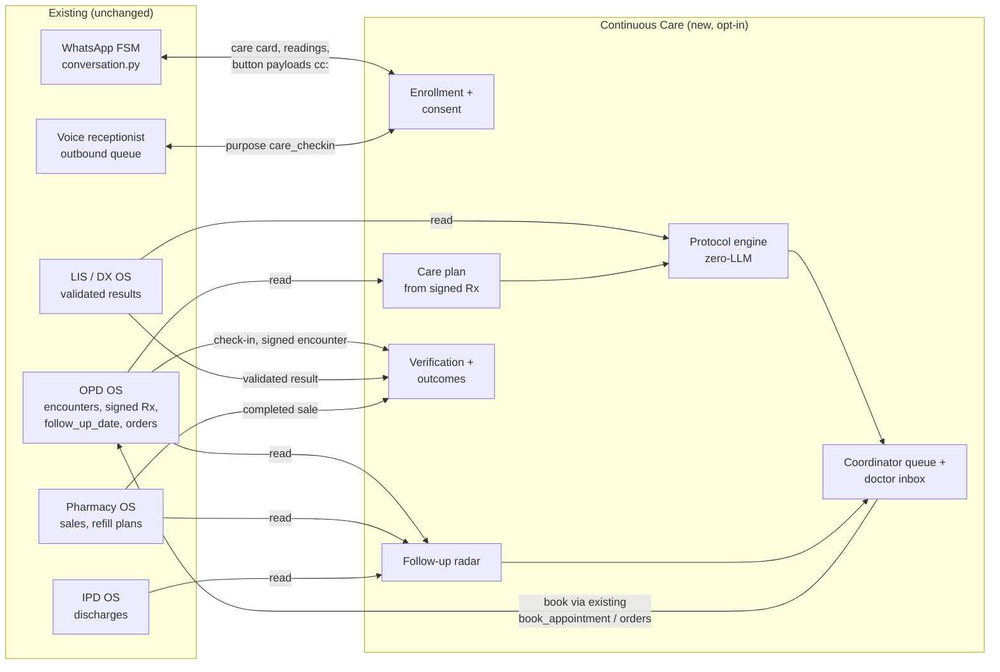
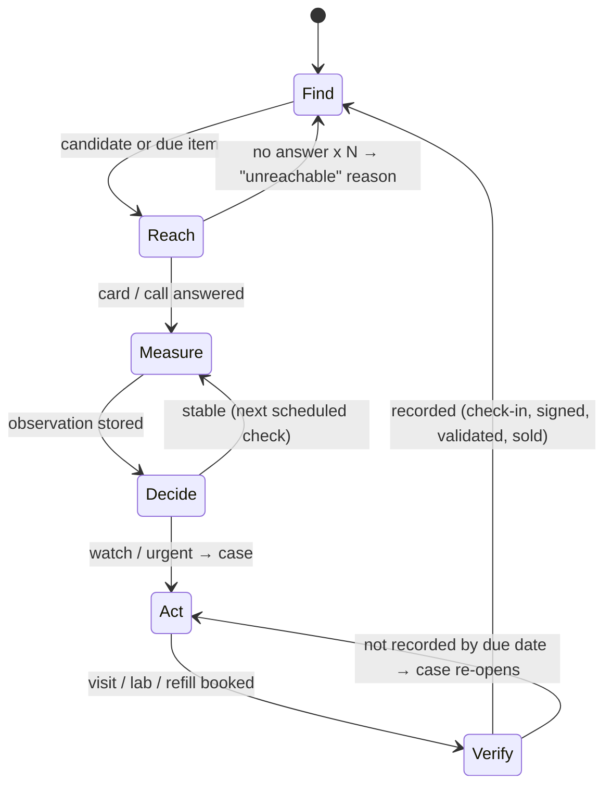

# Kriya Continuous Care — Architecture

> Lane **CC**. Decisions are argued in [ADR.md](ADR.md); tables in [DATA-MODEL.md](DATA-MODEL.md); rules in
> [PROTOCOLS.md](PROTOCOLS.md); evidence for every "existing" claim in [AUDIT.md](AUDIT.md).
> One sentence to keep in mind: **the AI reaches and listens, code decides the risk, the doctor decides the treatment.**

## 1. Position in Kriya



CC **reads** every existing module and **writes only `cc_*` tables** plus three additive touch points: a CHECK widen on
`voice_outbound_jobs.purpose`, a CHECK widen on `clinic_message_quota_usage.kind`, and one prefix/state hook in
`conversation.py` (§7). Bookings and lab orders it triggers go through the existing service functions, so every
existing guard (slot index, leave/holiday checks, payment, order invariants) applies unchanged.

## 2. The closed loop



| Step | Component | Input | Output | Owner |
|:-|:-|:-|:-|:-|
| Find | `cc_radar.py` (read model) | encounters, appointments, orders, results, refill plans, evaluations, enrollments | radar rows with a **reason code** and priority score | code |
| Reach | `cc_channels.py` (WhatsApp) + `app/voice` purpose `care_checkin` | due schedule items | `cc_prompts` (sent / delivered / answered / failed) | code + AI voice |
| Measure | `cc_observations.py` | button payloads, typed numbers claimed under ADR-CC-09 (open prompt + idle state, no new FSM state), voice digits/speech, validated lab values | append-only `cc_observations` | patient / lab |
| Decide | `cc_protocols/` + `cc_engine.py` | plan + observations + adherence + labs, protocol version, clinic parameters | `cc_evaluations` (tier stable/watch/urgent, reasons, proposed action codes) | **code** |
| Act | `cc_cases.py` | evaluations, radar | cases → coordinator → doctor approval → booking / order / call | **doctor** approves |
| Verify | `cc_verify.py` | check-in, signed encounter, validated result, completed sale | `cc_verifications`; outcome snapshots | code |

## 3. Process topology

Nothing new runs on the webhook thread. The webhook keeps persisting to `inbound_messages` and returning 200
(AGENTS.md §1.4); CC's conversation hook runs inside the existing per-phone locked handler.

| Process | New work | Cadence (IST) | Lock |
|:-|:-|:-|:-|
| Web (FastAPI) | `/admin/cc/*` routes; conversation hook | request | — |
| Scheduler | `cc_schedule_materialize` (tomorrow's due items) | 23:15 | `distributed_job_lock("cc_materialize")` |
| Scheduler | `cc_card_dispatch` (care cards whose send time is due) | every 5 min, 07:00–21:00 | `cc_card_dispatch` |
| Scheduler | `cc_evaluate` (re-evaluate enrollments with new observations / results) | every 10 min | `cc_evaluate` |
| Scheduler | `cc_radar_refresh` (rebuild radar rows, open/close cases) | 06:30 and 13:30 | `cc_radar` |
| Scheduler | `cc_verify` (match actions to recorded events) | 01:45 | `cc_verify` |
| Scheduler | `cc_outcomes_snapshot` (monthly / on demand) | 1st of month 03:15 | `cc_outcomes` |
| Voice gateway | `care_checkin` jobs through the existing `dispatch_due` | existing window, cap | existing |

Every job selects `clinics WHERE cc_state <> 'OFF'` first (indexed); zero CC clinics → zero work (§8).

## 4. Care plan derivation (from a signed prescription)

```mermaid
flowchart TD
  S[opd_prescriptions status=signed] --> E{patient enrolled\nin an ACTIVE protocol?}
  E -- no --> X[nothing]
  E -- yes --> M[map each line through the closed maps\nfrequency, dose, duration]
  M -->|maps| I[cc_plan_items kind=medication\nschedule = times of day from frequency + timing]
  M -->|does not map\n(SOS, custom, taper, injection)| N[item kept as 'display only'\nno dose check, shown verbatim]
  S --> F[follow_up_date] --> V[cc_plan_items kind=visit]
  P[protocol pack] --> L[kind=lab, measure, education\nfrom the pack schedule]
  I & N & V & L --> CP[cc_care_plans version n\nprevious version superseded]
```

Rules (ADR-CC-05): only `signed` prescriptions; the plan copies the line text verbatim (`drug_name`, `strength`,
`dosage`, `frequency`, `timing`) and never computes or rounds a dose; anything outside the closed maps is
"display only"; Schedule H1/X/narcotic/psychotropic lines are shown but never get a "taken?" prompt (same exclusion
as the refill engine, AUDIT A20). A new signed version for the same patient supersedes the plan in one transaction.

## 5. Protocol engine

Pure functions: `evaluate(pack, params, plan, observations, labs, adherence, today) -> Evaluation`. No I/O, no clock
reads, no randomness, no AI import (enforced by `tests/test_cc_no_llm.py`). Each pack is a Python module under
`app/services/cc_protocols/` with a semantic version; the clinic's **activation** pins the version and the
parameters a doctor signed (ADR-CC-06). Output:

```json
{"tier": "watch", "reasons": [{"code": "fbs_high_x2", "values": [212, 238], "window_days": 7}],
 "proposed": ["recheck_3d", "book_review_14d"], "protocol": "t2dm", "version": "1.2.0",
 "inputs_hash": "sha256:…", "safety_card": null}
```

A `safety_card` (e.g. low-sugar "what to do now") is chosen by code from a fixed, clinic-approved text and sent at
once; it never waits for a coordinator (ADR-CC-07).

## 6. Follow-up radar (Find)

A read model rebuilt twice a day per CC clinic, plus incremental closes when the underlying event arrives. Reason codes
(full list in [WORKFLOWS.md](WORKFLOWS.md) W6):

| Reason | Source (read-only) |
|:-|:-|
| `followup_overdue` | `opd_encounters.follow_up_date < today` and no later `checked_in_at` visit for the patient |
| `visit_missed` | appointment past, `checked_in_at IS NULL`, no rebook within 3 days |
| `lab_overdue` | plan lab item due and no validated result; or `opd_orders.status='ordered'` older than N days |
| `refill_lapsed` | `rx_refill_plans.covered_until < today` and no completed sale since (Pharmacy OS clinics) |
| `off_target` | latest `cc_evaluations.tier in (watch, urgent)` |
| `not_responding` | ≥ 3 consecutive unanswered prompts |
| `candidate` | not enrolled; a signed encounter in the last 180 days with an ICD-10 code a pack lists (E11.*, I10, E03.*, F32.*, F41.1 …) — scanned **incrementally** from a `signed_at` watermark, full rebuild weekly (VERIFICATION D9) |
| `discharged_followup` | IPD discharge with a `cc_discharge_followups` date due |

Priority score (deterministic, explainable — shown as "why" on every row):
`score = tier_weight + days_overdue_weight + missed_prompts_weight + condition_weight`, weights per clinic within
fixed bounds; ties broken by oldest due date.

## 7. Integration contracts with existing modules (all additive)

| Existing object | Change | Backward compatibility |
|:-|:-|:-|
| `clinics` | + `cc_state TEXT DEFAULT 'OFF'`, `cc_settings JSONB DEFAULT '{}'` | defaults; no reader of other columns changes |
| `OPT_IN_FEATURES` | + `"care_enabled"` | owner-only; wildcard never enables (A2) |
| `/admin/me` | + `cc_access`, `cc_state`, `cc_perms` | additive keys |
| `permissions.py` | + `CC_VIEW`, `CC_COORDINATE`, `CC_APPROVE` (doctor logins only), `CC_ADMIN`; role `CARE_COORDINATOR` | existing logins gain nothing unless `cc_access` |
| `conversation.py` | one block right after the `rx_refill:` hook (A29), **outside** the `message_type == "button"` branch so it sees both template quick replies (`button`) and in-window taps (`interactive`): (1) ids starting `cc:` are claimed; (2) a strictly numeric text is claimed only under ADR-CC-09's four conditions. No new state, no change to any other branch (VERIFICATION D1, D2) | every other message flows exactly as before; proven by the unedited FSM suite |
| `data_retention.anonymize_clinical_records` | + one guarded step calling `cc_purge_patient` (stops prompts, redacts CC rows) when the clinic has CC rows (VERIFICATION D6) | no-op for clinics without CC; family-member FK fallback already redacts instead of failing |
| `voice/gateway.py`, `voice/session.py`, `voice/dialog.py`, `voice/outbound.py` | `care` packet branch mirroring `reminder`; new outcomes; `care_daily_cap` (ADR-CC-16, VERIFICATION D3) | reminder and lead branches byte-identical; voice suites unedited |
| `whatsapp.py` | none — the Graph API read of messaging tier / quality lives in `cc_channels.py` (ADR-CC-17) | — |
| `ai_engine.EMERGENCY_KEYWORDS` | **latent fix CC-L1** (owner-approved): self-harm phrases | a strictly safer reply; separate commit, separate test |
| `voice_outbound_jobs.purpose` CHECK | widened + `care_checkin` (112 pattern) | old values valid; pre-CC code never writes it |
| `clinic_message_quota_usage.kind` CHECK | widened + `care` | dental kinds unchanged |
| `voice/dialog.py` | new `care_checkin` script entered only for that purpose | inbound and other purposes untouched |
| `opd_encounters`, `opd_prescriptions`, `lab_*`, `rx_*`, `appointments` | **no schema change, no trigger** | CC polls by indexed `(clinic_id, created_at)` / `signed_at` ranges |
| Booking / orders | called through `book_appointment`, `place_orders` services with the coordinator as actor | identical guards |
| Platform purge | `cc_purge_clinic` before OPD purge, only when the clinic has `cc_enrollments` | no-op otherwise |
| `TENANT_OWNED_TABLES` | + every `cc_*` table | lint covers them |
| `admin/index.html` | `<!-- CC:… -->` blocks, `data-cc` gating; one appended `loaders` line per page; one guarded chart-repaint line in `toggleTheme()` (UI spec §5) | hidden unless `cc_access`; repaint line is a no-op when no CC page is visible |

## 8. Zero-impact guarantees for clinics without Continuous Care

1. **No hot-path cost.** The conversation hook is a `startswith("cc:")` check and a regex on values already in
   memory; the `cc_access` check uses the clinic row already loaded. No DB call for a clinic without CC, and for a CC
   clinic only for strictly numeric messages.
2. **Router mounted but gated.** Every `/admin/cc/*` route returns 403 `care_not_enabled` before any DB read beyond
   the clinic row already loaded for auth.
3. **Jobs filter first** on `cc_state <> 'OFF'`.
4. **No trigger on any existing table.** CC reads by polling.
5. **UI hidden** until `applyCcGates()` sees `cc_access`.
6. **Proof.** The full existing suite passes unedited after each CC migration; webhook p95 compared before/after on
   the perf fixture (≤ 5 %), same gate as RX.

## 9. Failure modes

| Failure | Behaviour |
|:-|:-|
| Template not approved / paused by Meta | card not sent; prompt `failed:template`; radar reason `not_responding` is **not** raised for template failures (the patient did nothing wrong); setup page shows red |
| Monthly `care` quota exhausted | cards stop, safety cards still go (they are replies inside the window); owner + clinic warned at 90 % / 100 % |
| Patient sends "142" in the middle of booking | state is not `None`/`idle`/`main_menu` → not claimed; the FSM handles it as today |
| Patient sends "sugar 142 dizzy" | not strictly numeric → not claimed; firewall/emergency rules apply as today |
| Care templates approach the number's Meta messaging limit, or quality drops | ADR-CC-17 budget: capped share, halved at MEDIUM, stopped at LOW; transactional messages keep their room |
| Reading outside plausible range (e.g. 1420) | not stored; "Please check the number" once; second implausible value → dropped, prompt marked `unparsed` |
| Low sugar reading | safety card at once + urgent case; never waits for the evaluate job |
| PHQ-9 item 9 > 0 | crisis card (Tele-MANAS 14416 + hospital number) at once + urgent case + coordinator alert; voice: warm transfer when staffed |
| Coordinator does not act within SLA | case escalates to `CC_ADMIN`; after-hours urgent cases go to the morning queue **and** the patient already has the safety card |
| Supabase timeout mid-job | each enrollment is its own transaction; job resumes from the next enrollment on the next run |
| Duplicate webhook for a button tap | existing duplicate guard (A29) + `cc_observations` unique `(clinic_id, source_message_id)` |
| Clock skew | all due dates computed from DB `now()` in IST |
| Protocol pack bug found after go-live | activation pinned to version; a fix ships as a new version that a doctor re-signs; old evaluations stay explained by their own version |
