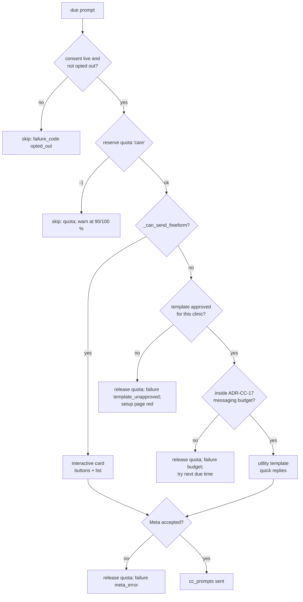

# Kriya Continuous Care — Channels: WhatsApp care card, voice check-in, templates, cost

## 1. Channel choice per send (ADR-CC-10)



Safety cards and direct replies to a patient's message are always in-window replies, never reserve quota, and are
never blocked by a quota or a template state.

## 2. Template catalogue (category UTILITY; submitted per clinic through its WABA)

Bodies are drafts for legal review (owner decision O-7). `{{n}}` are Meta variables. Payloads are set per send.

| Name | Body (en) | Buttons (payload) |
|:-|:-|:-|
| `cc_consent_invite_v1` | Hello {{1}}. Dr {{2}} at {{3}} has invited you to the {{4}} care programme on WhatsApp: medicine reminders, reading check-ins and follow-up booking. This is an automated service; our care team reads replies {{5}}. How we use your data: {{6}}. You can stop any time by replying STOP CARE. | Join (`cc:consent:<enr>:yes`) · Not now (`cc:consent:<enr>:no`) · Talk to staff (`cc:staff:<enr>`) |
| `cc_care_card_v1` | Good morning {{1}}. Today's medicines from {{2}}: {{3}}. Did you take your {{4}} dose? | Taken (`cc:adh:<prompt>:taken`) · Missed (`cc:adh:<prompt>:missed`) · Send reading (`cc:read:<prompt>`) |
| `cc_reading_request_v1` | {{1}}, {{2}} would like your {{3}} reading today. Tap below, then type the number. | Send reading (`cc:read:<prompt>`) · Not today (`cc:skip:<prompt>`) |
| `cc_lab_due_v1` | {{1}}, your {{2}} test is due on {{3}}. | Book home sample (`cc:lab:<item>:home`) · Book at hospital (`cc:lab:<item>:visit`) · Already done (`cc:lab:<item>:done`) |
| `cc_visit_due_v1` | {{1}}, your follow-up with Dr {{2}} is due on {{3}}. | Book (`cc:visit:<item>:book`) · Call me (`cc:staff:<enr>`) |
| `cc_phq_start_v1` | {{1}}, it is time for your two-weekly wellbeing check from {{2}}. It has 9 short questions. | Start (`cc:phq:<prompt>:start`) · Later (`cc:skip:<prompt>`) |
| `cc_visit_booked_v1` | {{1}}, your follow-up with Dr {{2}} is booked for {{3}} at {{4}}, {{5}}. Booking ref {{6}}. | Can't come (`cc:visit:<appt>:cant`) |
| `cc_service_ended_v1` | {{1}}, the {{2}} WhatsApp care programme has ended. Please contact the hospital on {{3}} for your follow-up. | — |

Rules: **no diagnosis, no dose advice, no promotional words** (Meta re-categorises promotional utility templates as
marketing). Variable `{{3}}` of the care card carries medicine names only when the clinic turns on
`cc_settings.card_show_medicine_names` (**default false** — family phones are shared and a medicine name reveals a
condition; DPDP minimisation, VERIFICATION D17); otherwise it reads "your morning medicines". The in-window card
(after the patient replies) may show names. Hindi and Telugu versions are separate template languages of the same
name. Templates accept more quick replies than interactive messages (up to 10 vs 3), but cards keep to 3 for
clarity and so the template and in-window versions behave the same. Length limits are tested per language in the
fixtures (reply-button titles ≤ 20 chars, list-row titles ≤ 24, header ≤ 60) — Hindi and Telugu translations are
written to fit, never truncated by code (visual rules: UI spec §7.11).

## 3. In-window interactive card
Header: hospital name. Body: whose plan, each medication item (verbatim display text), the reading asked for, the
next due lab / visit. Buttons ≤ 3 (Meta limit) — `Taken` / `Missed` / `Send reading`; a list message carries
per-medicine taken/missed when the plan has more than one adherence item at that time.

## 4. Reading capture (ADR-CC-09, revised)
- No conversation state is used. A tap on `cc:read:<prompt>` marks that prompt `awaiting_value` and replies "Please
  type your fasting sugar number". A typed message is claimed only when: CC on, strict pattern below, session state
  `None`/`idle`/`main_menu`, and an open prompt (≤ 12 h, unanswered) for a fitting measure exists for this phone.
- Parsers (strict, whole message, after trimming and Devanagari/Telugu digit normalisation):
  | Measure | Pattern | Plausible range | Unit |
  |:-|:-|:-|:-|
  | `fbg`, `ppbg`, `rbg` | `^\d{2,3}$` | 20–600 | mg/dL (`mmol/L` only if `cc_settings.glucose_unit='mmol'`: `^\d{1,2}(\.\d)?$`, 1.1–33.3) |
  | `bp` | `^\d{2,3}\s*[/\- ]\s*\d{2,3}$` | sys 60–260, dia 30–160, sys > dia | mmHg |
  | `weight` | `^\d{1,3}(\.\d)?$` | 2–300 | kg |
  | `hba1c` (self-reported, shown as "reported") | `^\d{1,2}(\.\d)?$` | 3.0–20.0 | % |
- Outside range → one "Please check the number" reply; second implausible value → prompt marked `unparsed`.
- Any non-matching text is not claimed and continues through the normal pipeline unchanged.
- Two family members with open prompts → "Whose reading is this?" buttons (`cc:who:<prompt>`), then stored.
- PHQ-9 / GAD-7 answers are buttons only (`cc:phq:<prompt>:q<n>:<0-3>`), one question per message, in-window only
  (the start template opens the window).

## 5. Voice check-in script (purpose `care_checkin`, ADR-CC-16 — spoken answers, no DTMF)
```
1. "Namaste, this is <assistant>, the automated care assistant of <Hospital>. Am I speaking with <first name>?"
2. Identity: spoken yes → continue; no → "Sorry to trouble you" and end (outcome care_identity_failed).
3. For each due item (at most 6):
   adherence:  "Did you take your morning medicines today? Please say yes or no."   → taken / missed
   reading:    "Please tell me your fasting sugar reading."  ("142", "one four two", "140 by 90")
               read back: "I heard 1 4 2. Is that correct?"  yes → stored (voice_speech_confirmed);
               no → asked again once; a second no stores nothing for that item.
4. Safety phrases → the existing voice safety screen (emergency script + transfer). A confirmed low reading →
   the `hypo_now` guidance is spoken in the call.
5. Close: "Thank you. Your answers are with your care team." (outcome care_answered / care_partial)
```
Key presses (DTMF) are not used: the voice runner does not pass `dtmf` stream events to the dialog (ADR-CC-16).
Languages: en / hi / te (existing voice stack). Calls only inside the clinic's outbound window and daily cap.

## 6. Message volume and cost model (planning)
Per enrolled patient per month (T2DM default): ~30 medication cards + ~8 reading prompts + ~2 lab/visit = ~40
prompts. A patient who answers daily keeps the 24-hour window open, so next-day cards go as in-window interactive
messages (not charged under the per-message pricing effective 1 Jul 2025); only cards after a silent day need the
template. Expected template share is measured in the pilot (`cc_prompts.channel`) and fed to the owner's `care`
limit. Owner sees per clinic: prompts sent, template share, answered rate, estimated Meta cost at the current rate
card (rate entered by the owner — Kriya does not hard-code Meta prices).

## 7. Meta policy checklist (per clinic, on the Care Setup page)
- WhatsApp opt-in captured in person / on a call **before** the first care template (W2), stored in `cc_consents`.
- Messaging budget (ADR-CC-17): number's tier and quality rating shown; care template share capped; auto-pause at LOW.
- Templates are utility, non-promotional, tied to the patient's own programme; quality rating monitored — a
  template paused by Meta stops CC sends for that clinic and shows red.
- Honour STOP and "stop care" in every language; never message after withdrawal.
- The clinic's own WABA and phone number only (AGENTS.md §1.6).
