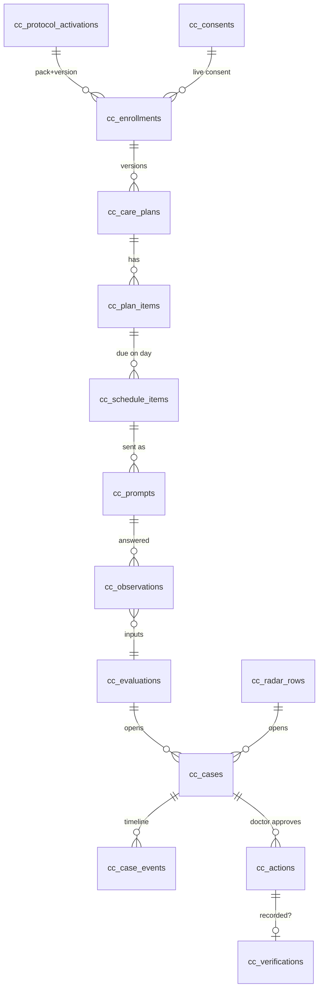

# Kriya Continuous Care — Data Model (migrations CC-M1…CC-M5)

> Provisional numbers **143–147** (latest on disk is 142, AUDIT A38). Numbers are taken in merge order: if another lane
> lands first, renumber every CC file and doc reference in one commit (status.md §2 step 4).
> House conventions apply to every table: `id UUID PK`, `clinic_id UUID NOT NULL REFERENCES clinics ON DELETE CASCADE`,
> `UNIQUE (clinic_id, id)`, composite `(clinic_id, x_id)` foreign keys, `created_at/updated_at TIMESTAMPTZ`, CHECKs for
> every enum and length, IST dates as `DATE`, money in paise `BIGINT`. Each migration: idempotent, a rollback in
> `migrations/rollback/`, a verify block appended to `verify_supabase_schema.sql`, and every table added to
> `TENANT_OWNED_TABLES` in the same commit. **No trigger on any pre-existing table** (ADR-CC-13).

## CC-M1 — 143 `cc_foundation`

**`clinics`** + `cc_state TEXT NOT NULL DEFAULT 'OFF' CHECK (cc_state IN ('OFF','ACTIVE','WIND_DOWN'))`,
`cc_settings JSONB NOT NULL DEFAULT '{}' CHECK (jsonb_typeof(cc_settings)='object')`. Partial index
`idx_clinics_cc_on ON clinics (id) WHERE cc_state <> 'OFF'` (job pre-filter).

`cc_settings` keys (validated in Python, defaults shown): `reply_hours` `{"days":"Mon-Sat","from":"09:00","to":"18:00"}`,
`med_times` `{"OD":["08:00"],"BD":["08:00","20:00"],"TDS":["08:00","14:00","20:00"],"QID":["08:00","12:00","16:00","20:00"],"HS":["22:00"]}`,
`card_window` `{"from":"07:30","to":"21:00"}`, `sla_hours` `{"urgent":2,"watch":16,"overdue":40}` (working hours),
`radar_weights`, `emergency_number`, `template_lang_default`.

**`cc_protocol_activations`** — a clinic's signed use of a pack version.
| Column | Type | Notes |
|:-|:-|:-|
| `protocol_code` | TEXT | `^[a-z0-9_]{2,40}$` (`t2dm`, `htn`, `phq9`…) |
| `version` | TEXT | semver of the code pack |
| `params` | JSONB | validated against the pack's bounds before insert |
| `status` | TEXT | `draft`, `active`, `retired` |
| `signed_by_admin_id`, `signer_snapshot` | UUID, JSONB | snapshot must contain `registration_number` (CHECK when `status='active'`) |
| `signed_at`, `retired_at`, `retired_reason` | | |
Unique: one `active` per `(clinic_id, protocol_code)` (partial index).

**`cc_consents`** — DPDP purpose `continuous_care`.
| Column | Notes |
|:-|:-|
| `patient_id`, `family_member_id NULL` | composite FKs to `patients`, `family_members` |
| `wa_optin_at`, `wa_optin_method` (`in_person`, `phone_call`, `whatsapp_reply`), `wa_optin_by` | Meta opt-in before any care template (VERIFICATION D7) |
| `notice_version`, `notice_sha256 BYTEA` | the exact text shown |
| `language` | `en`/`hi`/`te` |
| `method` | `whatsapp_button`, `voice_dtmf`, `counter_signed` |
| `captured_by NULL`, `guardian_relation NULL` | staff id for counter; relation when consenting for a family member |
| `granted_at`, `withdrawn_at NULL`, `withdrawn_via NULL` | withdrawal is a column update, never a delete |
Unique live consent: `(clinic_id, patient_id, COALESCE(family_member_id, nil-uuid)) WHERE withdrawn_at IS NULL`.

**Existing CHECK widens (additive, dynamic constraint inspection — 112 / 077 pattern):**
- `voice_outbound_jobs.purpose` + `'care_checkin'`; partial index `idx_voice_jobs_care` for the dispatcher.
- `clinic_message_quota_usage.kind` + `'care'`.

Functions: `cc_purge_clinic(p_clinic_id)` v1 (deletes `cc_*` rows in FK order). Rollback restores both CHECKs only if
no row uses the new value; otherwise refuses with a message (RX 139 precedent).

## CC-M2 — 144 `cc_enrollments_plans`

**`cc_enrollments`**
| Column | Notes |
|:-|:-|
| `patient_id`, `family_member_id NULL` | the person under care |
| `activation_id` | FK `cc_protocol_activations` (pins pack + version + params) |
| `consent_id NULL` | required when `status='active'` (CHECK) |
| `primary_doctor_id` | FK `doctors` |
| `coordinator_admin_id NULL` | staff owner |
| `branch_id NULL` | FK `branches` |
| `status` | `invited`, `active`, `paused`, `graduated`, `withdrawn`, `lost`, `ended_by_clinic` |
| `language`, `channel_pref` | `whatsapp`, `voice`, `both` |
| `source` | `doctor_enrolled`, `radar_candidate`, `import`, `discharge` |
| `enrolled_at`, `ended_at`, `end_reason` | |
| `baseline` JSONB | snapshot at enrollment: last HbA1c/BP, visits/labs in prior 90 days (for OUTCOMES) |
Unique: one non-ended enrollment per `(clinic, person, protocol_code)`.

**`cc_care_plans`** — versioned projection of a signed prescription (ADR-CC-05).
`enrollment_id`, `version SMALLINT`, `source_prescription_id NULL` (FK `opd_prescriptions`), `status`
(`active`,`superseded`,`ended`), `valid_from DATE`, `valid_to DATE NULL`, `built_by` (`system`/admin id),
`superseded_at`. Unique active plan per enrollment.

**`cc_plan_items`**
| Column | Notes |
|:-|:-|
| `plan_id` | FK, cascade |
| `kind` | `medication`, `measure`, `lab`, `visit`, `education`, `procedure_session`, `vaccine`, `anc_visit` |
| `source_prescription_item_id NULL` | FK `opd_prescription_items` (verbatim origin) |
| `display_text` | ≤ 300, copied from the signed line, never edited |
| `prompt_mode` | `adherence` (ask taken/missed), `display_only`, `reading`, `due_date` |
| `measure_code NULL` | `fbg`, `ppbg`, `rbg`, `bp`, `weight`, `phq9`, `gad7`, `hba1c`, `tsh`, `iop`… |
| `schedule` JSONB | `{"times":["08:00","20:00"]}` or `{"every_days":3}` or `{"due_on":"2026-12-12"}` or `{"weekly":["mon","thu"]}` |
| `starts_on`, `ends_on NULL` | |
| `lab_test_id NULL` | for `lab` items (maps to booking / order) |

**`cc_discharge_followups`** — optional structured follow-up written from the IPD discharge screen (L5):
`admission_id` (FK `ipd_admissions`), `follow_up_on DATE`, `doctor_id`, `note ≤ 300`. No change to the 111 column.

## CC-M3 — 145 `cc_measure`

**`cc_schedule_items`** — tomorrow's due items, materialised nightly (idempotent upsert).
`enrollment_id`, `plan_item_id`, `due_at TIMESTAMPTZ`, `kind`, `status` (`due`,`prompted`,`answered`,`missed`,`skipped`),
unique `(clinic_id, plan_item_id, due_at)`.

**`cc_prompts`** — every outbound card / call attempt.
| Column | Notes |
|:-|:-|
| `enrollment_id`, `schedule_item_ids UUID[]` | one card can bundle the morning's items |
| `channel` | `whatsapp_interactive`, `whatsapp_template`, `voice` |
| `template_name NULL`, `quota_reserved BOOL` | |
| `status` | `queued`,`sent`,`delivered`,`read`,`answered`,`failed`,`expired` |
| `failure_code NULL` | `window_closed`,`template_unapproved`,`quota`,`meta_error`,`opted_out`,`no_answer` |
| `wa_message_id NULL`, `voice_job_id NULL` | delivery tracking only |
| `sent_at`, `answered_at`, `expires_at` | |

**`cc_observations`** — append-only (guard trigger refuses UPDATE/DELETE except purge functions).
| Column | Notes |
|:-|:-|
| `enrollment_id`, `prompt_id NULL` | |
| `measure_code` | as plan items + `adherence` |
| `value_num NUMERIC(8,2) NULL`, `value_num2 NULL` | BP uses both (sys/dia) |
| `value_code NULL` | `taken`,`missed`,`phq9_q1=2`… |
| `unit` | `mg/dL`,`mmHg`,`%`,`kg`,`score` |
| `observed_at` | patient's time (card's due time) |
| `source` | `whatsapp_button`,`whatsapp_typed`,`voice_dtmf`,`voice_speech_confirmed`,`lab_result`,`coordinator_entered`,`clinic_device` |
| `source_message_id NULL` | unique per clinic (duplicate webhook guard) |
| `lab_result_value_id NULL` | when ingested from LIS (FK `lab_result_values`) |
| `entered_by NULL`, `corrects_id NULL`, `correction_reason NULL` | provenance |
| `plausible BOOL` | false rows are kept for audit but never evaluated |

**`cc_measure_sources`** — clinic mapping of a lab parameter to a measure (`lab_test_id`, `parameter_id`, `measure_code`,
`unit_factor`). Seeded from `lab_tests.loinc_code` where present (HbA1c 4548-4, FBS 1558-6, TSH 3016-3, LDL 13457-7…),
editable by `CC_ADMIN`.

**`cc_evaluations`** — engine output, one row per run that changed the tier or reasons.
`enrollment_id`, `activation_id`, `protocol_version`, `tier` (`stable`,`watch`,`urgent`), `reasons JSONB`,
`proposed JSONB`, `safety_card NULL`, `observation_ids UUID[]`, `inputs_sha256 BYTEA`, `evaluated_at`.

## CC-M4 — 146 `cc_act`

**`cc_radar_rows`** — read model (rebuilt). `patient_id`, `family_member_id`, `enrollment_id NULL`, `reason`,
`detail JSONB` (dates, values, ICD codes), `score INT`, `source_ref JSONB` (table + id), `first_seen_on`, `last_seen_on`,
`closed_on NULL`, `close_reason NULL`. Unique open row per `(clinic, person, reason, source_ref)`.

**`cc_cases`**
| Column | Notes |
|:-|:-|
| `enrollment_id NULL` | candidates have none until enrolled |
| `reason` | radar reason or evaluation reason family |
| `tier` | `urgent`,`watch`,`routine` |
| `status` | `open`,`acknowledged`,`awaiting_doctor`,`actioned`,`closed`,`cancelled` |
| `assigned_to NULL`, `due_by` | SLA deadline (working hours) |
| `evaluation_id NULL`, `radar_row_id NULL` | why it exists |
| `closed_reason NULL` | `verified`,`patient_declined`,`unreachable`,`transferred`,`duplicate`,`clinical_decision` |
Partial unique: one open case per `(clinic_id, enrollment_id, reason)` (ADR-CC-14).

**`cc_case_events`** — append-only timeline: `kind` (`note`,`call_out`,`call_in`,`message`,`assigned`,`escalated`,
`doctor_decision`,`status_change`), `body ≤ 1000` (staff text — never sent to the patient), `actor_id`, `actor_name`.

**`cc_actions`** — a doctor's or coordinator's decision.
| Column | Notes |
|:-|:-|
| `case_id` | FK |
| `action_code` | `book_review_visit`,`order_lab`,`book_home_sample`,`recheck_in_days`,`continue_plan`,`call_patient_now`,`refer`,`enroll`,`pause`,`end` |
| `params JSONB` | `{"days":14}`, `{"lab_test_id":…}`, `{"doctor_id":…}` — validated per code; **no drug/dose keys** (ADR-CC-04) |
| `decided_by`, `decider_role` | `CC_APPROVE` required for clinical actions |
| `appointment_id NULL`, `order_id NULL`, `voice_job_id NULL` | what was created through existing services |
| `due_on` | when it must be recorded by |
| `status` | `created`,`booked`,`verified`,`not_verified`,`cancelled` |

## CC-M5 — 147 `cc_verify_outcomes`

**`cc_verifications`** — `action_id`, `evidence_kind` (`check_in`,`signed_encounter`,`validated_result`,`completed_sale`),
`evidence_ref JSONB`, `verified_at`, `revenue_paise BIGINT NULL` (from the paid invoice line / sale line). Unique per
`action_id`.

**`cc_outcome_snapshots`** — monthly per `(clinic, protocol_code, period_month)`: `enrolled`, `active`, `returned_90d`,
`at_target`, `labs_on_time`, `refills_on_time`, `visits_verified`, `labs_verified`, `refills_verified`,
`revenue_paise`, `baseline JSONB`, `computed_at`, `method_version`.

Functions: `cc_purge_clinic` final version; `cc_purge_patient(clinic, patient, family_member)` called by the DPDP
erasure flow (redacts observations' free fields, deletes prompts/radar rows, keeps de-identified outcome counts).

## Index plan (all `(clinic_id, …)` first)
| Query | Index |
|:-|:-|
| due cards in the next 5 min | `cc_schedule_items (clinic_id, status, due_at)` |
| latest observations per enrollment | `cc_observations (clinic_id, enrollment_id, measure_code, observed_at DESC)` |
| open cases by SLA | `cc_cases (clinic_id, status, due_by) WHERE status IN (…open…)` |
| radar by score | `cc_radar_rows (clinic_id, score DESC) WHERE closed_on IS NULL` |
| verification sweep | `cc_actions (clinic_id, status, due_on) WHERE status='booked'` |
| candidate scan (read on existing table) | uses `idx_opd_encounters_patient` (103) + `signed_at` range; no new index on `opd_*` in v1 — add one only if TEST-PLAN §6 latency fails, as a separate reviewed migration |

## Delete behaviour of foreign keys into existing tables (VERIFICATION D8)
| Referenced table | Behaviour | Why it is safe today |
|:-|:-|:-|
| `patients`, `family_members` | RESTRICT (default) | DPDP erasure redacts instead of deleting when a FK blocks (`data_retention.py` family-member fallback) and calls `cc_purge_patient` first (D6) |
| `doctors` | RESTRICT | doctor delete already answers 409 "deactivate instead" on any FK (`app/routers/admin.py` `delete_doctor`) |
| `branches` | RESTRICT | branch delete has the FK fallback added in RX-67 |
| `opd_prescriptions`, `opd_prescription_items`, `lab_result_values`, `ipd_admissions` | RESTRICT | these rows are never deleted outside the clinic purge, which runs `cc_purge_clinic` first |
| `appointments` (`cc_actions.appointment_id`) | `ON DELETE SET NULL (appointment_id)` (PG15 column list, 122 precedent) | appointment purge paths must not fail on CC links |
Staff ids (`coordinator_admin_id`, `decided_by`, `entered_by`) carry no FK — the house rule for staff rows.

## Retention
Observations and evaluations: life of the enrollment + 3 years (clinical record policy of the clinic, configurable);
prompts: 13 months; radar rows: rebuilt, closed rows 90 days; consents: never deleted (withdrawal recorded).
Purge jobs follow `data_retention.py` conventions.
