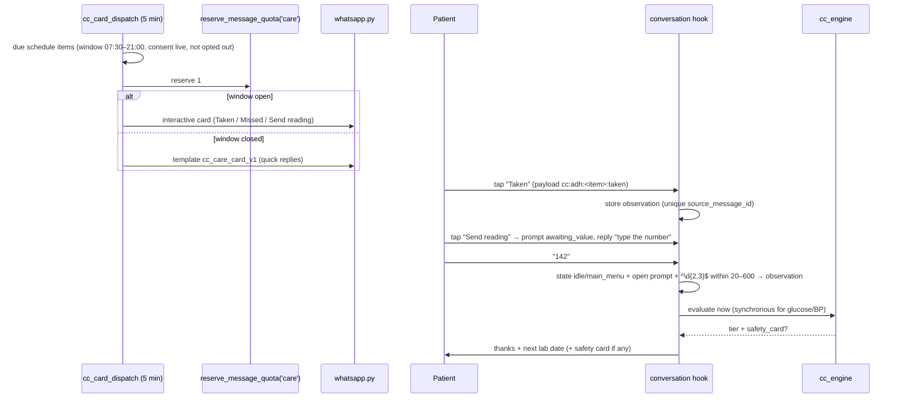
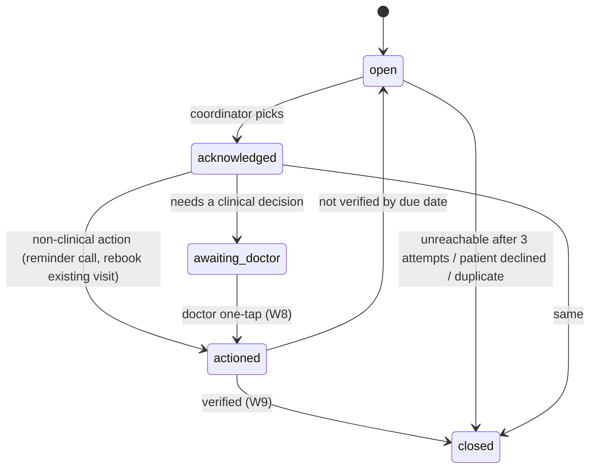

# Kriya Continuous Care — Workflows

> W-numbers are referenced by API.md, UI.md and TEST-PLAN.md. Every workflow names its permission and the existing
> function it reuses. "Clinic" = tenant with `cc_access = ACTIVE` unless stated.

## W1 — Setup and pack activation (CC_ADMIN, then a doctor with CC_APPROVE)
1. Owner enables `care_enabled` in the owner console (needs OPD; ADR-CC-01) → `cc_state = ACTIVE`.
2. **Care Setup** page checklist (blocks go-live until green): reply hours · emergency number · medication clock times ·
   templates `cc_care_card_v1`, `cc_reading_request_v1`, `cc_lab_due_v1`, `cc_visit_due_v1`, `cc_visit_booked_v1`, `cc_service_ended_v1`
   submitted through the clinic's WABA (dental `submit_templates` pattern) and **APPROVED** · consent notice approved
   in en/hi/te · at least one coordinator login · `care` message limit set by the owner · legacy-reminder count shown
   (latent L2) · lab mapping (`cc_measure_sources`) for the pack's labs.
3. CC_ADMIN opens a pack (e.g. `t2dm 1.0.0`), reviews defaults with sources, edits within bounds, saves draft.
4. A doctor (login linked to a doctor row with a registration number) signs → activation `active`; previous
   activation of the same pack `retired`.

## W2 — Enrollment (4 entry points, one rule: no live consent → not active)
| Entry | Who | Steps |
|:-|:-|:-|
| At consultation | doctor (CC_APPROVE) | On the signed-prescription screen: "Enroll in care: T2DM" → enrollment `invited` with `primary_doctor_id`; consent request sent |
| From radar `candidate` | coordinator (CC_COORDINATE) | Candidate row (ICD E11 etc.) → "Invite" → doctor approval required (`awaiting_doctor`) → `invited` |
| Import | CC_ADMIN | chronic list from data import (docs/data-import) → candidates only, never auto-enrolled (no consent in old systems) |
| IPD discharge | discharging doctor | discharge screen → structured follow-up date + "30-day post-discharge care" → `invited` |

Step 0 — **WhatsApp opt-in first** (ADR-CC-11, VERIFICATION D7): the doctor or counter staff asks in person (or the
coordinator on a call) and ticks "Agreed to receive care messages on WhatsApp at <number>"; no care template goes to a
number without this record. Radar candidates and imported patients are invited by staff in person or by phone, never
by a cold template.

Consent capture (ADR-CC-11): WhatsApp utility template "Your doctor has invited you to <Hospital> Care…" with
buttons **Join** / **Not now** / **Talk to staff**; or voice DTMF; or counter-signed form (staff ticks + uploads nothing
— the notice version is recorded). Join → `cc_consents` row → enrollment `active` → W3. Not now → `withdrawn`
(`source=declined`), never re-asked by the system for 90 days.

## W3 — Care plan build and update
1. Trigger: enrollment becomes `active`, or a new `opd_prescriptions` row for the person is `signed` (detected by the
   `cc_evaluate` job polling `signed_at > last_seen`; no trigger, ADR-CC-13).
2. Build items from the signed lines (ADR-CC-05), the encounter's `follow_up_date` (visit item), the pack's lab /
   measure / education items.
3. In one transaction: insert plan vN+1 + items; mark vN `superseded`; future `cc_schedule_items` of vN → `skipped`.
4. Patient gets "Your care plan was updated by Dr X" on the next card (no medicine list in the template body —
   the interactive in-window card shows it).

## W4 — Daily care card (WhatsApp)

Rules: one bundled card per due time per patient; no card if the patient sent STOP (`accepts_engagement` False) or
withdrew care consent; failed template send → `failure_code`, quota released, retried at the next due time only
(never a burst); 3 consecutive unanswered → W5 voice (if `channel_pref` allows) then `not_responding` case.

## W5 — Voice care check-in
1. Due when `channel_pref='voice'`, or after 3 unanswered WhatsApp cards (once per 7 days).
2. `enqueue(clinic, phone, "care_checkin", {"enrollment_id":…, "items":[…]}, "system")` — existing eligibility,
   window, cap and do-not-call rules (AUDIT A24, A25).
3. Script (ADR-CC-16): identify the clinic, say it is an automated assistant, confirm the person by a spoken yes to their first
   name, ask only due items (spoken yes/no), read back numbers, close with the next due date. Safety phrases → the
   existing voice emergency path + urgent case.
4. Outcomes map to `cc_observations` (`voice_speech_confirmed`; no DTMF, ADR-CC-16) and `cc_prompts.status`.

## W6 — Follow-up radar (Find)
Runs 06:30 and 13:30 per clinic. Reasons, sources and closing events:

| Reason | Opens when | Closes when |
|:-|:-|:-|
| `followup_overdue` | `follow_up_date + grace(3 d) < today`, no checked-in visit since the encounter | a checked-in visit or a signed encounter for the patient |
| `visit_missed` | appointment date passed, `checked_in_at IS NULL`, not cancelled-and-rebooked | rebooked appointment checked in |
| `lab_overdue` | plan lab item due + grace, or `opd_orders.status='ordered'` > 7 d | validated result for the mapped test |
| `refill_lapsed` | `rx_refill_plans.covered_until + 3 d < today`, no completed sale of the item since | completed sale |
| `off_target` | evaluation tier watch / urgent | next evaluation stable, or case closed with `clinical_decision` |
| `not_responding` | 3 unanswered prompts and the voice attempt failed | any answer |
| `candidate` | not enrolled; signed encounter ≤ 180 d with a pack ICD-10 code; consent not declined in 90 d | enrolled / declined / dismissed by staff with reason |
| `discharged_followup` | `cc_discharge_followups.follow_up_on + grace < today` without visit | visit checked in |

Each open row with `score ≥ clinic threshold` (or tier urgent) opens or updates a case (W7).

## W7 — Case lifecycle (coordinator console)

Every transition writes a `cc_case_events` row. Coordinator calls use the phone app outside Kriya or a voice job;
the note is typed in the case (staff-only text, never sent). SLA per ADR-CC-14.

## W8 — Doctor approval inbox (one tap)
The doctor sees: patient, pack, the "why" (reasons with values and dates), last 30 days chart, current signed plan,
proposed actions. One tap = one of `book_review_visit` (opens the existing slot picker pre-filtered to this doctor,
first free slot pre-selected), `order_lab` / `book_home_sample`, `recheck_in_days`, `continue_plan`,
`call_patient_now`, `refer`. No action carries a drug or dose (ADR-CC-04).

Booking rules (VERIFICATION D5, D16): slots come only from `get_available_slots` (holidays, leave and sessions are
checked there — `book_appointment` itself checks only conflicts, `app/database.py:1223`); the row is written by
`book_appointment` as `confirmed`, `booking_type='consultation'`, pay-at-counter (no payment link, so the 1-minute
`expire_stale_bookings` job never touches it); `book_appointment` sends **no** message, so CC sends
`cc_visit_booked_v1` (or the in-window equivalent) itself. The generic 24-hour reminder job then reminds as for any
confirmed consultation.

## W9 — Verification (01:45 nightly + on event)
For each `cc_actions.status='booked'`: look for evidence (ADR-CC-08). Found → `cc_verifications` (+ revenue from the
paid invoice line / sale line) → action `verified` → case `closed(verified)`. Due date passed without evidence →
`not_verified`, case re-opens with reason `visit_missed` / `lab_overdue`.

## W10 — Outcome report
Monthly snapshot per pack + on-demand for any date range; definitions and worked example in [OUTCOMES.md](OUTCOMES.md).

## W11 — STOP, withdrawal, erasure
| Patient does | Effect |
|:-|:-|
| STOP (existing keyword) | `opted_in=False` → engagement stops; CC treats as consent withdrawn for prompts; safety replies still answer messages the patient sends |
| "stop care" / card button "Stop care messages" (`cc:off:<enrollment>`) | consent `withdrawn_at`; enrollment `withdrawn`; one confirmation; open cases closed `patient_declined` |
| DPDP erasure request | existing erasure flow + `cc_purge_patient` |

## W12 — Wind-down (owner disables)
Preview → confirm → `WIND_DOWN`: no new enrollments or cards; one `cc_service_ended_v1` message to each active
enrollment ("Please contact the hospital for your follow-up"); coordinators can close cases and export; `OFF` when
no active enrollment remains.

## W13 — Safety triggers (any channel)
Trigger → in the same request: safety card (in-window reply) → urgent case → in-app alert to coordinators + WhatsApp
alert to the clinic's admin phone (existing alert path) → `cc_case_events(escalated)`. Outside reply hours the card
already tells the patient what to do now; the case waits for the morning queue at the top.

## W14 — Family members and guardians
A child or elderly parent is a `family_members` row under the account holder's phone. Consent is the account holder's
as guardian; cards say whose plan it is ("For Ravi (son): …"); a phone can carry several enrollments; cards bundle
per person per due time. Minors' PHQ instruments are excluded in v1 (different validated tools; CC-D6).
