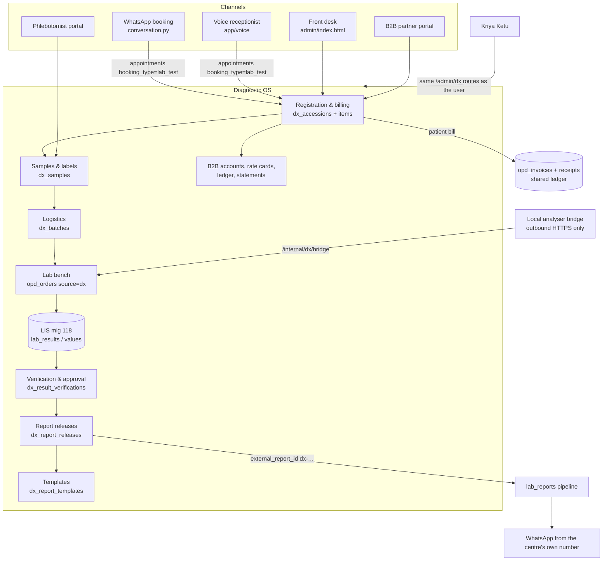
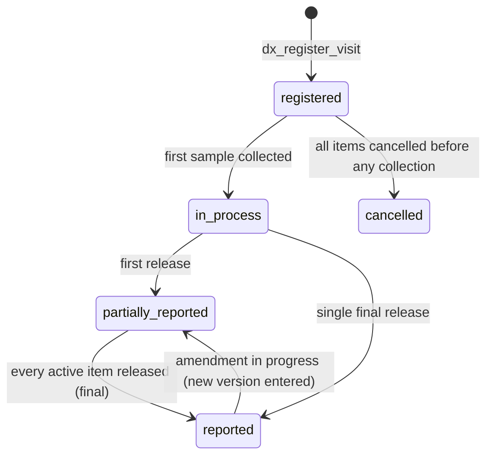

# Kriya Diagnostic OS — Architecture

> Execution tracker: [status.md](status.md) · Decisions: [ADR.md](ADR.md) · Schema: [DATA-MODEL.md](DATA-MODEL.md) ·
> Workflows: [WORKFLOWS.md](WORKFLOWS.md) · Tests and reports: [REPORT-TEMPLATES.md](REPORT-TEMPLATES.md) ·
> Routes: [API.md](API.md) · Screens: [UI.md](UI.md) · Security: [SECURITY.md](SECURITY.md) ·
> Tests: [TEST-PLAN.md](TEST-PLAN.md) · Rollout: [ROLLOUT.md](ROLLOUT.md) · Assistants: [KRIYA-KETU.md](KRIYA-KETU.md) ·
> Market: [COMPETITIVE-ANALYSIS.md](COMPETITIVE-ANALYSIS.md) · Gaps: [GAP-ANALYSIS.md](GAP-ANALYSIS.md) ·
> Agent prompts: [AGENT-PROMPT.md](AGENT-PROMPT.md)
>
> Anchored to `main` @ `56f719f` (migration 124). Diagnostic OS adds migrations **DX-M1 … DX-M9** (numbers assigned
> at merge time, recorded in status.md §5; ADR-DX-18).

**Principle.** One patient, one registry, one ledger, one staff identity, **one result engine**. A diagnostic visit
(accession) is a new encounter type beside the OPD visit and the IPD stay. Its tests are ordinary `opd_orders`
rows (`source='dx'`), so the G1 worklist invariants and the G2 LIS (migration 118) apply unchanged. The Diagnostic OS
adds what a lab needs around them: visits, tubes, logistics, verification, visit-level reports, templates, B2B.

## 1. Context



## 2. Reuse map (verified in code at `56f719f`)

| Concern | Existing | Diagnostic OS decision |
|:-|:-|:-|
| Entitlement | `OPT_IN_FEATURES` + `PATCH /platform/clinics/{id}/features`; `opd_enabled()` needs `booking` | **New** `dx_enabled` opt-in; `dx_access(clinic)` → `ACTIVE` / `WIND_DOWN` / `None`; **independent of OPD** (F1). Eligible: tenant account and `has_feature(lab_test_booking) or has_feature(lab_reports)` evaluated on the *plan set*, never the enterprise wildcard alone (ADR-DX-02) |
| Module state | `clinics.opd_state`, `ipd_state` | New `clinics.dx_state` (`OFF`/`ACTIVE`/`WIND_DOWN`) + `clinics.dx_settings` JSONB |
| Route guard | `_opd_scope`, `_ipd_scope`, `_lis_scope` | New `_dx_scope(user, clinic_id, *perms, new_work=False)` in `app/routers/dx.py`; `_lis_scope` and the G1 worklist scope widened with `or dx_access(clinic)` |
| Sites | `branches` | `dx_sites` row per branch: `collection`, `processing` or both; routing rules decide the processing site per test |
| Staff | `clinic_admins` + roles + `permissions[]` + `branch_id` + `doctor_id` | **Reuse.** DX permissions and roles (SECURITY.md §3). Pathologists are doctor-linked logins (118 rule). A branch-pinned user sees a visit if its registration site **or** a processing site of one of its samples is their branch |
| Patient master | `patients`, `family_members`, MRN counter (103) | **Reuse, no copy.** DX registration route calls the same registry functions as OPD Front Desk under `_dx_scope` |
| Catalogue | `lab_tests` (+ categories, details), CSV import | **Extend additively** (codes, department, container, method, TAT minutes, interpretation, kind test/panel/package); `dx_test_components` for panels/packages |
| Parameters | `lab_test_parameters` (118) | **Extend additively** (code, method, decimals, rounding, formula, reference text, analyser code, delta) |
| Work unit | `opd_orders` (115) | **Extend**: `source='dx'`, `accession_id`, `accession_item_id`, `dx_sample_id`, `replaces_order_id`, `outsource_partner_id`; `doctor_id` NULL allowed only for `dx` |
| Results | `lab_results`, `lab_result_values`, `lis_record_results`, `lis_validate_result` | **Reuse unchanged** (functions); add a DX-only verification gate trigger; skip per-test delivery for DX |
| Money (patient) | `opd_invoices` / items / receipts / shifts / refunds / payment links / prepaid / GST | **Reuse.** DX bill = `opd_invoices` row with `accession_id`; lines carry `dx_accession_item_id`; issue/receipt/refund via `app/services/opd_billing.py` |
| Money (B2B) | — | **New** append-only `dx_b2b_ledger` + `dx_b2b_statements` (bill-of-supply series `B2B-YYYY-NNNNN`) |
| Numbering | `opd_next_counter`, `opd_format_number` | **Reuse** keys `dx_accession:<YYYY>`, `dx_sample:<YY><cc>`, `dx_batch:<YYYY>`, `dx_b2b:<YYYY>` |
| Delivery | `LabReportService.upload_and_send`, receipts, retries | **Reuse.** One call per release, `external_report_id='dx-<release_id>'`, `source='dx'` |
| PDF | `app/services/opd_pdf.py` (fpdf2 + Noto fonts, Indic scripts) | **New** `app/services/dx_pdf.py` (visit report v2, labels, bill) reusing `_a4`/font helpers |
| Audit | `log_admin_action` → `admin_audit_logs` | Every write and every clinical read; plus per-visit timeline `dx_events` written inside SQL functions |
| Tenancy | `TENANT_OWNED_TABLES`, `scoped_query`, AST linter, composite FKs | Same on every `dx_*` table |
| Assistants | Ketu registry, voice scope, WhatsApp FSM | R0 reads + H hand-offs (P9); no DX writes through Ketu in v1 |
| Clinical firewall | zero-LLM clinical paths | `tests/test_dx_no_llm.py` (AST) like `test_ipd_no_llm.py` |
| Frontend | inlined `admin/index.html`, `go(page)`, `data-opd`/`data-ipd` gating | `data-dx` gating + `applyDxGates()`; pages listed in UI.md |

## 3. Components

| Component | Responsibility | Never does |
|:-|:-|:-|
| `migrations/<DX-M1…M9>_*.sql` | Tables, CHECKs, partial unique indexes, composite FKs, guard triggers, all state-changing SQL functions (`dx_register_visit`, `dx_add_items`, `dx_cancel_item`, `dx_collect_samples`, `dx_reject_sample`, `dx_dispatch_batch`, `dx_receive_batch`, `dx_verify_result`, `dx_approve_results`, `dx_create_release`, `dx_b2b_post_charge`, `dx_b2b_issue_statement`, `dx_purge_clinic`, …) | Trust the caller for tenancy: every function takes `p_clinic_id` and treats foreign ids as not found |
| `app/services/dx.py` | Visits, items, pricing (MRP / rate card / package), billing glue to `opd_billing`, read models (stage worklists, visit detail, TAT) | Write state columns directly; return raw DB errors |
| `app/services/dx_samples.py` | Tube grouping, sample numbering, collection, rejection, batches, routing | — |
| `app/services/dx_results.py` | Calculated parameters (formula engine), delta checks, verification, batch approval, critical events; calls `lis.*` | Accept flags or calculated values from the browser |
| `app/services/dx_formula.py` | Safe expression evaluator (AST whitelist), pure | `eval`, attribute access, names outside the parameter set |
| `app/services/dx_reports.py` | Release composition, template resolution, delivery routing, share links, verify codes | Render from live rows (always from snapshots) |
| `app/services/dx_pdf.py` | Visit report, labels (PDF + ZPL), bill print | Network or DB access (pure renderer over dicts) |
| `app/services/dx_barcode.py` | Code128 (B/C) encoder, check digit, pure | — |
| `app/services/dx_b2b.py` | Accounts, rate cards, ledger postings, statements, holds | Edit a posted ledger row |
| `app/routers/dx.py` | `/admin/dx/*` (staff) and `/admin/dx/partner/*` (confined partner); `_dx_scope`; audit | Allow a write without permission + entitlement + tenant + site scope |
| `app/routers/dx_public.py` | `/public/dx/verify/{code}`, `/public/dx/r/{token}` | Return values or PHI beyond SECURITY.md §6 |
| `app/routers/dx_bridge.py` | `/internal/dx/bridge/*` (HMAC, replay window, per-agent key) | Accept unsigned or stale requests |
| `admin/index.html` | DX pages (UI.md) | Show a state before the server confirms |
| `admin/platform.html` | DX OS card (enable / wind-down) | — |
| `app/assistant/registry.py` | DX pages, R0 reads, H hand-offs | Any DX write |

## 4. State machines

### 4.1 Visit (`dx_accessions.status`, changed only inside `dx_*` functions)


### 4.2 Test (one `opd_orders` row, source `dx`) — the work stage shown in worklists
The stored order status keeps the 115 enum. The **stage** is derived (`dx_stage()` in `app/services/dx.py`), which is
what replaces MocDoc's tabs:

| Stage (worklist tab) | Derived from |
|:-|:-|
| `awaiting_payment` | visit `patient` billing, `dx_settings.collect_before_payment=true`, bill not paid |
| `pending_collection` | order `ordered`, its sample `pending_collection` |
| `pending_receipt` (accession) | order `sample_collected`, sample `collected` or `in_transit`, processing site ≠ received |
| `pending_entry` (completion) | sample `received`, no `lab_results` row `entered` |
| `pending_verification` | latest result `entered`, `approval_levels = 3`, no valid verification for its `updated_at` |
| `pending_approval` | latest result `entered` and (levels = 2 or verified) |
| `pending_release` (print/dispatch) | result `validated`, not in a release |
| `released` | in a `dx_report_releases` row (delivery state shown separately) |
| `rejected` / `cancelled` | order `cancelled` (rejection = cancel + replacement order) |

### 4.3 Sample (`dx_samples.status`)
`pending_collection → collected → in_transit → received → (stored → discarded)`; `collected|in_transit|received →
rejected` (reason code, replacement sample created by `dx_reject_sample`). Transitions only inside functions; a
trigger refuses direct writes (pattern `kriya.ipd_tx`, here `kriya.dx_tx`).

### 4.4 Report release (`dx_report_releases.status`)
`rendered → queued → sent | failed (retry) | held_dues`; any → `superseded` when a later release covers an amended
result. Content columns immutable after insert; only delivery columns move.

## 5. Data flow: walk-in to WhatsApp

```mermaid
sequenceDiagram
  participant Desk
  participant API as /admin/dx
  participant DB as dx_* functions
  participant Lab
  participant Path as Pathologist
  participant Pipe as lab_reports pipeline
  Desk->>API: POST /visits {patient, referrer, b2b?, items[], idempotency_key}
  API->>DB: dx_register_visit (price snapshot, explode panels/packages, orders, samples by container)
  DB-->>API: LAB-2026-000123, 2 samples (01 serum, 07 EDTA)
  Desk->>API: POST /visits/{id}/bill → opd_invoices draft → issue → receipt (opd_billing)
  Desk->>API: GET /visits/{id}/labels.pdf (Code128, tube colour, tests)
  Desk->>API: POST /visits/{id}/collect {samples:[{id, barcode?}]}
  API->>DB: dx_collect_samples (orders → sample_collected with specimen_barcode)
  Lab->>API: POST /batches/{id}/receive (scan) → samples received at processing site
  Lab->>API: POST /admin/lis/orders/{id}/results (values; formulas computed server-side)
  Lab->>API: POST /results/{id}/verify {expected_updated_at}   (3-level labs)
  Path->>API: POST /results/approve {items:[{result_id, expected_updated_at}]}
  API->>DB: lis_validate_result per item (gate trigger checks verification)
  API->>DB: dx_create_release (signed results ready + dues rule + template snapshot)
  API->>Pipe: upload_and_send(external_report_id=dx-<release>) → patient, referrer copy, B2B desk
```

## 6. Authorization layers (order of checks)
Entitlement (`dx_access`) → tenant (`enforce_clinic_access`, fail-closed for unscoped super-admin) → permission (DX
permission set, SECURITY.md §3) → **clinician identity** for approval (doctor-linked login with registration, 118) →
**site scope** (registration site or processing site) → **partner confinement** (`B2B_PARTNER` logins see only
their account's visits) → database (composite FKs, guard triggers, functions refusing foreign ids).

## 7. Coexistence with the MocDoc connector and CallMedex
`dx_settings.delivery_owner` is a per-branch map with values `connector` (default for existing clients; DX does not
send), `shadow` (DX renders releases but never sends; staff compare against MocDoc output), `dx` (DX sends; the
connector for that branch must be disabled by the owner). The release service refuses to send when the branch is not
`dx`. `lab_reports.external_report_id` prefixes (`mocdoc-…`, `lis-…`, `dx-…`) keep sources distinct, and the
existing unique index prevents a double send of the same release.

## 8. Failure behaviour

| Failure | Behaviour |
|:-|:-|
| DB timeout inside a function | Whole function rolls back; fixed 500 "Nothing was changed; please retry"; retry is idempotent (keys on visit, collection, batch, release, ledger) |
| Two desks register the same idempotency key | One visit; the replay returns it |
| Two technicians scan the same pre-printed barcode onto two visits | `uq_dx_samples_barcode` → second gets `409 dx_barcode_in_use` |
| Result re-entered between verification and approval | `updated_at` moved → verification no longer matches → approval refused `409 dx_verification_required`; approval of stale view refused `lis_result_changed` |
| WhatsApp / Meta down | Release stays `queued`/`failed`; existing retry job; desk can print; nothing about the result changes |
| Storage upload fails | Release `failed`, PDF re-rendered from snapshots on retry (deterministic, same SHA-256) |
| Analyser bridge offline | Manual entry continues; bridge messages queue at the lab and replay with idempotency (`message_id`) |
| Owner disables DX with open visits | `409` + preview; confirm → `WIND_DOWN`: no new visits; collection, results, releases, billing continue |
| B2B account over limit / overdue | New visits on that account refused `409 dx_b2b_on_hold` (unless an admin overrides with reason); existing visits continue |
| AI provider down | No effect on any DX path (zero-LLM); only the optional patient AI summary in the existing pipeline is skipped |

## 9. Non-functional targets
| Item | Target |
|:-|:-|
| Registration to label print | ≤ 2 s server time for a 40-test package |
| Worklist page | ≤ 500 ms for 2,000 open orders per site (indexed by `(clinic_id, status, …)`, paged with `fetch_all`) |
| Release render | ≤ 3 s for a 14-page report; rendered in a background task, status polled |
| Webhook SLA | Unchanged (no DX work in `POST /webhook`) |
| Time | IST everywhere (`AT TIME ZONE INTERVAL '+05:30'` in SQL, `today_ist()` in Python) |
| Scale | 1,500 visits/day per clinic, 15 sites, without schema change |
