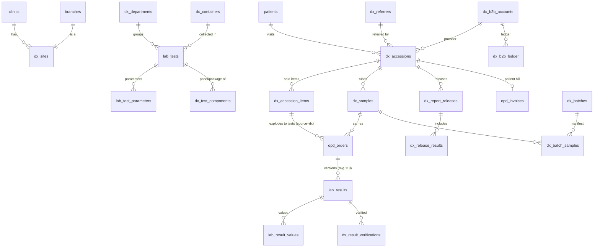

# Kriya Diagnostic OS — Data Model and Migration Plan

> Part of the Diagnostic OS set: start at [status.md](status.md). Decisions referenced as ADR-DX-nn are in [ADR.md](ADR.md).
>
> The DDL below is the **contract**, written as sketches: the implementing agent writes the real migration with the
> house rules from migrations 111/115/118 — `CREATE … IF NOT EXISTS`, `UNIQUE (clinic_id, id)` on every table,
> children referencing parents by `(clinic_id, parent_id)`, RLS enabled + forced with the service-role and
> tenant-isolation policy pair, `anon`/`authenticated` revoked, every function `SET search_path = public, pg_temp`,
> `REVOKE ALL … FROM PUBLIC, anon, authenticated` and `GRANT EXECUTE … TO service_role`, a final **verify block**
> that raises if anything is missing, and a rollback file in `migrations/rollback/`. Error codes are
> `RAISE EXCEPTION 'dx_<code>[:detail]' USING ERRCODE = 'P0001'` and mapped in Python (never shown raw).
> Column names may be adjusted only by recording the change in status.md §7 (deviation log) **and** here.

## 0. Migration plan

| ID | Phase | File (number assigned at merge time, recorded in status.md §5 — ADR-DX-18) | Contents | Rollback |
|:-|:-|:-|:-|:-|
| DX-M1 | P1 | `NNN_dx_os_foundation.sql` | `clinics.dx_state`, `clinics.dx_settings`; `dx_sites`; `dx_purging()`, `dx_purge_clinic()` (v1) | refuses while any `dx_sites` row exists unless purge flag |
| DX-M2 | P2 | `NNN_dx_catalogue.sql` | `dx_departments`, `dx_containers`, `dx_signatories`; additive columns on `lab_tests` and `lab_test_parameters`; `dx_test_components` + cycle guard | drops new tables/columns; refuses if any `dx_accession_items` exist |
| DX-M3 | P3 | `NNN_dx_visits_and_billing.sql` | `dx_referrers`, `dx_b2b_accounts` (identity + payer kind + holder patient), `dx_accessions`, `dx_accession_bookings`, `dx_accession_items`, `dx_samples`, `dx_events`; `family_members.dx_b2b_account_id`; `opd_orders` extension; `opd_invoices.accession_id`; `opd_invoice_items.dx_accession_item_id` + DX bill-line guard; functions `dx_register_visit`, `dx_add_items`, `dx_cancel_item`, `dx_cancel_visit`, `dx_bill_visit`; `dx_purge_clinic` v2 | refuses while any `dx_accessions` exist |
| DX-M4 | P4 | `NNN_dx_collection.sql` | `dx_rejection_reasons`, `dx_field_collections`, `dx_label_prints`; sample guard; `dx_collect_samples`, `dx_bind_barcode`, `dx_reject_sample`, `dx_receive_sample`, `dx_mark_sample_stored`, `dx_record_field_collection`, `dx_handover_field_collection` | drops functions/tables |
| DX-M5 | P5 | `NNN_dx_logistics.sql` | `dx_outsource_partners`, `dx_routing_rules`, `dx_batches`, `dx_batch_samples`; `opd_orders.outsource_partner_id`; `dx_create_batch`, `dx_batch_add`, `dx_dispatch_batch`, `dx_receive_batch` | refuses while batches exist |
| DX-M6 | P6 | `NNN_dx_result_workflow.sql` | `dx_result_value_meta`, `dx_result_verifications`, `dx_critical_events`, `dx_result_attachments`; gate trigger on `lab_results`; `dx_record_results`, `dx_verify_result`, `dx_approve_results` | drops trigger first, then objects |
| DX-M7 | P7 | `NNN_dx_reports.sql` | `dx_report_templates`, `dx_report_releases`, `dx_release_results`, `dx_release_deliveries`, `dx_delivery_overrides`, `dx_outbox` (+ triggers on `opd_receipts` / `opd_invoices`), `dx_share_links`, `dx_print_log`; release/delivery guards; `dx_delivery_decision`, `dx_claim_delivery`, `dx_create_release`, `dx_mark_delivery_result` | refuses while releases exist |
| DX-M8 | P8 | `NNN_dx_b2b.sql` | `dx_rate_cards`, `dx_rate_card_items`; billing + co-pay columns on `dx_b2b_accounts`; `dx_b2b_ledger`, `dx_b2b_statements`, `dx_barcode_stock`; `clinic_admins.dx_b2b_account_id`; `dx_b2b_post_charge`, `dx_b2b_record_payment`, `dx_b2b_issue_statement`, `dx_b2b_set_hold` | refuses while ledger rows exist |
| DX-M9 | P10 | `NNN_dx_instruments_qc.sql` | `dx_bridge_agents`, `dx_instruments`, `dx_instrument_results`, `dx_qc_materials`, `dx_qc_results` | drops |

All tables are added to `TENANT_OWNED_TABLES` in `app/tenancy.py` with a `# migration NNN (Diagnostic OS)` comment
and to `migrations/verify_supabase_schema.sql`. `dx_purge_clinic` is redefined (`CREATE OR REPLACE`) by each migration
to delete that migration's tables, children first, with `kriya.dx_purging` set so append-only guards allow it.

## 1. Entities



## 2. DX-M1 — Foundation

```sql
ALTER TABLE clinics ADD COLUMN IF NOT EXISTS dx_state TEXT NOT NULL DEFAULT 'OFF'
    CHECK (dx_state IN ('OFF', 'ACTIVE', 'WIND_DOWN'));
ALTER TABLE clinics ADD COLUMN IF NOT EXISTS dx_settings JSONB NOT NULL DEFAULT '{}'::jsonb;

CREATE TABLE dx_sites (
  id UUID PK, clinic_id UUID NOT NULL → clinics ON DELETE CASCADE,
  branch_id UUID NOT NULL,                       -- composite FK → branches (clinic_id, id)
  kind TEXT NOT NULL CHECK (kind IN ('collection', 'processing', 'collection_and_processing')),
  code TEXT NOT NULL CHECK (code ~ '^[A-Z0-9]{2,6}$'),   -- printed on labels and manifests
  display_name TEXT NOT NULL CHECK (char_length(btrim(display_name)) BETWEEN 2 AND 120),
  legal_name TEXT NULL, registration_no TEXT NULL, nabl_certificate_no TEXT NULL,  -- "Tested at" line (ADR-DX-08)
  is_active BOOLEAN NOT NULL DEFAULT true, created_at, updated_at,
  UNIQUE (clinic_id, id), UNIQUE (clinic_id, branch_id), UNIQUE (clinic_id, code)
);
```
`dx_settings` keys (validated by a pydantic model in `app/services/dx.py`, defaults applied by `provision_defaults`):
`approval_levels` (2|3), `collect_before_payment` (bool),
`auto_release` (`off|per_department|when_complete`), `delivery_owner` ({branch_id: `connector|shadow|dx`}),
`sample_seq_floor` (int; the sample counter is raised to it at go-live, never lowered), `label_mode`
(`per_sample|per_test`), `register_label` (bool), `extra_labels` (0–3),
`tat_clock` (`registration|receipt`), `accession_prefix` ("LAB-"), `batch_prefix` ("TRN-"), `b2b_prefix` ("B2B-"),
`referrer_copy_default` (bool), `critical_call_required` (bool), `share_link_ttl_hours` (72),
`instrument_auto_enter` (bool), `went_live_at` (timestamp), `version` (int, CAS on PATCH).

## 3. DX-M2 — Catalogue

```sql
CREATE TABLE dx_departments (
  id, clinic_id, code TEXT CHECK (code ~ '^[A-Z]{2,8}$'), name TEXT,        -- 'BIO', 'Biochemistry'
  report_heading TEXT,                                                        -- 'CLINICAL BIOCHEMISTRY'
  sort_order SMALLINT, is_active, UNIQUE (clinic_id, code));

CREATE TABLE dx_containers (
  id, clinic_id, code TEXT NOT NULL CHECK (code ~ '^[0-9]{2}$'),            -- barcode container digits
  name TEXT,                       -- 'Plain / Red top (serum)', 'EDTA (lavender)', 'Fluoride (grey)', 'Citrate (blue)', 'Urine', 'Stool', 'Swab'
  colour_hex TEXT CHECK (colour_hex ~ '^#[0-9A-Fa-f]{6}$'), sample_type TEXT,   -- serum | whole_blood | plasma | urine | stool | swab | other
  default_volume_ml NUMERIC(5,1), stability_room_hours SMALLINT, stability_cold_hours SMALLINT,
  is_active, UNIQUE (clinic_id, code));

CREATE TABLE dx_signatories (     -- who may approve which department, and how the signature prints
  id, clinic_id, doctor_id UUID NOT NULL (composite FK → doctors), department_id NULL (NULL = all),
  designation TEXT,               -- 'Consultant Pathologist'
  qualification_text TEXT,        -- 'MD Pathology'
  signature_asset_path TEXT NULL, -- storage key in bucket dx-assets/<clinic_id>/signatures/…
  is_active, UNIQUE (clinic_id, doctor_id, department_id));

-- lab_tests: additive, all nullable or defaulted; WhatsApp booking ignores them
ALTER TABLE lab_tests
  ADD COLUMN test_code TEXT NULL CHECK (test_code ~ '^[A-Z0-9._-]{1,20}$'),
  ADD COLUMN kind TEXT NOT NULL DEFAULT 'test' CHECK (kind IN ('test', 'panel', 'package')),
  ADD COLUMN department_id UUID NULL,  ADD COLUMN container_id UUID NULL,   -- composite FKs
  ADD COLUMN sample_volume_ml NUMERIC(5,1) NULL, ADD COLUMN method TEXT NULL,
  ADD COLUMN tat_minutes INTEGER NULL CHECK (tat_minutes BETWEEN 5 AND 43200),
  ADD COLUMN stat_tat_minutes INTEGER NULL,
  ADD COLUMN print_title TEXT NULL, ADD COLUMN interpretation TEXT NULL CHECK (char_length(interpretation) <= 6000),
  ADD COLUMN report_notes TEXT NULL CHECK (char_length(report_notes) <= 2000),
  ADD COLUMN gender_restriction TEXT NOT NULL DEFAULT 'all' CHECK (gender_restriction IN ('all','male','female')),
  ADD COLUMN loinc_code TEXT NULL, ADD COLUMN print_order SMALLINT NULL,
  ADD COLUMN dx_result_mode TEXT NOT NULL DEFAULT 'parameters'
      CHECK (dx_result_mode IN ('parameters', 'document', 'none')),          -- ADR-DX-22 (ECG, X-ray impression…)
  ADD COLUMN dx_approved_at TIMESTAMPTZ NULL, ADD COLUMN dx_approved_by UUID NULL, ADD COLUMN dx_approved_by_name TEXT NULL;
CREATE UNIQUE INDEX uq_lab_tests_code ON lab_tests (clinic_id, upper(test_code)) WHERE test_code IS NOT NULL AND is_active;

-- lab_test_parameters: additive (bands stay one row per age/sex band, grouped by name, mig 118)
ALTER TABLE lab_test_parameters
  ADD COLUMN code TEXT NULL CHECK (code ~ '^[A-Z][A-Z0-9_]{0,23}$'),   -- formula / analyser identifier, same across bands
  ADD COLUMN method TEXT NULL, ADD COLUMN decimals SMALLINT NULL CHECK (decimals BETWEEN 0 AND 4),
  ADD COLUMN rounding TEXT NOT NULL DEFAULT 'half_up' CHECK (rounding IN ('half_up', 'half_even', 'truncate')),
  ADD COLUMN formula TEXT NULL CHECK (char_length(formula) <= 500),     -- non-NULL = calculated parameter
  ADD COLUMN reference_text TEXT NULL CHECK (char_length(reference_text) <= 1500),  -- multi-line printed range
  ADD COLUMN section_heading TEXT NULL, ADD COLUMN machine_code TEXT NULL CHECK (char_length(machine_code) <= 40),
  ADD COLUMN low_exclusive BOOLEAN NOT NULL DEFAULT false, ADD COLUMN high_exclusive BOOLEAN NOT NULL DEFAULT false,
  ADD COLUMN delta_check_pct NUMERIC(6,2) NULL, ADD COLUMN delta_window_days SMALLINT NULL,
  ADD COLUMN is_reportable BOOLEAN NOT NULL DEFAULT true, ADD COLUMN comment TEXT NULL;

CREATE TABLE dx_test_components (
  id, clinic_id, parent_test_id UUID NOT NULL, child_test_id UUID NOT NULL,   -- composite FKs → lab_tests
  sort_order SMALLINT NOT NULL DEFAULT 1,
  UNIQUE (clinic_id, parent_test_id, child_test_id), CHECK (parent_test_id <> child_test_id));
-- trigger dx_guard_components: parent.kind IN ('panel','package'); child.kind = 'test' or (parent package AND child panel);
-- depth ≤ 2; no cycles; a test's own parameters exist only when kind = 'test'.
```
**Lab-test deletion (AUDIT A22).** The existing admin delete / bulk delete of `lab_tests` must keep working for tests DX
never used: `dx_test_components`, `dx_rate_card_items` and `dx_routing_rules` reference `lab_tests` with
`ON DELETE CASCADE`; `lab_tests.department_id` / `container_id` are composite FKs to the DX tables with
`ON DELETE RESTRICT` (a department or container in use cannot be deleted; deactivate it). `dx_accession_items.lab_test_id` is a reference
without FK (snapshots keep signed history), and the admin delete route refuses (409 "This test has been ordered in
Diagnostic OS — deactivate it instead") when any `dx_accession_items` row names the test. Regression:
`tests/test_lab_tests_bulk_delete.py` unedited + a new case.

## 4. DX-M3 — Visits, items, samples, orders, billing link

```sql
CREATE TABLE dx_referrers (
  id, clinic_id, kind TEXT CHECK (kind IN ('doctor', 'hospital', 'clinic', 'corporate', 'other')),
  name TEXT NOT NULL, qualification TEXT NULL, registration_no TEXT NULL, phone TEXT NULL, email TEXT NULL,
  organisation TEXT NULL, b2b_account_id UUID NULL,              -- composite FK → dx_b2b_accounts
  report_copy TEXT NOT NULL DEFAULT 'none' CHECK (report_copy IN ('none', 'whatsapp', 'email')),
  name_key TEXT GENERATED ALWAYS AS (upper(regexp_replace(name, '[^A-Za-z0-9]', '', 'g'))) STORED,
  is_active, created_at, UNIQUE (clinic_id, id));
CREATE INDEX idx_dx_referrers_key ON dx_referrers (clinic_id, name_key);

CREATE TABLE dx_b2b_accounts (    -- identity, routing and branding; money columns added in DX-M8
  id, clinic_id, code TEXT CHECK (code ~ '^[A-Z0-9]{2,12}$'), name TEXT NOT NULL,
  kind TEXT CHECK (kind IN ('hospital', 'clinic', 'franchise', 'corporate', 'insurance_tpa', 'camp', 'other')),
  contact_name, contact_phone, desk_whatsapp TEXT NULL,           -- report desk number (generalises report_routing)
  report_delivery TEXT NOT NULL DEFAULT 'patient' CHECK (report_delivery IN ('patient', 'account', 'both', 'none')),
  patient_copy_authorised_at TIMESTAMPTZ NULL, patient_copy_authorised_by UUID NULL,
  patient_copy_reason TEXT NULL CHECK (char_length(btrim(patient_copy_reason)) BETWEEN 10 AND 300),
  holder_patient_id UUID NULL,                                    -- composite FK → patients (ADR-DX-21)
  default_billing_mode TEXT NOT NULL DEFAULT 'b2b_credit'
         CHECK (default_billing_mode IN ('patient', 'b2b_credit', 'b2b_prepaid', 'b2b_split')),
  white_label BOOLEAN NOT NULL DEFAULT false, template_id UUID NULL,   -- FK added in DX-M7
  status TEXT NOT NULL DEFAULT 'active' CHECK (status IN ('active', 'on_hold', 'closed')), hold_reason TEXT NULL,
  created_at, updated_at, UNIQUE (clinic_id, id), UNIQUE (clinic_id, code),
  -- ADR-DX-20: payer-routed accounts never default to the patient
  CONSTRAINT dx_b2b_payer_routed CHECK (kind NOT IN ('insurance_tpa', 'corporate')
        OR report_delivery IN ('account', 'none')
        OR (report_delivery = 'both' AND patient_copy_authorised_at IS NOT NULL AND patient_copy_reason IS NOT NULL)),
  CONSTRAINT dx_b2b_authorisation_shape CHECK ((patient_copy_authorised_at IS NULL) = (patient_copy_reason IS NULL)));

CREATE TABLE dx_accessions (       -- one diagnostic visit / requisition
  id, clinic_id, branch_id UUID NOT NULL,                         -- registration site (composite FK → branches)
  accession_year SMALLINT NOT NULL, accession_seq INTEGER NOT NULL CHECK (accession_seq > 0),
  accession_number TEXT GENERATED ALWAYS AS (opd_format_number('LAB-', accession_year, accession_seq, 6)) STORED,
  patient_id UUID NOT NULL, family_member_id UUID NULL,           -- composite FKs
  source TEXT NOT NULL CHECK (source IN ('walk_in', 'whatsapp_booking', 'voice_booking', 'home_collection',
                                         'b2b', 'partner_portal', 'opd', 'ipd', 'camp')),
  -- bookings are linked through dx_accession_bookings (a patient books one test per appointment, AUDIT A9)
  referrer_id UUID NULL, referrer_snapshot JSONB NULL,            -- {name, qualification} as printed
  b2b_account_id UUID NULL, external_ref TEXT NULL CHECK (char_length(external_ref) <= 40),  -- hospital OP/IP no.
  patient_type TEXT NOT NULL DEFAULT 'op' CHECK (patient_type IN ('op', 'ip', 'home', 'b2b')),
  billing_mode TEXT NOT NULL DEFAULT 'patient'
         CHECK (billing_mode IN ('patient', 'b2b_credit', 'b2b_prepaid', 'b2b_split', 'internal')),
  sample_seq INTEGER NULL CHECK (sample_seq > 0),                 -- the visit's shared 8-digit tube sequence (ADR-DX-05)
  priority TEXT NOT NULL DEFAULT 'routine' CHECK (priority IN ('routine', 'urgent', 'stat')),
  fasting_status TEXT NOT NULL DEFAULT 'unknown' CHECK (fasting_status IN ('fasting', 'non_fasting', 'unknown')),
  last_meal_at TIMESTAMPTZ NULL, clinical_notes TEXT NULL CHECK (char_length(clinical_notes) <= 1000),
  patient_snapshot JSONB NOT NULL,                                -- name, age text, sex, MRN at registration
  delivery_prefs JSONB NOT NULL DEFAULT '{}',                     -- {patient: bool, referrer: bool, account: bool, consent_at}
  template_override_id UUID NULL,
  status TEXT NOT NULL DEFAULT 'registered'
         CHECK (status IN ('registered', 'in_process', 'partially_reported', 'reported', 'cancelled')),
  cancelled_at, cancelled_by, cancellation_reason,
  idempotency_key TEXT NULL CHECK (char_length(idempotency_key) BETWEEN 8 AND 80),
  created_by UUID NULL, created_by_name TEXT NOT NULL, created_at, updated_at,
  UNIQUE (clinic_id, id), UNIQUE (clinic_id, accession_year, accession_seq),
  CHECK (billing_mode NOT LIKE 'b2b%' OR b2b_account_id IS NOT NULL),
  CHECK ((status = 'cancelled') = (cancelled_at IS NOT NULL AND cancellation_reason IS NOT NULL)));
CREATE UNIQUE INDEX uq_dx_accessions_idem ON dx_accessions (clinic_id, idempotency_key) WHERE idempotency_key IS NOT NULL;
CREATE UNIQUE INDEX uq_dx_accessions_sample_seq ON dx_accessions (clinic_id, accession_year, sample_seq)
  WHERE sample_seq IS NOT NULL;

CREATE TABLE dx_accession_bookings (   -- WhatsApp / voice / home bookings converted into this visit
  id, clinic_id, accession_id UUID NOT NULL, appointment_id UUID NOT NULL,   -- composite FKs
  prepaid_applied_at TIMESTAMPTZ NULL, created_at,
  UNIQUE (clinic_id, appointment_id));            -- a booking joins exactly one visit, ever (cancelled visits release it
                                                  -- by deleting the link inside dx_cancel_visit, the only delete allowed)
CREATE INDEX idx_dx_accessions_day ON dx_accessions (clinic_id, branch_id, created_at DESC);
CREATE INDEX idx_dx_accessions_patient ON dx_accessions (clinic_id, patient_id, created_at DESC);
CREATE INDEX idx_dx_accessions_account ON dx_accessions (clinic_id, b2b_account_id, created_at DESC) WHERE b2b_account_id IS NOT NULL;

CREATE TABLE dx_accession_items (   -- what was sold (bill and B2B charge source)
  id, clinic_id, accession_id UUID NOT NULL,
  lab_test_id UUID NULL,                         -- reference; name/code snapshotted; NULL only for kind = 'fee'
  kind TEXT NOT NULL CHECK (kind IN ('test', 'panel', 'package', 'fee')),
  fee_code TEXT NULL CHECK (fee_code IN ('home_collection', 'stat_surcharge', 'report_courier', 'other')),
  source_appointment_id UUID NULL,               -- the booking this line came from (prepaid reconciliation)
  item_name TEXT NOT NULL, test_code TEXT NULL,
  mrp_paise INTEGER NOT NULL CHECK (mrp_paise BETWEEN 0 AND 100000000),
  price_paise INTEGER NOT NULL CHECK (price_paise BETWEEN 0 AND 100000000),   -- after rate card
  discount_paise INTEGER NOT NULL DEFAULT 0 CHECK (discount_paise BETWEEN 0 AND price_paise),
  patient_share_paise INTEGER NOT NULL,          -- what the patient pays (OPD ledger)
  payer_share_paise   INTEGER NOT NULL,          -- what the B2B account pays (B2B ledger)
  price_source TEXT NOT NULL CHECK (price_source IN ('mrp', 'rate_card', 'manual', 'booking', 'fee')),
  rate_card_id UUID NULL, status TEXT NOT NULL DEFAULT 'active' CHECK (status IN ('active', 'cancelled')),
  cancelled_at, cancelled_by, cancellation_reason, created_at,
  UNIQUE (clinic_id, id), FOREIGN KEY (clinic_id, accession_id) → dx_accessions,
  CHECK ((kind = 'fee') = (lab_test_id IS NULL)), CHECK ((kind = 'fee') = (fee_code IS NOT NULL)),
  CHECK (patient_share_paise >= 0 AND payer_share_paise >= 0
         AND patient_share_paise + payer_share_paise = price_paise - discount_paise));
-- shares are computed IN SQL by dx_register_visit from the visit billing_mode:
--   patient → (net, 0); b2b_credit / b2b_prepaid → (0, net); b2b_split → account copay rule (percent/fixed, DX-M8);
--   internal → (0, 0) and the item is informational (money already on the OPD bill or IPD charges).
-- guard: price/discount/shares/name immutable after insert; cancel only via dx_cancel_item; delete only on purge

CREATE TABLE dx_samples (            -- one physical tube / container
  id, clinic_id, accession_id UUID NOT NULL, container_id UUID NOT NULL, sample_type TEXT NOT NULL,
  barcode TEXT NULL CHECK (barcode ~ '^[A-Za-z0-9._/-]{3,64}$'),           -- NULL only while pre-printed mode awaits binding
  barcode_source TEXT NOT NULL CHECK (barcode_source IN ('generated', 'preprinted', 'external')),  -- external = old LIMS label (shadow)
  tube_seq INTEGER NULL,          -- the 8-digit part used in a generated barcode (= visit sample_seq, or a fresh one, ADR-DX-05)
  collection_site_id UUID NOT NULL, processing_site_id UUID NULL,           -- NULL = outsourced (partner on orders)
  status TEXT NOT NULL DEFAULT 'pending_collection'
         CHECK (status IN ('pending_collection', 'collected', 'in_transit', 'received', 'rejected', 'stored', 'discarded')),
  collected_at, collected_by, collected_by_name, collection_mode TEXT NULL CHECK (collection_mode IN ('centre', 'home', 'ward', 'partner')),
  received_at, received_by, received_by_name, received_site_id UUID NULL,
  rejection_reason_code TEXT NULL, rejection_notes TEXT NULL, rejected_at, rejected_by,
  recollect_of UUID NULL,                                                   -- self composite FK
  storage_location TEXT NULL, volume_ml NUMERIC(5,1) NULL, created_at, updated_at,
  UNIQUE (clinic_id, id),
  CHECK (barcode IS NOT NULL OR (barcode_source IN ('preprinted', 'external') AND status = 'pending_collection')),
  CHECK ((barcode_source = 'generated') = (tube_seq IS NOT NULL)),
  CHECK ((status = 'rejected') = (rejected_at IS NOT NULL AND rejection_reason_code IS NOT NULL)));
CREATE UNIQUE INDEX uq_dx_samples_barcode ON dx_samples (clinic_id, barcode) WHERE barcode IS NOT NULL;
CREATE INDEX idx_dx_samples_queue ON dx_samples (clinic_id, status, processing_site_id, created_at);

CREATE TABLE dx_events (            -- per-visit timeline, written only inside dx_* functions; append-only
  id BIGSERIAL, clinic_id, accession_id UUID NOT NULL, sample_id UUID NULL, order_id UUID NULL,
  kind TEXT NOT NULL,               -- registered, item_added, item_cancelled, billed, collected, rejected, dispatched,
                                    -- received, results_entered, verified, returned, approved, released, sent, printed, …
  actor_id UUID NULL, actor_name TEXT NULL, details JSONB NOT NULL DEFAULT '{}', created_at,
  UNIQUE (clinic_id, id));

-- opd_orders extension (ADR-DX-03), constraints NOT VALID then VALIDATE
ALTER TABLE opd_orders DROP CONSTRAINT opd_orders_source_check,
  ADD CONSTRAINT opd_orders_source_check CHECK (source IN ('opd', 'ipd', 'dx')) NOT VALID;
ALTER TABLE opd_orders ADD COLUMN accession_id UUID NULL, ADD COLUMN accession_item_id UUID NULL,
  ADD COLUMN dx_sample_id UUID NULL, ADD COLUMN replaces_order_id UUID NULL;        -- composite FKs
ALTER TABLE opd_orders ALTER COLUMN doctor_id DROP NOT NULL;
ALTER TABLE opd_orders ADD CONSTRAINT opd_orders_doctor_required CHECK (source = 'dx' OR doctor_id IS NOT NULL) NOT VALID;
-- opd_orders_source_shape gains: OR (source = 'dx' AND accession_id IS NOT NULL AND accession_item_id IS NOT NULL
--                                    AND encounter_id IS NULL AND admission_id IS NULL AND ipd_order_id IS NULL)
CREATE UNIQUE INDEX uq_opd_orders_dx_item_test ON opd_orders (clinic_id, accession_item_id, catalog_reference_id)
  WHERE source = 'dx' AND status <> 'cancelled' AND replaces_order_id IS NULL;     -- explode once
CREATE INDEX idx_opd_orders_dx_accession ON opd_orders (clinic_id, accession_id) WHERE accession_id IS NOT NULL;
CREATE INDEX idx_opd_orders_dx_sample ON opd_orders (clinic_id, dx_sample_id) WHERE dx_sample_id IS NOT NULL;
-- opd_guard_order: v_mutable += 'dx_sample_id' is NOT needed (set at insert); leave the function unchanged.

ALTER TABLE opd_invoices ADD COLUMN accession_id UUID NULL;                         -- composite FK
CREATE INDEX idx_opd_invoices_accession ON opd_invoices (clinic_id, accession_id) WHERE accession_id IS NOT NULL;
-- NOT unique: tests added after the first bill is issued go on a supplementary DX bill for the same visit.
-- Double billing is prevented per ITEM: at most one live (non-void) line per dx_accession_item_id (line guard).
ALTER TABLE opd_invoice_items ADD COLUMN dx_accession_item_id UUID NULL;            -- composite FK
-- trigger dx_guard_invoice_item (BEFORE INSERT OR UPDATE OR DELETE ON opd_invoice_items), AUDIT A10:
--   * on an invoice whose accession_id IS NOT NULL, any INSERT / UPDATE / DELETE of a line is refused
--     ('dx_bill_lines_managed') unless current_setting('kriya.dx_tx', true) = clinic_id — i.e. only DX functions
--     (dx_bill_visit, dx_cancel_item) write DX bill lines; the OPD Billing page's draft save on a DX bill fails
--     with a mapped message, exactly like the IPD bill-line guard;
--   * a line with dx_accession_item_id must be on its own visit's invoice, the item active, unit price = the item's
--     patient_share_paise, discount 0 (the discount is already inside the share), quantity 1, catalog_code NULL
--     (0 % GST, AUDIT §2), item_type 'diagnostic'; at most one live line per item (row lock on the item);
--   * the purge path (dx_purging) is exempt.
-- Invoice issue / receipts / refunds / void / payment links stay the unchanged OPD functions and services.

ALTER TABLE family_members ADD COLUMN dx_b2b_account_id UUID NULL;   -- composite FK; ADR-DX-21
CREATE INDEX idx_family_members_dx_b2b ON family_members (clinic_id, dx_b2b_account_id) WHERE dx_b2b_account_id IS NOT NULL;
-- app/database.py::get_family_members adds .is_("dx_b2b_account_id", "null") (patient-facing picker only).
```

### Functions (DX-M3)
| Function | Does (one transaction) | Key errors |
|:-|:-|:-|
| `dx_register_visit(p_clinic_id, p_payload JSONB, p_actor_id, p_actor_name)` → JSONB | sets `kriya.dx_tx`; replays on idempotency key; validates patient/family/branch/referrer/account (B2B subject → holder-patient dependant, ADR-DX-21); refuses `b2b_*` billing modes until DX-M8 is installed (`dx_b2b_not_enabled`); links bookings (`dx_accession_bookings`, each booking must be `confirmed`, `booking_type='lab_test'`, same patient, not linked elsewhere); requires every test `is_active` and `dx_approved_at IS NOT NULL`; inserts items with price computed **in SQL** (booking amount for booked tests, else rate card → branch row → clinic row price; discount bounded by the actor's limit) and shares by billing mode; adds `fee` items (home-collection fee from the booking, STAT surcharge from settings); explodes panels/packages to one `opd_orders` row per member test (`unit_price_paise = 0`, `ordered_by_name`, `urgency` from priority, `sample_type` from container; `document`/`none` mode tests get no `sample_type`); resolves processing site per test (rules from DX-M5; before that: the registration site if it processes, else the clinic's single processing site); groups specimen orders by (container, processing site) into `dx_samples`; takes **two counters at the end** (visit number, then visit `sample_seq` = `GREATEST(next, sample_seq_floor)`) to keep the `clinics` row lock short (AUDIT A13); barcodes `YY‖cc‖seq`, a repeated container in the visit gets a fresh seq; writes `registered` event; returns visit, items, samples, orders | `dx_test_not_approved`, `dx_test_inactive`, `dx_gender_restricted`, `dx_booking_invalid`, `dx_booking_linked`, `dx_b2b_on_hold`, `dx_b2b_not_enabled`, `dx_no_processing_site`, `dx_discount_over_limit` (`dx_wind_down` checked in API) |
| `dx_add_items(…, p_accession_id, p_items, p_idempotency_key)` | adds items to a not-reported visit; new orders join an existing `pending_collection` sample of the same container/site or a new sample | `dx_visit_closed` |
| `dx_cancel_item(…, p_item_id, p_reason)` | item → cancelled; its orders → cancelled if not `in_progress/resulted/completed`; draft bill line removed; issued bill → `409 dx_refund_first` | `dx_item_in_progress`, `dx_refund_first` |
| `dx_cancel_visit(…)` | only when no sample collected | `dx_visit_has_samples` |
| `dx_bill_visit(…, p_accession_id, p_create BOOLEAN)` | builds/refreshes the visit's draft `opd_invoices` (`accession_id` set, **`appointment_id` NULL** so OPD's one-bill-per-appointment index is never involved) with one line per active item whose `patient_share_paise > 0`; no invoice when the patient share total is 0 and billing is B2B; after the service issues it, `app/services/dx.py` calls `opd_billing._apply_prepaid(clinic, invoice, appt)` once per linked booking (idempotent on the gateway payment id) and stamps `prepaid_applied_at` | `dx_not_patient_billing`, `dx_bill_issued` (refresh refused once issued: add-ons go on a supplementary DX bill) |

## 5. DX-M4 — Collection and rejection
```sql
CREATE TABLE dx_rejection_reasons (id, clinic_id, code TEXT CHECK (code ~ '^[A-Z_]{3,30}$'), label TEXT,
  requires_recollection BOOLEAN NOT NULL DEFAULT true, is_active, UNIQUE (clinic_id, code));
-- provisioned defaults: HEMOLYSED, CLOTTED, LIPEMIC, INSUFFICIENT_QTY, WRONG_CONTAINER, UNLABELLED, MISLABELLED,
-- LEAKED, TRANSIT_DELAY, TEMPERATURE_BREACH, OTHER

CREATE TABLE dx_field_collections (   -- money a phlebotomist took at the doorstep (AUDIT A14); append-only
  id, clinic_id, accession_id UUID NOT NULL, amount_paise INTEGER NOT NULL CHECK (amount_paise > 0),
  mode TEXT NOT NULL CHECK (mode IN ('cash', 'upi_to_clinic')), reference TEXT NULL,      -- UPI ref when given
  collected_by UUID NOT NULL, collected_by_name TEXT NOT NULL, collected_at TIMESTAMPTZ NOT NULL,
  status TEXT NOT NULL DEFAULT 'pending_handover' CHECK (status IN ('pending_handover', 'handed_over', 'disputed')),
  receipt_id UUID NULL,                    -- the opd_receipts row created at handover (cashier's open shift)
  handed_over_to UUID NULL, handed_over_at TIMESTAMPTZ NULL, dispute_note TEXT NULL,
  idempotency_key TEXT NOT NULL, UNIQUE (clinic_id, idempotency_key));
-- dx_handover_field_collection(clinic, id, actor): status pending_handover → handed_over with the receipt id; the
-- receipt itself is created by app/services/opd_billing.create_receipt (idempotency key 'fc:<id>') on the cashier's
-- open shift BEFORE the status change; a crash in between is healed by re-running the handover (idempotent).

CREATE TABLE dx_label_prints (id, clinic_id, accession_id, sample_ids UUID[] NOT NULL, mode TEXT CHECK (mode IN
  ('per_sample', 'per_test', 'register')), copies SMALLINT, is_reprint BOOLEAN, printed_by, printed_by_name, created_at);
  -- every print and reprint is logged (mislabel investigations, AUDIT A28)
```
Trigger `dx_guard_sample`: status and collection/receipt/rejection columns change only with `kriya.dx_tx` set
(inside functions); barcode immutable once set; delete only on purge.

| Function | Does | Errors |
|:-|:-|:-|
| `dx_bind_barcode(…, p_sample_id, p_barcode)` | pre-printed label → sample (checks `dx_barcode_stock` range in DX-M8 when configured) | `dx_barcode_in_use`, `dx_barcode_not_issued` |
| `dx_collect_samples(…, p_accession_id, p_samples JSONB [{sample_id, barcode?, volume_ml?}], p_mode, p_actor…, p_idempotency_key)` | each sample `pending_collection → collected`; every live order on it `ordered → sample_collected` with `specimen_barcode`, `sample_collected_*`; visit `registered → in_process`; events; replay returns same | `dx_sample_not_pending`, `dx_awaiting_payment` (when `collect_before_payment`) |
| `dx_reject_sample(…, p_sample_id, p_reason_code, p_notes, p_recollect BOOLEAN)` | ADR-DX-05: reject, cancel live orders, create replacement sample + orders (`replaces_order_id`) | `dx_sample_results_signed` (cannot reject once any result validated) |
| `dx_receive_sample(…, p_barcode, p_site_id)` | direct receipt when collection and processing are the same site: `collected → received` at that site (lets P6 run before P5 logistics exists) | `dx_sample_wrong_site`, `dx_sample_not_collected` |
| `dx_mark_sample_stored(…, p_sample_id, p_location)` | received → stored | — |

## 6. DX-M5 — Logistics and outsourcing
```sql
CREATE TABLE dx_outsource_partners (id, clinic_id, name, legal_name, address, registration_no, nabl_certificate_no,
  contact_phone, is_active, UNIQUE (clinic_id, id));
CREATE TABLE dx_routing_rules (id, clinic_id, from_site_id UUID NULL (NULL = any), lab_test_id UUID NULL,
  department_id UUID NULL, to_site_id UUID NULL, outsource_partner_id UUID NULL, priority SMALLINT NOT NULL DEFAULT 100,
  is_active, CHECK (num_nonnulls(lab_test_id, department_id) <= 1), CHECK (num_nonnulls(to_site_id, outsource_partner_id) = 1));
-- precedence: test rule > department rule > site default; then lowest priority number; ties refused at insert
CREATE TABLE dx_batches (id, clinic_id, batch_year, batch_seq, batch_number GENERATED ('TRN-'),
  from_site_id UUID NOT NULL, to_site_id UUID NULL, outsource_partner_id UUID NULL,
  status TEXT CHECK (status IN ('open', 'dispatched', 'received', 'received_with_discrepancy', 'cancelled')),
  carrier_name TEXT NULL, dispatch_temp_c NUMERIC(4,1) NULL, receipt_temp_c NUMERIC(4,1) NULL,
  dispatched_at, dispatched_by, received_at, received_by, notes, created_at,
  CHECK (num_nonnulls(to_site_id, outsource_partner_id) = 1));
CREATE TABLE dx_batch_samples (id, clinic_id, batch_id, sample_id,
  receipt TEXT NULL CHECK (receipt IN ('received', 'missing', 'damaged')), receipt_notes TEXT NULL);
CREATE UNIQUE INDEX uq_dx_sample_one_live_batch ON dx_batch_samples (clinic_id, sample_id) WHERE receipt IS NULL;
ALTER TABLE opd_orders ADD COLUMN outsource_partner_id UUID NULL;   -- composite FK; set at insert from routing
```
Functions: `dx_create_batch`, `dx_batch_add(batch, barcodes[])` (only `collected` samples whose processing site /
partner = batch destination), `dx_dispatch_batch` (samples → `in_transit`), `dx_receive_batch(batch, scanned
barcodes[], temp)` (scanned → `received` at the batch's site; unscanned → `missing`; extra scanned barcodes reported,
not received). Direct same-site receipt (`dx_receive_sample`) already exists from DX-M4.

## 7. DX-M6 — Result workflow
```sql
CREATE TABLE dx_result_value_meta (id, clinic_id, result_id UUID NOT NULL, parameter_id UUID NOT NULL,
  is_calculated BOOLEAN NOT NULL, formula_snapshot TEXT NULL, previous_value TEXT NULL, previous_at TIMESTAMPTZ NULL,
  delta_pct NUMERIC(8,2) NULL, delta_failed BOOLEAN NOT NULL DEFAULT false, source TEXT NOT NULL DEFAULT 'manual'
  CHECK (source IN ('manual', 'instrument', 'calculated')), instrument_result_id UUID NULL,
  UNIQUE (clinic_id, result_id, parameter_id));        -- rows replaced with the values on re-entry, frozen after sign
CREATE TABLE dx_result_verifications (id, clinic_id, result_id UUID NOT NULL, result_updated_at TIMESTAMPTZ NOT NULL,
  decision TEXT NOT NULL CHECK (decision IN ('verified', 'returned')), comment TEXT NULL CHECK (char_length(comment) <= 500),
  verifier_id UUID NULL, verifier_name TEXT NOT NULL, is_auto BOOLEAN NOT NULL DEFAULT false, created_at);   -- append-only
CREATE TABLE dx_critical_events (id, clinic_id, result_id UUID NOT NULL, accession_id UUID NOT NULL,
  parameters JSONB NOT NULL, detected_at TIMESTAMPTZ NOT NULL,
  notified_to TEXT NULL, notified_role TEXT NULL CHECK (notified_role IN ('referrer', 'patient', 'ward', 'account', 'other')),
  channel TEXT NULL CHECK (channel IN ('phone', 'whatsapp', 'in_person')), notified_at TIMESTAMPTZ NULL,
  read_back_confirmed BOOLEAN NULL, recorded_by UUID NULL, recorded_by_name TEXT NULL, notes TEXT NULL);  -- append-only;
  -- a correction is a new row (rows are never updated)
CREATE TABLE dx_result_attachments (id, clinic_id, result_id UUID NOT NULL, kind TEXT CHECK (kind IN ('graph', 'image', 'pdf')),
  storage_path TEXT NOT NULL, caption TEXT NULL, sha256 TEXT NOT NULL, print_on_report BOOLEAN NOT NULL DEFAULT true,
  uploaded_by, created_at);      -- insert only while the result is draft/entered (trigger checks lab_results.status)

-- gate (ADR-DX-06): BEFORE UPDATE OF status ON lab_results
--   IF OLD.status = 'entered' AND NEW.status = 'validated'
--      AND (SELECT source FROM opd_orders WHERE clinic_id = OLD.clinic_id AND id = OLD.order_id) = 'dx'
--      AND COALESCE((SELECT (dx_settings->>'approval_levels')::int FROM clinics WHERE id = OLD.clinic_id), 2) = 3
--      AND NOT EXISTS (SELECT 1 FROM dx_result_verifications v WHERE v.clinic_id = OLD.clinic_id
--                      AND v.result_id = OLD.id AND v.decision = 'verified'
--                      AND date_trunc('milliseconds', v.result_updated_at) = date_trunc('milliseconds', OLD.updated_at)
--                      AND NOT EXISTS (SELECT 1 FROM dx_result_verifications r WHERE r.clinic_id = v.clinic_id
--                                      AND r.result_id = v.result_id AND r.decision = 'returned' AND r.created_at > v.created_at))
--   THEN RAISE 'dx_verification_required'.
-- Trigger name sorts after trg_lab_results_guard is NOT required: both are BEFORE triggers and independent.
```
| Function | Does | Errors |
|:-|:-|:-|
| `dx_record_results(p_clinic_id, p_order_id, p_values JSONB, p_meta JSONB, p_has_critical, p_amendment_reason, p_actor_id, p_actor_name)` | order must be `source='dx'` and its sample `received`; calls `lis_record_results`; replaces `dx_result_value_meta`; inserts a `dx_critical_events` *detection* row if critical; event | `dx_sample_not_received`, plus all `lis_*` |
| `dx_verify_result(…, p_result_id, p_expected_updated_at, p_decision, p_comment)` | lock order then result (118 order); `entered` and `updated_at` matches; verifier ≠ technician when levels = 3 | `dx_self_verification`, `lis_result_changed`, `lis_not_pending` |
| `dx_approve_results(…, p_items JSONB [{result_id, expected_updated_at}], p_snapshots JSONB, p_batch BOOLEAN)` | per item, inside `BEGIN … EXCEPTION` (sub-transaction): when `p_batch`, require all flags `normal`, no critical, no `delta_failed`; call `lis_validate_result`; collect per-item outcome; if `critical_call_required` and the result has an un-notified critical event → refuse that item | per item: `dx_batch_not_normal`, `dx_critical_not_notified`, `dx_verification_required`, `lis_*` |

## 8. DX-M7 — Reports, templates, delivery
```sql
CREATE TABLE dx_report_templates (id, clinic_id, owner_kind TEXT CHECK (owner_kind IN ('clinic', 'branch', 'b2b_account')),
  owner_id UUID NULL, name TEXT NOT NULL, version SMALLINT NOT NULL DEFAULT 1, layout JSONB NOT NULL,   -- REPORT-TEMPLATES §4
  status TEXT NOT NULL DEFAULT 'draft' CHECK (status IN ('draft', 'published', 'retired')),
  published_at, published_by, created_at, updated_at,
  UNIQUE (clinic_id, owner_kind, owner_id, name, version));
-- guard: a published row is immutable except status published → retired; one published version per (owner, name)
CREATE TABLE dx_report_releases (id, clinic_id, accession_id UUID NOT NULL, release_no SMALLINT NOT NULL,
  kind TEXT NOT NULL CHECK (kind IN ('partial', 'final', 'amended')),
  template_snapshot JSONB NOT NULL, letterhead_snapshot JSONB NOT NULL, routing_snapshot JSONB NOT NULL,
  pdf_storage_path TEXT NULL, pdf_sha256 TEXT NULL, page_count SMALLINT NULL,
  verify_code TEXT NOT NULL CHECK (verify_code ~ '^[A-Z2-7]{10}$'),         -- base32, random; public verify
  status TEXT NOT NULL DEFAULT 'rendering' CHECK (status IN ('rendering', 'rendered', 'render_failed', 'superseded')),
  superseded_by UUID NULL, created_by, created_by_name, created_at, updated_at,
  UNIQUE (clinic_id, accession_id, release_no));
CREATE UNIQUE INDEX uq_dx_release_verify_code ON dx_report_releases (verify_code);   -- global: the public page has no clinic
CREATE TABLE dx_release_results (id, clinic_id, release_id, result_id, order_id, UNIQUE (clinic_id, release_id, result_id));

CREATE TABLE dx_release_deliveries (   -- one row per release × target (DELIVERY-POLICY §4); AUDIT A3
  id, clinic_id, release_id UUID NOT NULL, accession_id UUID NOT NULL,
  target TEXT NOT NULL CHECK (target IN ('patient', 'referrer', 'account')),
  recipient_phone TEXT NULL,                    -- resolved at creation; masked in every log line
  external_report_id TEXT NOT NULL,             -- 'dx-<release_id>-p|r|a', unique per clinic via lab_reports index
  status TEXT NOT NULL DEFAULT 'pending' CHECK (status IN ('pending', 'held_dues', 'held_shadow', 'blocked',
                                                           'queued', 'sending', 'sent', 'failed', 'deferred')),
  reason TEXT NULL,                             -- decision code (DELIVERY-POLICY §3) or pipeline deferral
  override_id UUID NULL, lab_report_id UUID NULL, attempts SMALLINT NOT NULL DEFAULT 0,
  decided_at, sent_at, created_at, updated_at,
  UNIQUE (clinic_id, release_id, target), UNIQUE (clinic_id, external_report_id));
-- guard: status changes only inside dx_claim_delivery / dx_mark_delivery_result / dx_reevaluate_deliveries (kriya.dx_tx)
CREATE TABLE dx_delivery_overrides (id, clinic_id, accession_id UUID NOT NULL, rule TEXT NOT NULL CHECK (rule = 'dues'),
  reason TEXT NOT NULL CHECK (char_length(btrim(reason)) BETWEEN 10 AND 300), approved_by UUID NOT NULL,
  approved_by_name TEXT NOT NULL, expires_at TIMESTAMPTZ NOT NULL, created_at);     -- append-only
CREATE TABLE dx_outbox (id BIGSERIAL, clinic_id, kind TEXT NOT NULL CHECK (kind IN ('reevaluate')), accession_id UUID NOT NULL,
  created_at, processed_at TIMESTAMPTZ NULL);
CREATE INDEX idx_dx_outbox_pending ON dx_outbox (created_at) WHERE processed_at IS NULL;
-- triggers (additive, AFTER, FOR EACH ROW): opd_receipts INSERT and opd_invoices UPDATE OF status, only when the
-- invoice has accession_id → INSERT INTO dx_outbox. No existing payment function is edited (DELIVERY-POLICY §4).
CREATE TABLE dx_share_links (id, clinic_id, release_id, token_hash TEXT NOT NULL UNIQUE, expires_at, max_attempts SMALLINT,
  attempts SMALLINT NOT NULL DEFAULT 0, revoked_at, created_by, created_at);
CREATE TABLE dx_print_log (id, clinic_id, release_id, printed_by, printed_by_name, copies SMALLINT, purpose TEXT,
  override_id UUID NULL, watermark TEXT NULL, created_at);
```
Release guard: content columns (`template_snapshot`, `letterhead_snapshot`, `routing_snapshot`, `kind`,
`release_no`) immutable; `pdf_storage_path`/`pdf_sha256`/`page_count` settable once (except the DPDP erasure function,
§11); status `rendering → rendered | render_failed → rendering`, any → `superseded`.

| Function | Does | Errors |
|:-|:-|:-|
| `dx_create_release(p_clinic_id, p_accession_id, p_result_ids UUID[], p_kind, p_snapshots, p_actor…)` | every result `validated`, of this visit, not in a non-superseded release (unless amended); allocates `release_no`; writes `dx_release_results`; supersedes the earlier release of an amended result; creates `dx_release_deliveries` rows for the targets in `routing_snapshot`; event | `dx_result_not_signed`, `dx_result_already_released` |
| `dx_delivery_decision(p_clinic_id, p_release_id, p_target)` STABLE → `(allowed, reason)` | DELIVERY-POLICY §3, top to bottom; reads invoices, field collections, overrides, account, settings | — |
| `dx_reevaluate_deliveries(p_clinic_id, p_accession_id)` | for `pending/held_*` rows: decision → `queued` / `held_*` / `blocked` | — |
| `dx_claim_delivery(p_clinic_id, p_delivery_id)` → BOOLEAN | `queued → sending` only if the decision still allows it (re-checked under the visit row lock) | — |
| `dx_mark_delivery_result(p_clinic_id, p_delivery_id, p_status, p_lab_report_id, p_reason)` | `sending → sent / failed / deferred` | `dx_bad_delivery_transition` |

Rendering, upload and the pipeline call happen in Python after commit (`spawn_background_task`), in this order:
render → `rendered` → `dx_reevaluate_deliveries` → for each `queued`: `dx_claim_delivery` → `upload_and_send` →
`dx_mark_delivery_result`.

## 9. DX-M8 — B2B money
```sql
CREATE TABLE dx_rate_cards (id, clinic_id, name, kind TEXT CHECK (kind IN ('b2b', 'corporate', 'camp', 'insurance')),
  valid_from DATE, valid_to DATE NULL, is_active, created_at);
CREATE TABLE dx_rate_card_items (id, clinic_id, rate_card_id, lab_test_id, price_paise INTEGER NOT NULL CHECK (price_paise >= 0),
  UNIQUE (clinic_id, rate_card_id, lab_test_id));
-- billing mode is dx_b2b_accounts.default_billing_mode from DX-M3 ('patient' = the patient pays the lab directly,
-- e.g. a referring hospital without a credit contract); copied onto each visit at registration.
ALTER TABLE dx_b2b_accounts
  ADD COLUMN rate_card_id UUID NULL, ADD COLUMN credit_limit_paise BIGINT NULL CHECK (credit_limit_paise >= 0),
  ADD COLUMN credit_days SMALLINT NULL, ADD COLUMN gstin TEXT NULL, ADD COLUMN billing_address TEXT NULL,
  ADD COLUMN statement_cycle TEXT NOT NULL DEFAULT 'monthly' CHECK (statement_cycle IN ('weekly', 'fortnightly', 'monthly')),
  ADD COLUMN auto_hold BOOLEAN NOT NULL DEFAULT true, ADD COLUMN hold_kind TEXT NULL CHECK (hold_kind IN ('manual', 'limit', 'overdue')),
  -- co-pay for b2b_split visits (ADR-DX-20): percent of each item's net, or a fixed amount per visit (first items first)
  ADD COLUMN copay_mode TEXT NOT NULL DEFAULT 'none' CHECK (copay_mode IN ('none', 'percent', 'fixed')),
  ADD COLUMN copay_value INTEGER NULL CHECK (copay_value >= 0),   -- basis points for percent, paise for fixed
  ADD CONSTRAINT dx_b2b_copay_shape CHECK ((copay_mode = 'none') = (copay_value IS NULL));
-- rounding: percent shares are floor-rounded to the paise per item; the remainder stays with the payer, so
-- patient_share + payer_share = net exactly (CHECK on dx_accession_items).
CREATE TABLE dx_b2b_ledger (id, clinic_id, account_id, entry_type TEXT NOT NULL
    CHECK (entry_type IN ('opening_balance', 'charge', 'charge_reversal', 'payment', 'prepaid_topup', 'credit_note', 'write_off')),
  amount_paise BIGINT NOT NULL CHECK (amount_paise > 0),          -- sign is implied by entry_type
  accession_id UUID NULL, accession_item_id UUID NULL, statement_id UUID NULL,
  payment_mode TEXT NULL CHECK (payment_mode IN ('neft', 'upi', 'cheque', 'cash', 'card', 'gateway')), reference TEXT NULL,
  reason TEXT NULL, idempotency_key TEXT NULL, created_by, created_by_name, created_at);   -- append-only
CREATE UNIQUE INDEX uq_dx_ledger_charge ON dx_b2b_ledger (clinic_id, accession_item_id) WHERE entry_type = 'charge';
CREATE UNIQUE INDEX uq_dx_ledger_idem ON dx_b2b_ledger (clinic_id, idempotency_key) WHERE idempotency_key IS NOT NULL;
CREATE TABLE dx_b2b_statements (id, clinic_id, account_id, statement_year, statement_seq, statement_number GENERATED ('B2B-'),
  period_from DATE, period_to DATE, total_charges_paise BIGINT, total_credits_paise BIGINT, opening_paise BIGINT,
  closing_paise BIGINT, status TEXT CHECK (status IN ('issued', 'void')), pdf_storage_path, issued_at, issued_by,
  void_reason, UNIQUE (clinic_id, account_id, period_from, period_to) /* where not void, partial index */);
CREATE TABLE dx_barcode_stock (id, clinic_id, account_id UUID NULL, site_id UUID NULL, prefix TEXT, range_from BIGINT,
  range_to BIGINT, issued_at, issued_by, CHECK (range_to >= range_from));     -- overlapping ranges refused by exclusion check
ALTER TABLE clinic_admins ADD COLUMN dx_b2b_account_id UUID NULL;            -- composite FK; required for B2B_PARTNER
```
Functions: `dx_b2b_post_charge` (called inside `dx_register_visit` / `dx_add_items` for B2B billing; refused when the
account is `on_hold` or prepaid balance insufficient), `dx_b2b_reverse_charge` (from `dx_cancel_item`),
`dx_b2b_record_payment`, `dx_b2b_issue_statement(account, period)` (locks account; totals = SQL sums over ledger rows
in period; assigns number), `dx_b2b_balance(account)` (STABLE; derived), `dx_b2b_set_hold`.

## 10. DX-M9 — Instruments and QC
```sql
CREATE TABLE dx_bridge_agents (id, clinic_id, site_id, name, key_hash TEXT NOT NULL, key_prefix TEXT NOT NULL,
  last_seen_at, is_active, created_at);
CREATE TABLE dx_instruments (id, clinic_id, site_id, agent_id, name, model, protocol TEXT CHECK (protocol IN ('astm', 'hl7v2')),
  department_id, is_active);
CREATE TABLE dx_instrument_results (id, clinic_id, instrument_id, message_id TEXT NOT NULL, barcode TEXT NOT NULL,
  raw_message TEXT NOT NULL CHECK (char_length(raw_message) <= 200000), parsed JSONB NOT NULL, received_at,
  mapping_status TEXT CHECK (mapping_status IN ('pending', 'applied', 'unmatched', 'ignored')), applied_result_id UUID NULL,
  UNIQUE (clinic_id, instrument_id, message_id));                       -- replay-safe
CREATE TABLE dx_qc_materials (id, clinic_id, instrument_id, parameter_code, level TEXT, lot TEXT, target_mean NUMERIC,
  target_sd NUMERIC CHECK (target_sd > 0), valid_from, valid_to, is_active);
CREATE TABLE dx_qc_results (id, clinic_id, material_id, value NUMERIC NOT NULL, z_score NUMERIC NOT NULL,
  westgard_flags TEXT[] NOT NULL DEFAULT '{}', run_at, entered_by, accepted BOOLEAN, reviewer_note);   -- append-only
```

## 11. Erasure and retention (DPDP)
`app/services/data_retention.py` gains a DX section (P3): on patient erasure, `dx_accessions.patient_snapshot`,
`referrer_snapshot` and `external_ref` are redacted in place; `dx_samples` keep barcodes; releases keep their
SHA-256 and verify code but the stored PDF object is deleted and `pdf_storage_path` set to the sentinel
`'[ERASED]'` through a purpose-specific function (the only write allowed on a sent release besides status). Signed
`lab_results` follow the existing LIS rule (records kept, identifiers redacted via patient row). Retention periods are
`dx_settings` data per owner decision O-DX-10.
