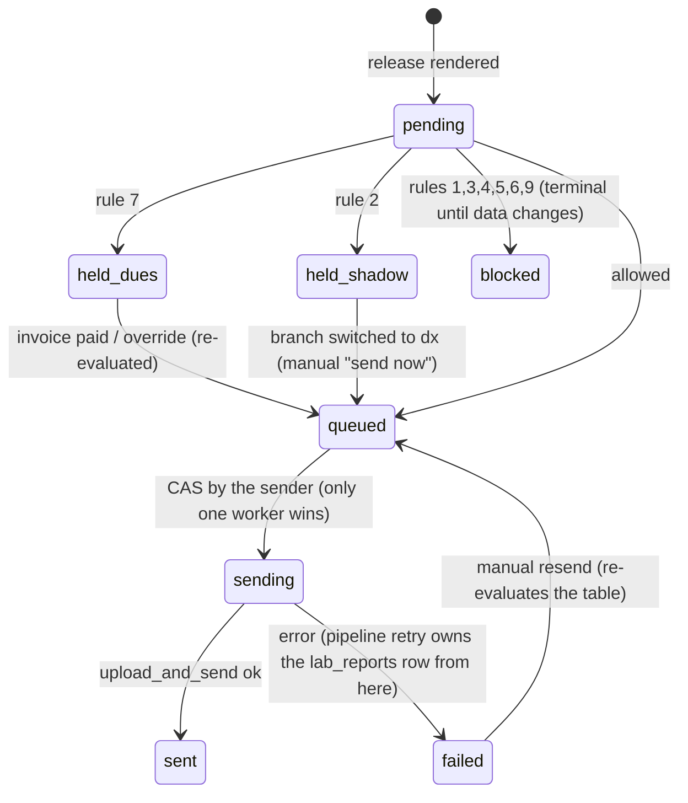

# Kriya Diagnostic OS — Report Delivery Policy (who may receive a report, and when)

> Part of the Diagnostic OS set: start at [status.md](status.md). Decisions: ADR-DX-07, -19, -20, -21. Findings that led
> here: [AUDIT.md](AUDIT.md) A1–A3, A19–A21, A24–A27.
>
> **This file is the single rulebook.** Every path that can put a DX report in someone's hands — automatic WhatsApp
> send, manual release, resend, desk print, PDF download for a patient, share link, partner portal, voice, WhatsApp
> chat, Kriya Ketu hand-off — calls the same decision function and obeys its answer. No path may implement its own
> version of these rules.

## 1. Two absolute rules (owner requirements, 2026-11-05)
1. **No payment, no report.** A visit with a patient-payable amount does not release a report document to the patient,
   the referrer or a printer for the patient until that amount is fully paid — unless an authorised person records an
   override with a reason. Nothing is sent "automatically" while dues exist. A later void of the bill puts the visit
   back on hold.
2. **Payer-routed visits never go to the patient.** Visits billed to an insurance company, TPA or corporate panel are
   delivered to that payer's desk (or held), never to the patient's phone — unless the account carries a recorded
   authorisation to also copy the patient.

Both rules are enforced in the database (the decision function and the delivery state machine), not only in Python.

## 2. Inputs to the decision
| Input | Source |
|:-|:-|
| Delivery owner of the visit's registration branch | `dx_settings.delivery_owner[branch_id]` = `connector` / `shadow` / `dx` |
| Billing mode of the visit | `dx_accessions.billing_mode` = `patient` / `b2b_credit` / `b2b_prepaid` / `b2b_split` / `internal` |
| Payer account (kind, delivery rule, patient-copy authorisation) | `dx_b2b_accounts` (`kind`, `report_delivery`, `patient_copy_authorised_at`) |
| Patient-payable amount and its state | live `opd_invoices` row with `accession_id` (`status`, `total_paise`, `paid_paise`); `dx_field_collections` pending handover |
| Override | latest unexpired `dx_delivery_overrides` row for the visit |
| Target | `patient` / `referrer` / `account` / `print_patient` / `share_link` / `partner_portal` |
| Recipient | patient phone (must exist, must not equal the account desk/contact phone), referrer phone + consent, account desk phone |
| Plan capability | `has_feature(clinic, "lab_reports")` for WhatsApp; `report_dispatch_allowed()` at send time (suspension, daily limit) |

## 3. Decision table (`dx_delivery_decision(p_clinic_id, p_release_id, p_target) → (allowed BOOLEAN, reason TEXT)`)
Evaluated top to bottom; the first rule that refuses wins. `reason` values are stable codes shown to staff.

| # | Rule | Refusal reason |
|:-|:-|:-|
| 1 | Release exists in this clinic and is not `superseded` (an amended report replaces it) | `release_superseded` |
| 2 | Branch delivery owner: `connector` → nothing leaves DX; `shadow` → WhatsApp/share/partner refused, staff print allowed only with the "SHADOW — NOT FOR PATIENT USE" watermark | `owner_connector` / `held_shadow` |
| 3 | Target allowed by payer kind: for `insurance_tpa` and `corporate` accounts, `patient`, `print_patient`, `share_link` refused unless `patient_copy_authorised_at` is set; `referrer` refused unless the same authorisation covers referrers | `payer_routed` |
| 4 | Target allowed by account delivery rule (`report_delivery` = `account` / `both` / `patient` / `none`) | `account_rule` |
| 5 | Target `patient`: patient phone present and ≠ account desk/contact phone; family dependants deliver to the account holder's phone (existing registry rule) | `no_patient_phone` |
| 6 | Target `referrer`: referrer has `report_copy='whatsapp'`, a phone, and the visit has `delivery_prefs.consent_at` | `no_referrer_consent` |
| 7 | **Dues** — applies when the visit has a patient-payable amount (visit `billing_mode` `patient` or `b2b_split`; an account whose `default_billing_mode` is `patient` produces visits with `billing_mode='patient'`, so the visit column is the only input) and the target is `patient`, `referrer`, `print_patient`, `share_link`, `partner_portal` — or `account` when the visit's `billing_mode='patient'` (a provider hospital must not receive, and hand over, the report of a patient who has not paid the lab): allowed only if **every active item with `patient_share_paise > 0` is on a live (non-void) invoice** of the visit, **every** live invoice of the visit is `paid` (or `issued` with `total_paise = 0`), and no `dx_field_collections` row is pending handover — or an active override exists. A draft invoice counts as unpaid | `held_dues` |
| 8 | Target `account` on a `b2b_credit`, `b2b_prepaid` or `b2b_split` visit: not subject to rule 7 (the account is the lab's debtor for its share; credit control is the account hold, W5). In `b2b_split` the patient-side targets still wait for the co-pay | — |
| 9 | WhatsApp targets need `has_feature(clinic, "lab_reports")`; otherwise only `print_patient` / `share_link` / `partner_portal` | `plan_no_delivery` |
| 10 | Otherwise allowed | — |

Never gated by this table: **critical-value communication** (phone call / urgent template to the referrer, W8 step 6),
and **staff clinical viewing** of a released PDF inside the panel (audit-logged read, watermarked "INTERNAL VIEW" when
rule 7 would refuse a patient copy).

## 4. Delivery state machine (`dx_release_deliveries`, one row per release × target)

- The **only** code that calls `LabReportService.upload_and_send` for DX is `dx_reports.send_delivery()`. It first
  re-runs `dx_delivery_decision` inside `dx_claim_delivery(p_delivery_id)` — a SQL function that sets
  `queued → sending` only if the decision still allows it — and only then calls the pipeline with
  `external_report_id = 'dx-<release_id>-<p|r|a>'`, `source='dx'`, `ai_summary` = true for `patient` only.
  An AST test (`tests/test_dx_no_llm.py` companion `test_dx_single_sender`) fails if any other module passes
  `source="dx"` to `upload_and_send`.
- Because a held delivery never creates a `lab_reports` row, the existing retry worker, voice `reports()` /
  `resend_report()` and the Lab Reports page can only ever see deliveries that passed the policy (AUDIT A21).
- **Re-evaluation triggers** (no polling of money paths): an `AFTER INSERT` trigger on `opd_receipts` and an
  `AFTER UPDATE OF status` trigger on `opd_invoices` for invoices with `accession_id` insert a row into `dx_outbox`
  (`kind='reevaluate', accession_id`); the scheduler job `dx_outbox_dispatch` (every 1 min, `scheduler_locks`)
  re-runs the decision for that visit's held deliveries. This catches desk receipts, payment-link settlement
  (`settle_opd_payment_link`, untouched), prepaid apply and voids without editing any existing payment code.
- **Void after send**: already-sent deliveries stay sent (cannot be unsent); new targets and resends are held again.

## 5. Per-target sending details
| Target | Recipient | Pipeline call | Notes |
|:-|:-|:-|:-|
| `patient` | patient (or account holder) phone | `ai_summary=True` (clinic's existing behaviour) | clinic's approved lab-report templates (`template_name_for`, `summary_template_name_for`) outside 24 h |
| `referrer` | referrer phone | `ai_summary=False`, report name prefixed "Copy for Dr …" | template `dx_report_copy_referrer` (new, Meta approval) outside 24 h |
| `account` | account desk phone (generalises `report_routing_phone`) | `ai_summary=False` | `match_source='dx_account'`, `match_confidence=1.0`; patient-match gate not applicable (same reasoning as `integrations.py:296`) |
| `print_patient` | desk printer | none (PDF to browser) | `dx_print_log` row; reason `held_dues` refuses unless override |
| `share_link` | patient | none | link creation refused under rules 3/7; **unlock re-checks** the decision |
| `partner_portal` | B2B partner login | none | account's own visits only; rule 7 applies to patient-billed visits |
Pipeline deferrals (`report_dispatch_allowed`: `suspended`, `daily_limit_reached`) are shown on the delivery as
`deferred:<reason>`; the pipeline's own retry/hold rules then apply.

## 6. Overrides (`dx_delivery_overrides`, append-only)
- Who: `DX_ADMIN` or `clinic_admin`; never the requesting cashier alone. Reason ≥ 10 characters (e.g. "staff",
  "patient admitted, bill on IPD", "known corporate, PO pending").
- Scope: one visit, rule 7 only (an override can never bypass rules 1–6 or 9), optional expiry (default 7 days).
- Effect: held deliveries are re-evaluated immediately; the release, print log and visit timeline show
  "released on override by <name>: <reason>".
- Reported in MIS (overrides per user per month).

## 7. Channel checklist (each must have a test in `tests/test_dx_reports_e2e.py`)
| Channel | Must call | Test |
|:-|:-|:-|
| Auto release after last approval | `dx_create_release` → deliveries → decision | `test_unpaid_visit_holds_every_target` |
| Manual release / resend (DX page) | decision per target | `test_resend_rechecks_policy` |
| Desk print | decision `print_patient` | `test_print_refused_with_dues_without_override` |
| Share link create + unlock | decision `share_link` at both steps | `test_share_unlock_rechecks_after_void` |
| Partner portal download | decision `partner_portal` | `test_partner_download_respects_dues_for_patient_billed_visit` |
| Generic Lab Reports resend / resolve | refuse `source='dx'` | `test_generic_resend_refuses_dx_rows` |
| Voice `resend_report` | only rows already sent (original number) | existing voice tests + `test_voice_cannot_reach_held_report` |
| WhatsApp chat "my report" | status text only (held → payment link) | `test_chat_status_for_held_report` |
| Payment arrives (desk, link, prepaid) | outbox re-evaluation | `test_payment_link_settlement_releases_held_report` |
| TPA / corporate visit | `account` only | `test_tpa_visit_never_targets_patient` |
| Co-pay visit | account copy immediately, patient copy after co-pay | `test_copay_visit` |
| Critical value | call log independent of dues | `test_critical_call_not_blocked_by_dues` |
