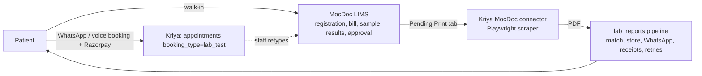

# Kriya Diagnostic OS — Gap Analysis

> Part of the Diagnostic OS set: start at [status.md](status.md). Verified against code at `main` @ `56f719f`
> (latest migration `124_insurance_tpa_and_cashless.sql`), 2026-11-05.

## 1. Today's operating model for diagnostic clients

Pain points (from the connector code, Session 40 and owner notes): staff key the same patient twice; the scraper
breaks when MocDoc changes its UI (`connectors/mocdoc/selectors.py`), costs 150–400 MB RAM per Chromium worker and
polls sequentially per client; report delivery lags by the poll interval; patient matching is heuristic
(`match_confidence`), and dues/partial releases are inferred from MocDoc's screens. **Every one of these
disappears when the centre runs its lab in Kriya.**

## 2. What already exists and will be reused (do not rebuild)

| Capability | Where | State | Reuse in Diagnostic OS |
|:-|:-|:-|:-|
| Patient master, MRN, family members, DPDP consent, duplicate check | `patients`, `family_members`, mig 020/103, `app/services/opd.py` registry | Production code | **Registration** (P3). Needs a DX-scoped route because OPD routes require `opd_enabled` |
| Lab test catalogue (name, sample type, price, prep, fasting, TAT hours, category, description, branch) | `lab_tests` mig 038/076/080/083; `app/routers/admin.py` lab-tests CRUD, CSV price import (`price_list_parser.py`) | Production | **Test master** base (P2 extends additively) |
| WhatsApp lab booking + payment holds, refunds, reminders | `appointments` (`booking_type='lab_test'`), `app/services/payment.py`, `conversation.py` | Production | **Source of visits** (P3 conversion) |
| Home sample collection, phlebotomist portal, least-busy assignment | mig 097, `app/services/home_collection*.py`, `app/routers/home_collection.py` | Production (diagnostic plans) | **Collection** (P4 adds barcode bind) |
| Orders as worklist rows (`opd_orders`), sample barcode, collect, complete | mig 115, `app/services/orders.py`, `app/routers/orders.py` (`/admin/diagnostic/*`) | Built, staging pending | **Per-test work unit** (P3 adds `source='dx'`) |
| LIS: parameters with age/sex bands, critical limits, flags, technician entry, pathologist signing, immutability, amendments, lab PDF | mig 118, `app/services/lis.py`, `app/routers/lis.py`, `opd_pdf.render_lab_report_pdf` | Built, staging pending | **Result engine** (P6 extends; P7 replaces the per-test PDF with the visit report for DX) |
| Billing ledger: invoices, gapless numbers, receipts, refunds, shifts, payment links, prepaid apply, GST lines, credit notes | mig 103/104/113/114/117, `app/services/opd_billing.py`, `gst_billing.py` | Built | **Patient bills** (P3) via `accession_id` on `opd_invoices` |
| Report delivery pipeline: storage, WhatsApp document send, delivery receipts, retries, AI summary, failed-report alerts | `app/services/lab_reports.py`, mig 037/041/045/062 | Production | **Delivery** (P7) with `external_report_id = dx-<release_id>` |
| Provider → TPA desk routing | `app/services/report_routing.py` (mig 070) | Production (connector config) | Generalised to B2B account routing (P8) |
| Branches, branch pinning, `enforce_branch_scope` | mig 010/029/030, `app/routers/admin.py` | Production | **Sites** (P1) |
| Staff roles LAB_OPERATOR, DIAGNOSTIC_OPERATOR, PATHOLOGIST, PHLEBOTOMIST, CASHIER | `app/services/permissions.py` | Built | Extended with DX permissions (P1) |
| Owner opt-in modules with wind-down | `OPT_IN_FEATURES`, `PATCH /platform/clinics/{id}/features`, `admin/platform.html` | Production | `dx_enabled` (P1) |
| Kriya Ketu action registry; voice receptionist plan scope (diagnostic = tests only) | `app/assistant/registry.py`, `app/voice/scope.py` | Built | P9 |
| Corporate health dashboards, partner (dashboard-only) accounts | mig 095/096 | Production | Unchanged; B2B accounts are a different concept (ADR-DX-09) |
| MocDoc connector, CallMedex processing-centre jobs | `connectors/`, `app/integrations/callmedex/` | Production | **Kept** for clients not on DX; shadow mode during cutover (P7, ROLLOUT) |

## 3. Blocking facts found during discovery

| # | Fact (code) | Consequence |
|:-|:-|:-|
| F1 | `opd_enabled()` requires `has_feature(clinic, "booking")`; plans `diagstream` / `diagbooking` do not have `booking` (`app/services/tenant.py`) | A pure diagnostic centre **cannot** enable OPD OS, so it cannot reach the registry, billing, worklist or LIS today. Diagnostic OS needs its **own entitlement** `dx_enabled` that does not depend on OPD (ADR-DX-02). |
| F2 | `_lis_scope()` (`app/routers/lis.py`) and the G1 worklist scope (`app/routers/orders.py`) require `opd_enabled(clinic) or ipd_access(clinic)` | Widen both to `… or dx_access(clinic)` (additive) in P1, with tests proving OPD/IPD behaviour unchanged. |
| F3 | `opd_orders.source` CHECK allows only `opd`/`ipd`; `doctor_id` is NOT NULL; `opd_orders_source_shape` requires an encounter or IPD order | P3 adds `source='dx'` with `accession_id`, and `doctor_id` nullable **only** for `dx` (constraint, ADR-DX-03). |
| F4 | `lis.validate_and_sign_report` spawns `deliver_report()` per test on every signature (`app/services/lis.py:389`) | For `source='dx'` this would send one PDF per test and bypass dues/partial-release rules. P6 must skip it for DX orders; DX releases deliver instead (ADR-DX-07). |
| F5 | `orders.get_diagnostic_worklist` lists all open `opd_orders` and assumes a doctor | DX rows would appear on the hospital worklist with `doctor_id NULL`. P3 filters it to `source IN ('opd','ipd')` and adds a regression test. |
| F6 | `lis_validate_result` signs `entered → validated` in one step | A 3-level lab (completion → verification → approval) needs a verification gate. P6 adds an additive trigger for DX orders only (ADR-DX-06). |
| F7 | `lab_results` is one row per test; a patient report is one PDF for the whole visit | P7 adds `dx_report_releases` composing many signed results into one versioned document (ADR-DX-07). |
| F8 | `docs/hospital-os/status.md` module board still shows G2 as NOT_STARTED although Session 44 built migration 118 | Documentation drift only; the gap analysis §1 row "Kriya has no lab result entry" is stale. Fix in that file when G2's staging run is recorded (out of DX scope). |
| F9 | Migration 115–124 are not yet applied to Supabase (each module's open item) | DX migrations depend on 115 and 118. **DX cannot go to staging before 115 and 118 are applied there** (ROLLOUT §1). |
| F10 | `diagstream` lacks `admin_dashboard` in `PLAN_FEATURES` | Check in P0 how diagnostic clients reach the panel today; `dx_enabled` must make the DX pages reachable without granting unrelated dashboard features. |

## 4. Gap matrix by stage of the diagnostic journey

Priority: **P0** = a centre cannot drop MocDoc without it · **P1** = needed within weeks of go-live · **P2** later.

| # | Stage | Exists | Gap | Priority | Phase |
|:-|:-|:-|:-|:-|:-|
| 1 | Module entitlement, settings, sites (collection / processing) | opt-in pattern, branches | `dx_enabled`, `dx_state`, `dx_settings`, `dx_sites` | P0 | P1 |
| 2 | Roles & permissions for front desk, collection, logistics, lab floor, verifier, pathologist, dispatch, B2B | some roles | DX permissions, roles, site-aware visibility | P0 | P1 |
| 3 | Test master: codes, departments, containers, methods, TAT, interpretation, panels, packages | basic `lab_tests` | additive columns + components | P0 | P2 |
| 4 | Parameters: method, formula, decimals, reference text, analyser code, delta | `lab_test_parameters` (bands) | additive columns, formula engine | P0 | P2 |
| 5 | Seed library of common Indian tests | — | opt-in seed, lab-director approval | P1 | P2 |
| 6 | Referrers (doctors, hospitals) | free text on reports | `dx_referrers` | P0 | P3 |
| 7 | Visit (accession) with source, referrer, provider/B2B, priority, fasting, external ref | — | `dx_accessions`, items | P0 | P3 |
| 8 | Bill at registration (MRP / rate card / package / discount), receipt, dues, refund | OPD ledger | `accession_id` link, DX routes | P0 | P3 |
| 9 | WhatsApp/voice booking → visit | bookings | conversion + prepaid apply | P0 | P3 |
| 10 | Tube grouping, sample IDs, label printing (thermal) | single barcode per order | `dx_samples`, numbering, Code128 labels | P0 | P4 |
| 11 | Collection at desk / home, bind pre-printed barcode | phlebotomist portal | collect function, bind | P0 | P4 |
| 12 | Reject / recollect with reasons | — | reasons, replacement orders, WhatsApp notice | P0 | P4 |
| 13 | Routing to processing lab, transit batches, receipt (accession), discrepancies, stability timers | — | `dx_batches`, routing rules | P0 for chains | P5 |
| 14 | Outsourcing to reference labs | — | partners, send-out, "performed at" | P1 | P5 |
| 15 | Stage worklists (receipt, entry, verify, approve, dispatch) with TAT | G1 worklist | DX read model by stage + site | P0 | P6 |
| 16 | Calculated parameters, delta checks, attachments (graphs) | — | engine + storage | P0 (calc) / P1 | P6 |
| 17 | Verification level, batch approval, critical-call log | single sign | gate trigger, tables | P0 | P6 |
| 18 | Visit-level report: department grouping, page x of y, interpretation, signatures, cumulative values, QR verify | per-test PDF | renderer v2 + releases | P0 | P7 |
| 19 | Templates & white-label cascade | clinic letterhead | `dx_report_templates` | P0 (B2B) | P7 |
| 20 | Partial release, dues gate, delivery to patient / referrer / B2B desk, print log, secure link | pipeline | release + routing | P0 | P7 |
| 21 | Shadow mode alongside MocDoc connector | — | `delivery_owner` per branch | P0 (cutover) | P7 |
| 22 | B2B accounts, rate cards, credit/prepaid limits, ledger, monthly statements, payments | — | `dx_b2b_*` | P0 for B2B labs | P8 |
| 23 | Partner portal (hospital registers samples, downloads white-label reports, pays) | — | confined login | P1 | P8 |
| 24 | MIS: TAT, volumes, revenue by site/referrer/account, rejection rate, pending | analytics | DX MIS | P1 | P9 |
| 25 | Kriya Ketu reads + hand-offs; voice "report status"; WhatsApp "my report" | partial | registry entries, tools | P1 | P9 |
| 26 | Analyser bridge (ASTM/HL7), host query, instrument results | — | bridge API + staging | P1 | P10 |
| 27 | IQC (Levey-Jennings, Westgard) | — | QC tables | P1 (NABL labs) | P10 |
| 28 | OPD/IPD lab orders through the DX bench (hospital with in-house lab) | G1 worklist | internal visits | P1 | P6b (DX-41) |
| 29 | ABDM M2 DiagnosticReportLab | — | FHIR export | P2 | DEFERRED (with G10) |
| 30 | Reagent / consumable inventory | — | needs G3 stock pattern | P2 | DEFERRED |
| 31 | Offline collection (PWA queue) | — | conflict design | P2 | DEFERRED |
| 32 | Reflex / add-on test rules | — | clinical governance | P2 | DEFERRED |

## 5. What "beyond the market" means here (and what it does not)

Additions that remove work, each deterministic and testable:
1. **Zero re-entry**: booking → visit → bill → tubes → results → report → WhatsApp, one record.
2. **Wrong-tube prevention**: tests are grouped onto tubes by container code; a label cannot carry a test of another container.
3. **Stability timers**: each container has room-temperature and 2–8 °C stability hours; transit batches turn amber/red before samples expire.
4. **Signature bound to what was reviewed** (`expected_updated_at`, already in 118) extended to verification.
5. **Batch signing of normal results** with a human signer (not auto-approval).
6. **Progressive release** with automatic top-up and dues gating; the patient pays from the same WhatsApp chat.
7. **Report authenticity QR** + SHA-256 of the released PDF; a public page confirms a report is genuine without showing values.
8. **White-label with honesty**: hospital-branded report always states where the test was performed.
9. **B2B auto-hold** on credit limit / overdue days; statements and payment links on WhatsApp.
10. **Cumulative values** printed beside each parameter (previous validated value and date).
11. **Ketu for lab staff**: "STAT samples pending", "reports waiting for my signature", in Telugu/Hindi/English.

Not done, on purpose: AI-set reference ranges, AI interpretation text on reports, auto-approval without a human
signer, referral-commission ledgers. See ADR-DX-10/11.
