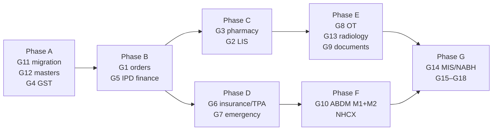

# Kriya Hospital OS — Gap Analysis and Implementation Roadmap

> **Status**: reference document, 2026-10-27. Source of truth for *what* to build next for OPD, IPD and
> multi-specialty hospitals, and the production bar every module must meet.
> **Read with**: [`docs/opd-os/SPEC.md`](../opd-os/SPEC.md) · [`docs/opd-os/status.md`](../opd-os/status.md) ·
> [`docs/ipd-os/status.md`](../ipd-os/status.md) · [`docs/ipd-os/COMPETITIVE-ANALYSIS.md`](../ipd-os/COMPETITIVE-ANALYSIS.md) ·
> [`docs/sessions/SESSION_40_MULTI_CLIENT_PRODUCTION_HARDENING.md`](../sessions/SESSION_40_MULTI_CLIENT_PRODUCTION_HARDENING.md)
>
> **Rule**: each module below gets its own `SPEC.md` + `status.md` (the OPD/IPD pattern) before code is written.
> A box is ticked only when its check has been run and passed.

---

## 1. Goal

A hospital running MocDoc (or any HMIS) must be able to move **every daily workflow** to Kriya without
keeping the old system for any part of it. Today that is true for clinics; it is not yet true for nursing
homes with a pharmacy, or for multi-specialty hospitals.

Readiness by segment (2026-10-27):

| Segment | Can switch fully today? | What blocks it |
|:-|:-|:-|
| Single/multi-doctor clinic, polyclinic | **Yes** | — |
| Diagnostic centre | **Yes, with MocDoc as the lab system** (current live model) | Kriya has no lab result entry (§5 G2) |
| Nursing home, 10–50 beds | **Partly** | Pharmacy, deposits, GST, investigation orders |
| Multi-specialty hospital, 50–500 beds | **No** | All P0 items in §4, plus OT, emergency, insurance/TPA, ABDM |

---

## 2. Market snapshot

### 2.1 Competitors

| Vendor | Positioning | Notes |
|:-|:-|:-|
| **MocDoc** | Cloud HMS for clinics → hospitals; also LIS | Publicly lists IPD with packages, nursing, pharmacy (OP/IP sales, batch/expiry, barcode, reorder), lab (analyzer interfacing, multi-level validation), ABDM milestone certification, NABH HIS/EMR certification. Dedicated TPA workflow not confirmed publicly. |
| **Insta HMS (Practo)** | Mid/large hospitals since 2008 | Full HIS. |
| **KareXpert** | Hospitals, government programmes | Full HIS, cloud. |
| **Suvarna** | HIMS + LIMS + EMR, Hyderabad | On NABH-certified software list. |
| **MediXcel** | EMR + HIS, ABDM | On NABH-certified software list. |
| **SoftClinic, Digital IPD, NIC eHospital** | See IPD competitive analysis | eHospital = government HMIS. |
| **CrelioHealth** | Lab (LIMS/PACS) only | Benchmark for lab integration, not a hospital competitor. |

All claims are vendors' public marketing pages, not verified product behaviour. No market-share data was
found without a paid analyst report.

### 2.2 Market forces that decide purchases (2026)

1. **ABDM-driven procurement.** Analysts describe an "ABDM-driven procurement shift" and a coming HIS
   replacement wave. PM-JAY and CGHS empanelled hospitals are expected to run ABDM-compatible software.
   Leaving the ABDM sandbox for production needs **any two milestones** (M1 ABHA, M2 HIP, M3 HIU).
2. **NHCX (National Health Claims Exchange)** is live with insurers and some hospitals. It is not legally
   mandatory, but the Digital Health Incentive Scheme pays hospitals per NHCX claim, and IRDAI requires
   cashless decisions within **3 hours** of discharge authorisation. Hospitals want claims raised from the HMIS.
3. **NABH Digital Health Standard for HIS/EMR (1st edition, 2024)** certifies the software itself. Competitors
   advertise it. Kriya should design every new module against its test cases (chapters: Access/Assessment/
   Continuity of Care, Care of Patients, Management of Medication, Information Systems Management).
4. **Cloud adoption** is accelerating; Kriya is already cloud-native and multi-tenant.

### 2.3 Where Kriya wins (keep these true while filling gaps)

- **One system end to end**: WhatsApp booking, AI receptionist, voice, OPD, IPD, billing, lab report delivery,
  in one patient record and one ledger.
- **Verifiable integrity**: money and bed invariants enforced in the database and tested under concurrency.
- **Safe AI**: Kriya Ketu reads with the user's own permissions; clinical paths are zero-LLM.
- **Multi-tenant, multi-branch, owner-controlled modules** with wind-down.

---

## 3. What exists today

| Area | Built and tested | Evidence |
|:-|:-|:-|
| Patient registry | MRN, DOB/age, gender, address, emergency contact, allergies, family members, duplicate check | mig 020, 103 |
| Appointments | WhatsApp, voice, desk, walk-in; slots, leaves, holidays, branches; payment-gated booking | mig 100, payment.py |
| OPD queue | Arrive, stages, call-next (locked), recall, TV display (no names) | opd.py |
| OPD clinical | Vitals, complaints, findings, diagnoses (free text + optional code), advice, follow-up date, signed e-Rx (PDF, WhatsApp), amendments | mig 103, opd_clinical.py |
| OPD billing | Invoices, gapless numbers, receipts cash/UPI/card, payment links, prepaid apply, refunds (idempotent), void, cashier shifts with blind close, payment exceptions, doctor earnings, collections | mig 103/104/113/114 |
| IPD | Wards/beds, bed board, admit/reserve/assign/transfer, vitals & I/O, notes, orders, MAR, charges, bed-day accrual, final bill via OPD ledger, discharge checklist, signed summary | mig 111/114 |
| Diagnostics | MocDoc connector → report delivery with patient-match gate, CallMedex jobs, AI summaries, home sample collection | connectors/, callmedex/ |
| Platform | Tenancy, branch pinning, roles (DOCTOR, CASHIER, NURSE, PHLEBOTOMIST, …), audit log, Razorpay/PhonePe, Kriya Ketu, FHIR export (some entities), ABHA format validation | — |

---

## 4. Gap matrix

Priority: **P0** = a hospital will not switch without it. **P1** = needed within weeks of go-live.
**P2** = by hospital type / later. Segment columns: C = clinic, N = nursing home, H = multi-specialty.

| ID | Module | Today | Priority | C | N | H |
|:-|:-|:-|:-|:-|:-|:-|
| G1 | Investigation & procedure orders (OPD + IPD) → bill → lab/radiology worklist | **Built, mig 115** ([status](status.md)); staging apply pending | **P0** | ✓ | ✓ | ✓ |
| G2 | Lab information system: samples, barcodes, result entry, ranges, validation, report | Missing (MocDoc used) | **P0** for N/H | | ✓ | ✓ |
| G3 | Pharmacy: item master, stock, batches/expiry, purchase/GRN, OP sale, IP issue, returns, drug registers | Missing | **P0** | | ✓ | ✓ |
| G4 | GST-aware billing: tax per line, HSN/SAC, GSTIN, credit notes, room-rent rule | Missing | **P0** | ✓ | ✓ | ✓ |
| G5 | IPD finance: deposits/advances, running & interim bills, packages, discount approval, credit/corporate | **Built, mig 116** ([status](status.md)); staging apply pending | **P0** | | ✓ | ✓ |
| G6 | Insurance / TPA / PM-JAY: payer & tariff masters, pre-auth, enhancement, claim, settlement, NHCX | **Built, mig 124** ([status](status.md)); staging apply pending; NHCX / portal integration deferred | **P0** for H | | ✓ | ✓ |
| G7 | Emergency / casualty: quick & unknown registration, triage, MLC register | Source flag only | **P1** (P0 if hospital runs casualty) | | ✓ | ✓ |
| G8 | Operation theatre: scheduling, WHO checklist, consent, anaesthesia record, implants billing | **Built, mig 122** ([status](status.md)); staging apply pending; implants free text (stock → G3) | **P1** | | ✓ | ✓ |
| G9 | Clinical documents: consent forms, discharge summary PDF, death/birth records, certificates | Partly (print view) | **P1** | ✓ | ✓ | ✓ |
| G10 | ABDM M1 (ABHA at registration), M2 (HIP), M3 (HIU) | Format validation only | **P1** (P0 for PM-JAY/CGHS) | ✓ | ✓ | ✓ |
| G11 | Data migration from previous HMIS (patients, history, balances, masters) | Missing (catalogue CSV only) | **P0** for any switch | ✓ | ✓ | ✓ |
| G12 | Clinical coding & masters: ICD-10 search, drug master for e-Rx, service catalogue per payer | Free text | **P1** | ✓ | ✓ | ✓ |
| G13 | Radiology: orders, worklist, report templates, PACS link, PCPNDT Form F for USG | **Built, mig 123** ([status](status.md)); staging apply pending; PACS = study UID + viewer link only | **P1** for H | | | ✓ |
| G14 | MIS & NABH quality indicators, day-end reports, exports | Partial (analytics) | **P1** | ✓ | ✓ | ✓ |
| G15 | Gateway refunds for OPD payment links (D4) | Manual only | **P1** | ✓ | ✓ | ✓ |
| G16 | Patient & attendant communication: bills, reports, IPD updates on WhatsApp | Deferred (IPD-23) | **P2** | | ✓ | ✓ |
| G17 | General inventory & purchase (non-drug), CSSD, diet/kitchen, blood bank, ambulance, HR/payroll | Missing | **P2** | | | ✓ |
| G18 | Clinical decision support: early-warning scores (NEWS2), drug–allergy/interaction checks | Deferred (IPD-24) | **P2** (needs clinician sign-off) | | ✓ | ✓ |

---

## 5. Module specifications (what to build)

Each section is the brief for that module's own SPEC. All modules follow §6.

### G1 — Investigation & procedure orders
- **Why**: a doctor advising "CBC, X-ray chest" must not be retyped at the counter and in the lab.
- **Scope**: order set on the OPD encounter and on IPD orders (`order_type = investigation | procedure`);
  each line references `lab_tests` / service catalogue; creates **proposed** bill lines (OPD draft invoice or
  IPD charges) and a **worklist** entry for the lab/radiology desk; status `ordered → sample_collected →
  resulted → reported | cancelled`.
- **Invariants**: an order belongs to one encounter/admission and one clinic; cancelling a billed order
  needs a refund/credit path; price snapshotted at order time; one worklist row per order line (unique).
- **Acceptance**: order in consult → appears on invoice draft and lab worklist without re-entry; cancel
  before payment removes the line; cancel after payment raises a refund task.

### G2 — Lab information system (LIS)
- **Scope**: test master with parameters, units, method, **reference ranges by age/sex**, critical limits;
  sample accession with barcode labels; collection (desk or home collection, reuse mig 097); result entry
  per parameter; **two-step validation** (technician → pathologist with registration, signed); amendments
  versioned; report PDF on letterhead; delivery via the existing lab-report/WhatsApp pipeline; TAT tracking.
- **Later**: analyzer interfacing (ASTM/HL7 via a local bridge), outsourcing to reference labs.
- **Live-client rule**: diagnostic centres on MocDoc keep the connector; the LIS is per-clinic opt-in.
- **Acceptance**: a validated report is immutable; critical value alerts the doctor; report reaches the
  patient through the same delivery path as connector reports.

### G3 — Pharmacy
- **Scope**: item master (generic, brand, strength, form, HSN, GST rate, schedule H/H1/X, reorder level);
  stores per branch (main + IP sub-store); purchase order → GRN with batch, expiry, MRP, cost; stock ledger
  (append-only movements); OP sale from e-Rx or counter; **IP issue against MAR orders**; returns; stock
  transfer; expiry and reorder alerts; Schedule H1/X register with prescriber details.
- **Invariants**: stock = sum of movements (never edited); no sale of expired batch; FEFO suggestion;
  quantity never negative (DB check); every sale line taxed per item GST.
- **Acceptance**: concurrent sales of the last unit → one succeeds; H1 register exportable; IP issue posts
  an IPD charge automatically.

### G4 — GST-aware billing
- **Scope**: per-line `hsn_sac`, `tax_rate`, `cgst/sgst/igst` (paise, computed server-side); clinic/branch
  GSTIN; tax invoice vs bill of supply; **credit notes** instead of editing issued invoices; room-rent rule
  (non-ICU room rent above the notified daily threshold taxed; ICU exempt); GSTR-1-ready export.
- **Note**: rates and thresholds are **data, not code** — verify current CBIC notifications before go-live.
- **Acceptance**: invoice totals reconcile to line taxes exactly; an exempt clinic's invoices are unchanged.

### G5 — IPD finance
- **Scope**: deposits/advances as receipts against the admission (refundable balance); running bill and
  interim bills; **packages** (fixed price with inclusions/exclusions, overrun handling); discount with
  approval workflow (role + reason + limit); credit/corporate bills settled later; deposit refund at
  discharge through the cashier shift.
- **Invariants**: final bill = posted charges − package adjustments − discount; deposits applied once;
  balance due computed, never stored by hand.

### G6 — Insurance / TPA / PM-JAY
- **Scope**: payer master (insurer, TPA, corporate, scheme), payer-specific tariffs; patient policy capture;
  **pre-authorisation** request/approval/enhancement with documents; claim file at discharge; settlement
  with deductions and write-off; patient-payable vs payer-payable split on the bill; ageing report.
- **Phase 2**: NHCX submission (FHIR claim bundles) and PM-JAY package codes.
- **Acceptance**: a cashless stay produces two balances (patient, payer) that sum to the bill; a settlement
  with deductions leaves an auditable write-off.

### G7 — Emergency / casualty
- **Scope**: 30-second registration (name optional → "Unknown Male ~40y" with temporary MRN, merge later);
  triage category; **MLC register** (police intimation, injury details, locked after sign); casualty
  notes; disposition to OPD, IPD, OT, referral or death.
- **Invariants**: MLC records immutable and access-logged; unknown-patient merge keeps both histories.

### G8 — Operation theatre
- **Scope**: OT and slot master; surgery booking linked to admission; pre-op checklist; **WHO surgical
  safety checklist** (sign-in, time-out, sign-out); consent capture; anaesthesia record; surgeon notes;
  implant/consumable capture (from pharmacy stock) → IPD charges.

### G9 — Clinical documents
- **Scope**: discharge summary PDF (IPD-20), consent templates with signature capture (typed name + timestamp
  + witness, or uploaded scan), fitness/medical certificates, death certificate data (MCCD format), birth
  record data; all generated from signed records; versioned.

### G10 — ABDM
- **M1**: create/verify ABHA at registration (OPD, IPD, emergency), store ABHA number/address.
- **M2 (HIP)**: link care contexts; share OP consult notes, prescriptions, discharge summaries, lab reports
  as FHIR documents on consent.
- **M3 (HIU)**: request and display records from other facilities with consent.
- **Gate**: production credentials need two milestones; plan M1 + M2 together.

### G11 — Data migration (onboarding a switching hospital)
- **Scope**: import patients (with MRN preserved), family links, doctors, service and lab catalogues, drug
  master and opening stock, outstanding balances, and read-only past visit history; dry-run with a report
  (duplicates, invalid phones, conflicts) before commit; idempotent re-run; per-clinic.
- **Acceptance**: a 50,000-patient import completes in batches, is resumable, and never merges across clinics.

### G12 — Clinical coding & masters
- ICD-10 search (bundled code list), drug master feeding e-Rx and pharmacy (one source), service catalogue
  with payer tariffs.

### G13 — Radiology
- Orders from G1; worklist; report templates; DICOM viewer link to the hospital's PACS (no image storage in
  Kriya); **PCPNDT Form F** for obstetric ultrasound (mandatory record), consistent with the existing
  sex-determination guard in `clinical_firewall.py`.

### G14 — MIS & NABH indicators
- Day-end and month-end reports (collections, census, ALOS, bed occupancy, TAT, readmission within 30 days,
  medication errors from MAR, return to OT); CSV/Excel export; owner console cross-branch view.

### G15 — Gateway refunds for payment links
- Refund an OPD payment-link payment through Razorpay/PhonePe from the panel, with the same idempotency and
  exception handling as booking refunds.

### G16–G18
- Attendant WhatsApp updates need approved templates and consent; CSSD/diet/blood bank/HR are per-hospital
  add-ons; clinical decision support only with clinician-approved rules.

---

## 6. Production standard for every module (non-negotiable)

These are the rules OPD and IPD already follow. A module is not done until all hold and are tested.

| # | Rule |
|:-|:-|
| 1 | **Money in integer paise**; totals derived by the database, never typed or stored by hand. |
| 2 | **Invariants in the database**: CHECK constraints, triggers, row locks, partial unique indexes. The API is not the only guard. |
| 3 | **Idempotency key on every money or stock write** (receipt, refund, deposit, sale, issue, claim). Retries return the first result. |
| 4 | **Compare-and-set** on every status change (`.eq("status", expected)` or `FOR UPDATE` in an RPC). |
| 5 | **Append-only ledgers** (receipts, stock movements, clinical records); corrections are new rows with provenance. |
| 6 | **Tenant scope** on every query (`scoped_query` / `.eq("clinic_id")`); `tests/test_lint_unscoped_queries.py` stays green. |
| 7 | **Branch scope** for pinned staff on every read and write (`enforce_branch_scope`). |
| 8 | **Named permission per action**, new roles as presets; least privilege for clinical vs billing data. |
| 9 | **Audit log** on every write and every clinical read. |
| 10 | **Zero-LLM** on clinical and money paths; AI only reads, with the user's permissions. |
| 11 | **No silent truncation**: page with `database.fetch_all`; batch `in_()` lookups by 100 (Session 40). |
| 12 | **No raw exception text** in responses; mapped error codes; generic 500 message. |
| 13 | **Background sends** via `spawn_background_task`, never bare `create_task`. |
| 14 | **Migration + rollback + verify block**, additive, applied off-peak, staging first; owner entitlement flag, off by default, with wind-down. |
| 15 | **Tests**: unit, real-Postgres invariants, concurrency (parallel writes), HTTP end-to-end, security matrices, live UI at desktop and 390 px. |
| 16 | **IST everywhere** for business dates; gapless document numbers per clinic per year where the law expects them. |
| 17 | **DPDP**: purpose-bound data, consent where required, erasure/retention rules per record type. |
| 18 | **Docs updated in the same change**: module `status.md`, `docs/agent-context/*`, session note. |

---

## 7. Roadmap

Sequenced by dependency and by what unblocks the most hospitals. Durations are not estimated here.

| Phase | Modules | Unlocks |
|:-|:-|:-|
| **A — Foundations** | G11 data migration, G12 masters (drug, ICD-10, services), G4 GST billing | Any hospital can bring its data and bill legally |
| **B — Orders & IPD money** | G1 orders, G5 deposits/packages/discounts/credit | Nursing homes without in-house pharmacy/lab |
| **C — Pharmacy & lab** | G3, G2 | Nursing homes fully; diagnostic centres can drop MocDoc LIS |
| **D — Payers & casualty** | G6, G7 | Multi-specialty hospitals with insurance patients and casualty |
| **E — Surgery & imaging** | G8, G13, G9 | Surgical hospitals |
| **F — National stack** | G10 ABDM M1+M2, NHCX claims | PM-JAY/CGHS empanelled hospitals; incentive scheme |
| **G — Depth** | G14–G18 | NABH-accredited hospitals, larger groups |

Pilot each phase the IPD way: sandbox clinic → clinical sign-off → one pilot site with paper backup for two
weeks → daily reconciliation queries at zero → next tenant.

---

## 8. Pending items carried from OPD, IPD and Session 40

| Source | Item | State |
|:-|:-|:-|
| IPD-17 | Apply mig 111 on a Supabase staging branch; run E2E with `TEST_DATABASE_URL` | Not started — **do before any IPD client goes live** |
| IPD-18 | Browser-automated UI regression for IPD pages | Not started |
| IPD-19 | `docs/agent-context` IPD sections | Not started |
| IPD-14 | Owner console IPD card browser-driven check | Implemented, not verified |
| IPD-20 | Discharge summary PDF | Deferred → G9 |
| IPD-21 | Deposits, packages, TPA, GST | Deferred → G4, G5, G6 |
| IPD-22 | Pharmacy dispensing, LIS orders/results | Deferred → G1, G2, G3 |
| IPD-23 | Attendant WhatsApp updates | Deferred → G16 |
| IPD-24 | Early-warning rules | Deferred → G18 |
| IPD-25 | Kriya Ketu IPD writes | Deferred |
| IPD-26 | ABDM discharge summary (FHIR) | Deferred → G10 |
| OPD D4 | Gateway refunds for payment links | Manual → G15 |
| OPD F5 | Signed e-Rx → medication reminders bridge | Out of scope; revisit with G12 drug master |
| OPD | ICD-10 autocomplete | → G12 |
| S40 | MocDoc connector sweep is sequential (delay grows per diagnostic client) | Owner decision: more workers vs bounded concurrency |
| S40 | Per-clinic `integration_secret` for every clinic | Onboarding step |
| S40 | `get_genuine_patients` → SQL view/RPC for very large clinics | Open |
| S40 | IPD bed board reads all beds in one request (fine < 1,000 beds) | Open |
| KA-19 | Tenant cache staleness up to 30 s across workers | Open |

---

## 9. Owner decisions needed before the specs

1. **Pharmacy scope**: one central store per branch, or sub-stores per ward/OT from day one?
2. **LIS**: build in-house (G2) or integrate a partner LIS for hospitals and keep MocDoc for diagnostic centres?
3. **GST**: which current clients are GST-registered, and does any sell taxable services (cosmetic, pharmacy)?
4. **Insurance**: first payers to support (PM-JAY, CGHS, top private insurers/TPAs) and whether NHCX is in the first release.
5. **Discount authority**: limits per role and who approves above them.
6. **Package policy**: how overruns and exclusions are billed.
7. **Pilot hospital** for Phases A–B and its non-negotiable day-one modules.
8. **NABH HIS/EMR certification**: pursue it (affects audit, access control and documentation design now).

---

## 10. Sources

Market and regulatory facts were taken from public web pages on 2026-10-27 and must be re-verified against
primary documents before a module ships.

- MocDoc module pages: [hospital software (Gulbarga)](https://mocdoc.com/india/ka/hospital-software-gulbarga), [cloud HMS (Gurgaon)](https://mocdoc.com/india/hr/cloud-hms-system-gurgaon), [Q1 2025 updates](https://mocdoc.com/blog/mocdoc-q1-2025-software-updates), [ABDM milestone certification](https://mocdoc.com/blog/abdm-milestone-certified-hospital-software), [NABH certification](https://mocdoc.com/blog/nabh-certified-digital-healthcare-transformation-2025)
- Market: [Black Book 2026 India digital health](https://www.accessnewswire.com/newsroom/en/healthcare-and-pharmaceutical/black-book-research-releases-2026-india-digital-health-and-acute-care-1134465), [NABH-certified software list](https://nabh.co/nabh-certified-healthcare-software/), [Insta / jvs technologies profile](https://www.cbinsights.com/company/jvs-technologies)
- ABDM: [DHIS operational guidelines](https://abdm.gov.in:8081/uploads/Operational_Guidelines_DHIS_0500f58100.pdf), [two-milestone rule](https://nirmitee.io/blog/abdm-m1-only-certificate-minimum-two-milestones-rule/), [M1–M4 guide](https://nirmitee.io/blog/abdm-integration-milestones-m1-m2-m3-m4-multi-software-guide), [ABDM operationalisation 2026](https://hmpi.org/2026/07/09/from-infrastructure-to-impact-operationalizing-indias-ayushman-bharat-digital-mission/)
- NHCX: [NHA hackathon release](https://pr.iith.ac.in/pressrelease/NHCX26.pdf), [is NHCX mandatory in 2026](https://nirmitee.io/blog/is-nhcx-mandatory-hospitals-hmis-2026/), [PM-JAY on NHCX](https://nirmitee.io/blog/pmjay-on-nhcx-hmis-claims-guide/), [NHCX integrations](https://digitalhealthnews.com/nha-s-nhcx-integrates-10-hospitals-8-insurers-marking-significant-achievement)
- GST: [Grant Thornton on room rent](https://www.grantthornton.in/en/insights/blogs/gst-on-hospital-room-rent-a-bitter-pill-to-swallow), [Mondaq](https://webiis08.mondaq.com/india/sales-taxes-vat-gst/1222622/hospital-room-rent-to-attract-gst), [Busy on hospital bills](https://busy.in/gst-rates/hospital-bill/)
- NABH: [Test cases, Digital Health Standard for HIS/EMR](https://portal.nabh.co/images/Standards/Test%20Cases%20for%20NABH%20Digital%20Health%20Standard%20for%20HIS%20and%20EMR%20Systems.pdf), [draft standards news](https://www.digitalhealthnews.com/nabh-releases-draft-standards-for-his-emr-systems), [6th edition chapter mapping (CAHO)](https://www.caho.in/masterclassform/11)
