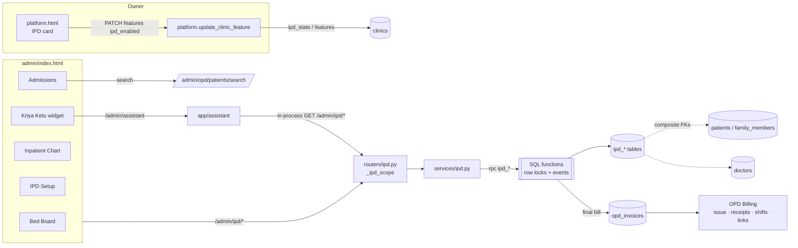
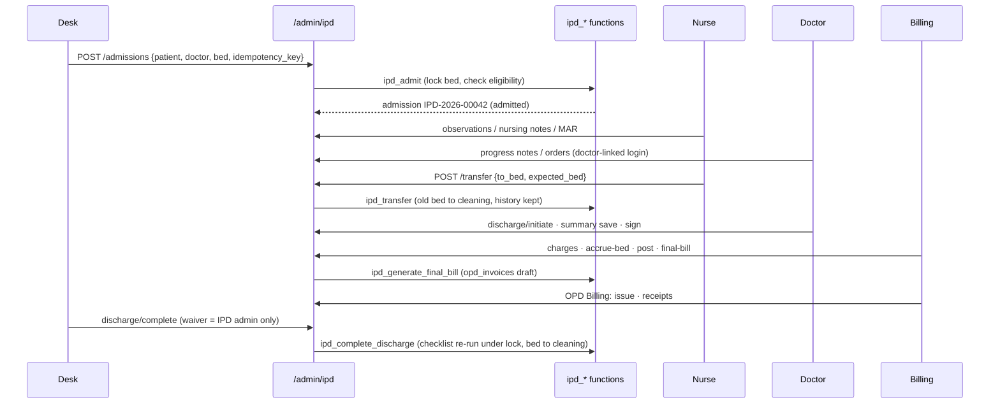

# Kriya IPD OS — Architecture

> Execution tracker: [status.md](status.md) · Decisions: [ADR.md](ADR.md) · Schema: [DATA-MODEL.md](DATA-MODEL.md) ·
> Workflows: [WORKFLOWS.md](WORKFLOWS.md) · Security: [SECURITY.md](SECURITY.md) · Tests: [TEST-PLAN.md](TEST-PLAN.md) ·
> Rollout: [ROLLOUT.md](ROLLOUT.md) · Kriya Ketu: [KRIYA-KETU.md](KRIYA-KETU.md) · Market: [COMPETITIVE-ANALYSIS.md](COMPETITIVE-ANALYSIS.md)
>
> Anchored to `main` @ `d262d1b` (migration 110). IPD adds migration **111** only.

Principle (extends OPD's): **one patient, one registry, one billing ledger, one staff identity — a new encounter type.**
An admission is a *different encounter* from an OPD visit; it links to the visit it came from but never changes it.

## 1. Discovery: what IPD reuses from the existing system

Verified in code at `d262d1b`.

| Concern | Existing implementation | IPD decision |
|---|---|---|
| Module entitlement | `OPT_IN_FEATURES` + `PATCH /platform/clinics/{id}/features` (`app/routers/platform.py`); helpers like `opd_enabled()` ignore the enterprise wildcard (`app/services/tenant.py`) | **Reuse.** `ipd_enabled` added to `OPT_IN_FEATURES`; `ipd_access(clinic)` → `ACTIVE` / `WIND_DOWN` / `None`. Requires `opd_enabled`. |
| Module state | `clinics.opd_state` (103) | New `clinics.ipd_state` (`OFF`/`ACTIVE`/`WIND_DOWN`) + `clinics.ipd_settings` JSONB |
| Route guard | `_opd_scope()` (`app/routers/opd.py`): permission → `enforce_clinic_access` → entitlement → state | **Same pattern**: `_ipd_scope()` in `app/routers/ipd.py`, plus a wind-down rule for new work |
| Staff identity | `clinic_admins` (`role`, `staff_role`, `permissions[]`, `branch_id`, `doctor_id`) → `AdminUser` | **Reuse.** 5 new permissions, 1 new staff role `NURSE`. The doctor link (`doctor_id`) is the clinician identity for orders, progress notes, discharge decisions and summary signing |
| Patient master | `patients` (one per phone) + `family_members` (dependants), shared MRN counter (103) | **Reuse, no copy.** Admission carries `patient_id` + `family_member_id` like every OPD row |
| Registration | OPD Front Desk (`POST /admin/opd/patients`, DPDP consent) | **Reuse.** IPD admits only registered patients; the admit form searches `/admin/opd/patients/search` |
| Doctors | `doctors` + NMC registration (103) | **Reuse.** Signing requires `registration_number` (same rule as OPD Rx) |
| Billing ledger | `opd_invoices` / items / receipts / shifts / payment links, gapless numbering, paid derived from receipts (103/104) | **Reuse for settlement.** The IPD final bill *is* an `opd_invoices` row (`admission_id` FK). IPD adds only `ipd_charges` (proposed → posted) upstream of it |
| Numbering | `opd_next_counter`, `opd_format_number` | **Reuse**: `IPD-2026-00001` |
| Tenancy enforcement | `TENANT_OWNED_TABLES`, `scoped_query`, AST linter, composite `(clinic_id, id)` FKs, immutability triggers | **Same pattern** on all 11 IPD tables |
| Audit | `log_admin_action` → `admin_audit_logs` | **Reuse** for every write and every clinical read; plus `ipd_events` (per-stay timeline written inside the SQL functions) |
| Branches | `branches`, `enforce_branch_scope`, `resolve_owned_branch` | **Reuse**: a ward may belong to a branch; admission branch = pinned user's branch |
| Kriya Ketu | `app/assistant/registry.py` ActionSpecs dispatch the real `/admin/*` routes in-process | **Extend**: IPD pages, 4 R0 reads, 3 H hand-offs. No IPD write through Ketu in v1 (ADR-IPD-08) |
| Clinical firewall | Zero-LLM in clinical paths (AGENTS.md §1.5) | **Same**: `tests/test_ipd_no_llm.py` |
| Labs / pharmacy | `lab_tests` (catalogue + price), `lab_reports` (delivery); `prescriptions` = medication *reminders*; no stock or dispensing system | **Integration boundary only** (ADR-IPD-05): orders reference `lab_test_id`; no copy of stock or results |
| Frontend | One inlined `admin/index.html`, `go(page)`, `api*()` helpers, `data-opd` gating | **Same**: 4 pages, `data-ipd` gating, `applyIpdGates()` |

### Dependency map

## 2. Components

| Component | Responsibility | Never does |
|---|---|---|
| `migrations/111_ipd_os_core.sql` | Tables, invariants (CHECK, partial unique indexes, composite FKs), guard triggers, **all state-changing SQL functions** (`ipd_admit`, `ipd_assign_bed`, `ipd_reserve_bed`, `ipd_transfer`, `ipd_set_bed_status`, `ipd_cancel_admission`, `ipd_initiate/revert/complete_discharge`, `ipd_discharge_checklist`, `ipd_correct_observation`, `ipd_amend_note`, `ipd_sign_discharge_summary`, `ipd_accrue_bed_charges`, `ipd_post_charges`, `ipd_void_charge`, `ipd_generate_final_bill`, `ipd_purge_clinic`) | Trust the caller for tenancy: every function takes `p_clinic_id` and treats other clinics' ids as not found |
| `app/services/ipd.py` | Calls the functions; maps `ipd_*` error codes to HTTP; read models (bed board, census, worklist, chart) with role-based field filtering | Write bed/admission state itself; return raw DB errors |
| `app/routers/ipd.py` | 38 routes under `/admin/ipd`; `_ipd_scope()`; doctor-link rule; branch scope; audit | Allow a write without permission + entitlement + tenant |
| `app/services/tenant.py` | `ipd_access()`, `ipd_eligible()` | Use `has_feature()` (enterprise wildcard) |
| `app/routers/platform.py` | Owner enable / disable / wind-down; OPD-off guard; IPD purge on clinic deletion | Delete, discharge or free beds on disable |
| `admin/index.html` | Bed Board, Admissions, Inpatient Chart, IPD Setup; staff role and permissions | Show a bed free or an action done before the server confirms |
| `admin/platform.html` | IPD OS card with wind-down confirmation | — |
| `app/assistant/registry.py` | IPD navigation, R0 reads, H hand-offs | Execute an IPD write |

## 3. Why the invariants live in SQL functions (summary of ADR-IPD-03)

The app connects as `service_role` (BYPASSRLS) through PostgREST, which has no multi-statement transactions.
A bed assignment touches 3 rows (bed, admission, assignment history) plus an event; a transfer touches 5.
Doing that as separate PostgREST calls would leave half-states on a timeout. One `SELECT ipd_*()` is one
transaction that row-locks the admission, then the beds in id order (no deadlocks), so:

- a bed never holds two active stays (row lock + `uq_ipd_beds_current_admission` + `uq_ipd_admissions_one_per_bed`
  + `uq_ipd_bed_assignments_open_bed`);
- a failed transfer changes nothing (the whole function rolls back);
- retries are safe (idempotency keys, `source_ref` unique per stay, functions return the existing row on replay).

Bed and admission *state columns* can only change inside these functions (transaction setting `kriya.ipd_tx`,
checked by triggers), so a future code path that `UPDATE`s them directly fails loudly instead of corrupting state.

## 4. Data flow: admit → discharge

## 5. Authorization boundaries
See [SECURITY.md](SECURITY.md) §3 for the matrix. In order: entitlement (`ipd_access`) → tenant
(`enforce_clinic_access`, fail-closed) → permission (5 IPD permissions; clinic_admin/super_admin hold all, the
house convention) → **clinician identity** for clinical decisions (`doctor_id` link) → branch scope → database
(composite FKs, triggers, functions that refuse foreign ids).

## 6. Failure behaviour
| Failure | Behaviour |
|---|---|
| DB timeout mid-function | Whole function rolls back; API returns a fixed 500 "Nothing was changed; please retry"; the retry is idempotent |
| Two desks pick the same bed | One `201`, the other `409 ipd_bed_unavailable` (tested: 6 parallel HTTP requests, 20 parallel SQL calls) |
| Stale screen transfers | `409 ipd_stale_bed` (expected bed ≠ current bed) |
| AI provider / WhatsApp down | No effect: IPD has no AI or messaging dependency |
| Owner disables IPD with patients admitted | `409` + preview; confirm → `WIND_DOWN` (care continues; no new admissions). ADR-IPD-07 |
| Owner tries to disable OPD while IPD is on | `409` (IPD billing runs through OPD) |
| Reservation hold expires | Bed shows "hold expired"; the next assignment frees it atomically (no background job) |
