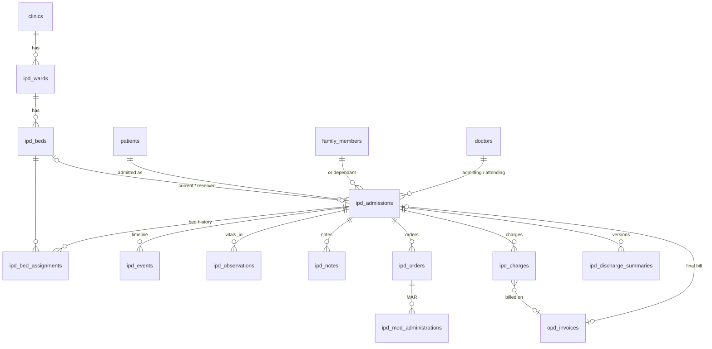

# Kriya IPD OS — Data Model and Migration Plan

Source of truth: [`migrations/111_ipd_os_core.sql`](../../migrations/111_ipd_os_core.sql) · rollback
[`migrations/rollback/111_down.sql`](../../migrations/rollback/111_down.sql).

## 1. Reused vs new
| Reused (unchanged) | Extended (additive) | New |
|---|---|---|
| `patients`, `family_members` (MRN, demographics, allergies), `doctors` (registration), `branches`, `appointments`, `opd_encounters`, `opd_invoice_items`, `opd_receipts`, `opd_cashier_shifts`, `clinic_admins` | `clinics` + `ipd_state`, `ipd_settings`; `opd_invoices` + `admission_id` (FK, one live bill per admission); `opd_invoice_items` + trigger `trg_ipd_bill_items_guard`; unique index `(clinic_id, id)` on `opd_encounters` | `ipd_wards`, `ipd_beds`, `ipd_admissions`, `ipd_bed_assignments`, `ipd_events`, `ipd_observations`, `ipd_notes`, `ipd_orders`, `ipd_med_administrations`, `ipd_charges`, `ipd_discharge_summaries` |

Every new table: `clinic_id NOT NULL REFERENCES clinics ON DELETE CASCADE`, `UNIQUE (clinic_id, id)`, children
reference parents by `(clinic_id, parent_id)`; RLS enabled+forced with the 103 policy pair; `anon`/`authenticated`
revoked; all 11 in `TENANT_OWNED_TABLES`. Every `ipd_*` function has `search_path = public, pg_temp` and is
executable only by `service_role`.

## 2. Entities

## 3. Lifecycles
**Admission**: `pending → admitted → discharge_pending → discharged`; `pending → cancelled`;
`discharge_pending → admitted` (revert; refused while a live bill exists). `current_bed_id` is set iff
`admitted`/`discharge_pending` (CHECK). Discharged/cancelled rows are locked (trigger).

**Bed**: `available ⇄ reserved` (hold for a pending stay, with `reserved_until`), `available/reserved → occupied`
(assign/admit), `occupied → cleaning` (transfer out / discharge), `cleaning → available`,
`available ⇄ maintenance/blocked` (admin, reason required). `occupied` ⇔ `current_admission_id` (CHECK); `reserved`
⇔ hold columns (CHECK); an inactive bed cannot be occupied/reserved (CHECK). Only the functions change these columns.

**Charge**: `proposed → posted → (billed: invoice_id set)`; `proposed/posted(unbilled) → void` (reason).
Amounts never change. A void bill's charges can be re-billed.

**Discharge summary**: `draft → signed → superseded` (by the next signed version). One draft and one signed per
admission (partial unique indexes).

## 4. Invariants and where they are enforced
| Invariant | Enforced by |
|---|---|
| A bed holds at most one active stay | row lock in `ipd_lock_eligible_bed` + `uq_ipd_beds_current_admission` + `uq_ipd_admissions_one_per_bed` + `uq_ipd_bed_assignments_open_bed` |
| A stay is in at most one bed | `uq_ipd_bed_assignments_open_admission` + `uq_ipd_beds_current_admission` |
| One active stay per person | `uq_ipd_admissions_one_active` (patient + family member) |
| No cross-tenant reference | composite FKs on every relation; functions filter by `p_clinic_id` |
| No duplicate admission/order/MAR/charge on retry | idempotency-key unique indexes; `uq_ipd_charges_source_ref` |
| Clinical records immutable | `ipd_guard_clinical_record`, `ipd_guard_order`, `ipd_guard_discharge_summary` |
| Writes only on a stay that holds a bed | `ipd_check_admission_active`, `ipd_check_mar_insert` |
| One live final bill per stay; bill lines = posted charges | `uq_opd_invoices_one_per_admission`, `ipd_guard_bill_items`, `ipd_guard_charge` |
| Typo bounds on vitals (not clinical thresholds) | CHECKs mirrored by pydantic bounds |

## 5. Migration sequence and safety
1. **Expand only.** New tables/columns with defaults; no existing constraint narrowed; existing rows untouched
   (`ipd_state` defaults to `OFF`). Pre-111 code runs unchanged on a 111 database (lifespan check only refuses a DB
   *older* than the code).
2. One transaction (runner), idempotent (`IF NOT EXISTS`, `DROP … IF EXISTS` before re-adding constraints/triggers,
   `CREATE OR REPLACE` functions) — `test_reapply_is_idempotent`.
3. Ends with a verify block (11 tables, 7 invariant indexes) that aborts the transaction if anything is missing.
4. Rollback `111_down.sql` refuses while any stay is active, then drops IPD objects; IPD bills stay as plain OPD
   invoices. `test_rollback_refuses_while_admitted_then_reapplies`.
5. Applied so far only to the embedded test Postgres (pgserver, PG 16). **Not applied to staging or production.**
