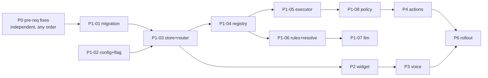

# Kriya Ketu — Implementation Plan

Parent: [spec.md](spec.md). Status of every task lives in [status.md](status.md). **All tasks below are
NOT_STARTED.** Do not start a task until its dependencies are VERIFIED and the plan is approved.

## Read before editing anything (every implementation agent)
1. `AGENTS.md` (tenancy, `sb()`, HTTP/1.1, firewall, IST, the inlined frontend)
2. `docs/kriya-ketu/spec.md` → this file → the task's linked sections
3. `docs/kriya-ketu/file-impact-matrix.md` (which files you may touch)
4. `docs/agent-context/08-AUTH-AND-MULTI-TENANCY.md`, `docs/agent-context/05-FRONTEND-MAP.md`

## Standing gates (run after **every** task)
```bash
pytest tests/test_lint_unscoped_queries.py
pytest tests/test_admin_super_admin_scope_matrix.py tests/test_phase2_route_adversarial_matrix.py
pytest tests/test_clinical_firewall.py
pytest tests/test_webhook.py tests/test_fsm_transitions.py
pytest tests/test_admin_panel_scope_helper.py tests/test_phase6_frontend_backend_wiring.py
pytest tests/test_assistant_*.py          # once they exist
```
Plain `pytest` is hermetic (`tests/conftest.py`). **Never** set `KRIYA_TEST_LIVE=1`.

## Parallelism

- **Parallel:** each P0 task; P2-01/02 (frontend) alongside P1-04..08 (backend), once P1-03 freezes the
  HTTP contract.
- **Sequential, single owner:** `app/assistant/executor.py` and `policy.py` (foundational; no two agents
  at once). `admin/index.html` is one file: only **one** agent edits it at a time (P2 and P3 tasks are
  serialized).

---

## P0 — Pre-requisite fixes to existing code (each separately approvable; not part of the assistant)

### KK-P0-01 Doctor-leave cancellation gap (D-01, D-06)
- **Goal:** bookings on a leave day are always cancelled and notified, including leaves for today, or
  for tomorrow entered after 08:00.
- **Decision first:** DP-01. (a) Run `check_doctor_leaves` also on leave creation, for leaves starting
  today/tomorrow, via `spawn_background_task`. (b) Change the window to `>= today` and run hourly. Option
  (a) is recommended: it is the smallest change and keeps the 08:00 run.
- **Files:** `app/services/scheduler.py` (window + `today_ist()`), `app/routers/admin.py` `create_leave`
  (trigger for near dates). **Inspect:** `payment.initiate_refund`, `notify_cancellation_outcome`, the
  `distributed_job_lock("doctor_leaves")` lease.
- **Acceptance:** a leave created at 09:00 IST for tomorrow cancels and notifies tomorrow's confirmed
  bookings within 2 min. A leave for today does too (only appointments with time > now). No double
  notifications on the next 08:00 run (the status is already off `confirmed`).
- **Tests:** a new `tests/test_doctor_leave_same_day.py` with frozen IST times 07:00, 09:00, 23:30 (UTC
  container).
- **Security / regression:** patient-facing messages; refund path. Covered by the existing session-20
  tests.
- **Rollback:** revert the commit. There is no schema change.
- **Evidence:** test output + a staging run log.

### KK-P0-02 Harden `POST /admin/lab-reports/{id}/resend` (D-03)
- **Goal:** the same authorization as `/admin/reports/{id}/resend`, with no raw `str(e)`.
- **Decision:** DP-02 (whether the panel relies on the route for roles without `REPORTS_RESOLVE`; check
  the `labreports` page callers in `admin/index.html`).
- **Files:** `app/routers/admin.py:5672`. **Tests:** extend `tests/test_phase2_route_adversarial_matrix.py`.
- **Rollback:** revert.

### KK-P0-03 Audit appointment cancellation (D-04)
- **Files:** `app/routers/admin.py:5390` adds `log_admin_action(action="cancel_appointment", …)`.
- **Tests:** a new assertion in an existing cancel test. **Rollback:** revert.

### KK-P0-04 Revoke sessions on permission, role or branch edits (D-09)
- **Files:** `app/routers/admin.py` `update_staff` (`:1337`): call `revoke_sessions_for_user(target.username)`
  when `permissions`, `staff_role`, `role` or `branch_id` changed. Not for the editor's own session unless
  they edited themselves.
- **Acceptance:** after the edit, the target's next request gets 401 "Session expired".
- **Regression:** the staff member is logged out mid-shift. This is a UX change that needs owner
  approval (DP-09).
- **Rollback:** revert.

---

## P1 — Backend foundation

### KK-P1-01 Migration 108 + tenancy + retention
- **Files (new):** `migrations/108_kriya_ketu.sql`, `migrations/rollback/108_down.sql`.
  **Change:** `app/tenancy.py` (add `assistant_runs`), `app/services/data_retention.py`
  (`purge_assistant_runs(days=90)`), `app/services/scheduler.py` (register the purge on the existing
  retention cadence, under `distributed_job_lock`).
- **Inspect:** `run_migrations.py`, `migrations/backfill_schema_migrations.sql` (checksum convention).
- **Acceptance:** applies on a Supabase branch / embedded PG; the lint passes; the purge deletes rows
  older than 90 days for every clinic in one scoped sweep (`# unscoped: platform_sweep` annotation per
  house style).
- **Rollback:** `108_down.sql` (drops assistant metadata only).

### KK-P1-02 Configuration and feature flag
- **Files:** `app/config.py` (settings in [openrouter-and-speech-spec.md](openrouter-and-speech-spec.md)
  §A.5), `app/services/tenant.py` (`OPT_IN_FEATURES["kriya_ketu"] = "Kriya Ketu assistant"`, plus
  `kriya_ketu_enabled(clinic)` with the same shape as `ai_receptionist_enabled`), `app/routers/admin.py`
  `GET /admin/me` (add `assistant_enabled`, `assistant_stt_enabled`), `.env.example`, and
  `render.yaml` (env keys only, default off).
- **Acceptance:** the owner can toggle it via the existing `PATCH /platform/clinics/{id}/features` (it
  validates against `OPT_IN_FEATURES`). Enterprise plans do **not** get it implicitly.
- **Tests:** `tests/test_assistant_feature_gate.py`.

### KK-P1-03 Store, state machine and router skeleton
- **Files (new):** `app/assistant/__init__.py`, `app/assistant/store.py`, `app/routers/assistant.py`.
  **Change:** `app/main.py` (`include_router`).
- **Behaviour:** the routes in [architecture.md](architecture.md) §2.4. `requests` is idempotent on
  `client_request_id`. CAS transitions per §5. A `GET runs` sweep marks EXECUTING > 2 min as
  UNKNOWN_OUTCOME. Only `nav.open` is routed in this task.
- **Acceptance:** KK-FR-001..003, 024. **Tests:** `tests/test_assistant_runs.py` (idempotency, CAS,
  BOLA 404, super_admin scope).

### KK-P1-04 Registry and drift tests
- **Files (new):** `app/assistant/registry.py`, `app/assistant/help.py`, `tests/test_assistant_registry.py`
  (permission equals the route dependency; P-tier deny-list + H-tier never executable; every R≥1 has verify; page table equals the
  sidebar `data-page` set parsed from `admin/index.html`).

### KK-P1-05 Executor: in-process dispatch and verification
- **Files (new):** `app/assistant/executor.py`.
- **Behaviour:** `httpx.AsyncClient(transport=httpx.ASGITransport(app=app), base_url="http://kriya.internal", timeout=20)`.
  It forwards the caller's `admin_session` cookie **or** `Authorization` header, plus `X-Correlation-ID`,
  appends `?clinic_id=<effective>`, maps status codes to error codes, never forwards raw `detail` (except
  allow-listed 4xx), runs `verify()`, and never retries writes.
- **Inspect:** whether `log_admin_action`'s IP should use an in-process scope marker (T-24; optional
  sub-task, DP-10).
- **Tests:** `tests/test_assistant_executor.py` (fake routes via a test FastAPI app: 2xx/4xx/5xx/timeout
  → states; the forbidden path stays forbidden; no auto-retry).

### KK-P1-06 Deterministic router and resolvers
- **Files (new):** `app/assistant/rules.py`, `app/assistant/resolve.py`,
  `tests/fixtures/assistant_corpus.yaml` (≥ 200 phrases: en / te-Latin / Telugu / hi-Latin / Devanagari /
  code-mix; negation, hypothetical, question, unsupported), `tests/test_assistant_rules.py`.
- **Reuse:** `app/voice/dates.parse_date`/`today_ist`, the DENY lexicon from `app/voice/nlu_rules.py`
  (imported as data), `difflib`, `clinical_firewall.screen_message`.
- **Acceptance:** KK-FR-010..012, 015, 016; ≥ 95 % corpus accuracy; 0 wrong writes; `llm_called=false`
  for every corpus phrase marked `rules`.

### KK-P1-07 OpenRouter fallback
- **Files:** new `app/assistant/llm.py`. **Change:** `app/services/ai_gateway.py`
  `call_ai_gateway(..., provider_prefs: Optional[dict] = None)`, which is added to the payload only when
  given. That is the only change there.
- **Gate G-KK-LLM:** a script `scripts/assistant_llm_smoke.py` (new) calls the configured models with the
  schema and records valid-JSON rate and latency on 30 phrases. Pass: ≥ 29/30 valid, p95 ≤ 4 s.
- **Tests:** `tests/test_assistant_llm.py` (mocked: valid, out-of-enum, malformed, timeout, 429,
  `SpendCapExceededError`, disabled flag); plus `tests/test_ai_gateway*.py` must still pass unchanged.

### KK-P1-08 Policy, preview and plan hash
- **Files (new):** `app/assistant/policy.py`. **Tests:** `tests/test_assistant_policy.py` (role ×
  permission × feature × branch matrix; R3 role rule; plan_hash stability; stale plan; expiry;
  typed count).

---

## P2 — Frontend widget (text)

All in `admin/index.html` (inline CSS in the existing `<style>`, the symbol in the existing sprite,
script in the existing `<script>`). One agent at a time.

| ID | Goal | Acceptance | Tests |
|---|---|---|---|
| KK-P2-01 | `#ketu-mark` symbol, launcher, panel shell, tokens, stacking, open/close, Ctrl+K, scope-banner offset | ux §3–4; hidden when `assistant_enabled=false` or for corp/phleb views | `tests/test_assistant_panel_static.py` (node-extracted functions, as in `test_admin_panel_scope_helper.py`), Playwright smoke |
| KK-P2-02 | Composer, send, draft, `client_request_id`, `sync()`, R0 cards (text/table/help/error), nav → `go()` | KK-FR-004, 005, 034 | node unit tests for key handling and the draft; Playwright |
| KK-P2-03 | Clarify, preview, typed preview, steps, result cards, countdown, confirm/cancel | KK-FR-012, 022, 023, 033 | Playwright with a stubbed API |
| KK-P2-04 | Accessibility, mobile sheet, reduced motion/transparency, light theme | KK-NFR-A11Y-01/02, MOB-01 | axe + emulateMedia + 375×812 viewport |

---

## P3 — Voice

| ID | Goal | Files | Acceptance |
|---|---|---|---|
| KK-P3-01 | Allow the same-origin microphone (D-05) | `app/utils/security.py` `Permissions-Policy: camera=(), microphone=(self), geolocation=()` | Header test updated (`tests/test_security*.py`). No other header changes. |
| KK-P3-02 | Transcribe endpoint + Sarvam REST provider + fake | new `app/assistant/stt.py`; route in `app/routers/assistant.py`; `ai_usage_ledger` `assistant_stt` | B.2 steps 4; size/mime/rate limits; no audio persisted; transcript not logged |
| KK-P3-03 | Mic UI and every failure state | `admin/index.html` | B.3 table; never auto-send (unit-tested); track stopped on all exits |
| KK-P3-04 | Gate G-KK-ASR: language evaluation | new `scripts/assistant_stt_eval.py` + a report in `docs/kriya-ketu/` | B.4 pass bar met, or language claims narrowed in the spec |

---

## P4 — Action rollout (one PR per row; each adds registry entries, corpus phrases, tests)

| ID | Actions | Depends | Extra acceptance |
|---|---|---|---|
| KK-P4-01 | All R0 reads in registry §4 | P1-* | Results match the corresponding page for the same filters (fixtures) |
| KK-P4-02 | PB-01 leave playbook: `doctor_leave.impact/create/delete`, `appointment.cancel_bulk` | P4-01, **KK-P0-01 decided** | KK-FR-040..043; impact count equals the `check_doctor_leaves` selection |
| KK-P4-03 | `report.resend`, `lead.message`, `connector.run_now` | P4-01 | KK-FR-050..053 |
| KK-P4-04 | **PLANNED**: new read endpoint over `failed_messages` / `outbound_message_ledger` + `whatsapp.failed_messages` | separate approval | New endpoint needs its own spec + tenancy review |
| KK-P4-05 | `appointment.check_in`, `appointment.cancel`, `booking.confirm/reject`, `opd.call_next`, `holiday.create`, `notifications.mark_all_read` | P4-01 | Verify statuses checked against the real service (to-verify items in the registry) |

## P5 — Platform-owner console (deferred; needs its own Phase 0 addendum)

## P6 — Rollout

| ID | Step | Evidence |
|---|---|---|
| KK-P6-01 | Staging tenant with `features.kriya_ketu=true`; full test plan | Test report |
| KK-P6-02 | Internal pilot on one live clinic (owner choice), env flags on, LLM on, STT off | 1 week of `assistant_runs` metrics |
| KK-P6-03 | STT on for the pilot clinic after G-KK-ASR | Eval report |
| KK-P6-04 | Metrics review against spec §1.7; GA decision | Signed-off metrics |

## Completion evidence (every task)
A PR link or commit hash, test output, the updated status.md row with evidence, and screenshots for
P2/P3 tasks.

---

## v2 additions (2026-10-14): full-system scope + bug remediation

### P0 — additional bug fixes (see [bug-remediation-register.md](bug-remediation-register.md); each: failing test first, own commit)
| ID | Defect | Files | Acceptance |
|---|---|---|---|
| KK-P0-05 | ~~D-10 lab test update validation~~ **Withdrawn**: the validator already exists | — | — |
| KK-P0-06 | D-11 duplicate leave dates | `create_leave` | Existing dates skipped and reported; optional unique index after cleanup (separate migration, DP-13) |
| KK-P0-07 | D-12 voice settings auth order | `voice_admin.put_settings` | 403 before 422 |
| KK-P0-08 | D-13 config lost update | `voice_admin.put_settings`, `admin.update_clinic_profile`, `admin.update_payment_settings` (verify each does read-modify-write) | Concurrent writes: the second gets 409 and retries on fresh data |
| KK-P0-09 | D-14 raw `str(e)` in error details | 20 sites in admin, platform, voice_admin | Each classified; 5xx → generic text; intended 4xx kept; a grep test guards it |
| KK-P0-10 | D-15 stale comment | `ai_gateway.py` | Comment points at the real budget code |
| KK-P0-11 | D-16 auto lead-call accuracy | `app/voice/outbound.py` | Mixed phone formats fixture: no repeat within 7 days; the cap counts queued calls, not candidates |
| KK-P0-12 | K-01 decision | `database.get_treatment_doctor_ids` | Per DP-12 |
| KK-P0-15 | **Endpoint hardening sweep**: before an action is registered, its endpoint passes the checklist (bounds; CAS/idempotency for state changes; no raw `str(e)`; audit row for writes; `sb()` off-loop; tenant + branch scope; permission source recorded) | Per endpoint | Checklist file per registered endpoint in `docs/kriya-ketu/hardening/` (created during implementation); any gap → new D-xx + fix task |

### P4 — additional actions and playbooks
| ID | Scope | Depends | Extra acceptance |
|---|---|---|---|
| KK-P4-06a | NEW-BE `dry_run` on `POST /admin/voice/outbound/bulk` | approval DP-14 | Never inserts; same skip reasons as the real call |
| KK-P4-06 | PB-03 leads → calls, PB-04 funnel, PB-05 auto-leads toggle, `lead.message` | P4-01, KK-P0-11 | WA-08..12 |
| KK-P4-07 | PB-06 register + token; OPD arrive/call/recall/stage | P4-01 | REG-01..05 |
| KK-P4-08 | PB-07 lab price (single/bulk), lab test create/update/deactivate, collection window | **KK-P0-05** | CAT-01..04 |
| KK-P4-09 | PB-08 cleanup, PB-09 import (attachment), auto-classify, generate details | P4-08 | CAT-05..07 |
| KK-P4-10 | PB-10 treatments (edit, price bulk, status, doctors, AI draft), PB-15 dental | P4-01 | CAT-08..10 |
| KK-P4-11 | PB-11 doctor schedule change, doctor create, branch doctor assign | P4-01 | SCH-01..03 |
| KK-P4-12 | H-tier hand-off framework + mappings (staff, payment settings, billing cash, workspace, deletions, imports/exports) | P2-03 | UI-19, SEC-18 |
| KK-P4-13 | Voice admin actions: knowledge, lexicon, learning review, settings | P4-01, KK-P0-07/08 | VOICE-12..14 |
| KK-P4-14 | PB-12 / PB-13 briefings (on demand) + L4a scheduled morning briefing to notifications | P4-01 | BRF-01..03 |
| KK-P4-15 | OPD billing R2 (invoice create/issue, payment link), refund R3, booking confirm/reject, home collection assign | P4-01 | PAY-01..04, HC-01..02 |
| KK-P7 | L4b standing write automations | ADR-006b approval | Out of v1 |

Ordering note: KK-P0-11 before KK-P4-06; KK-P0-07/08 before KK-P4-13.
