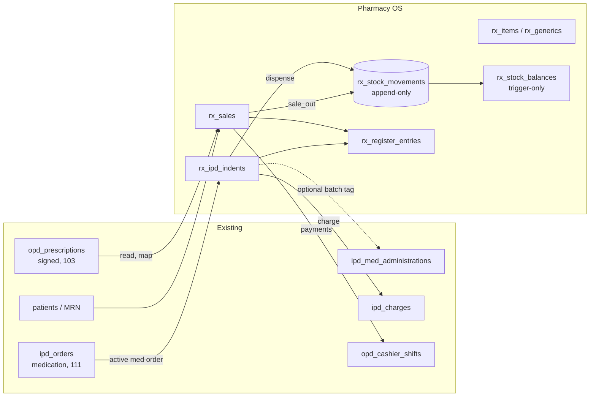
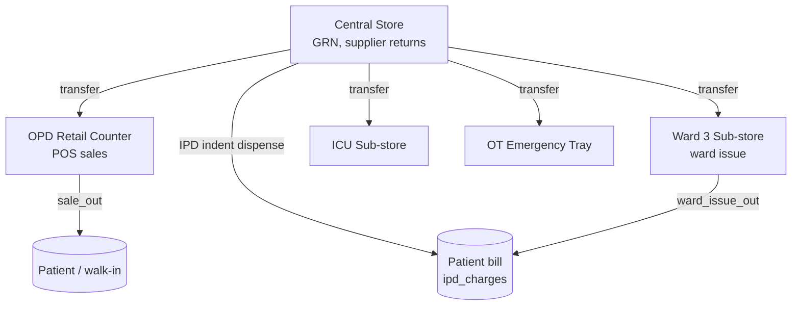
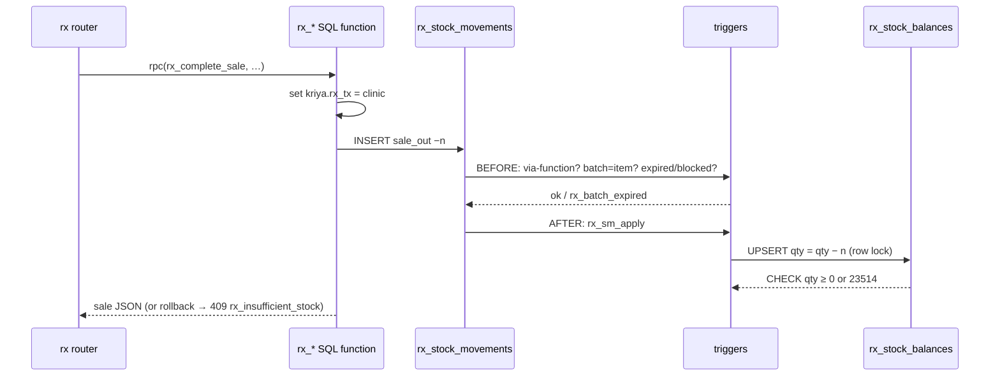
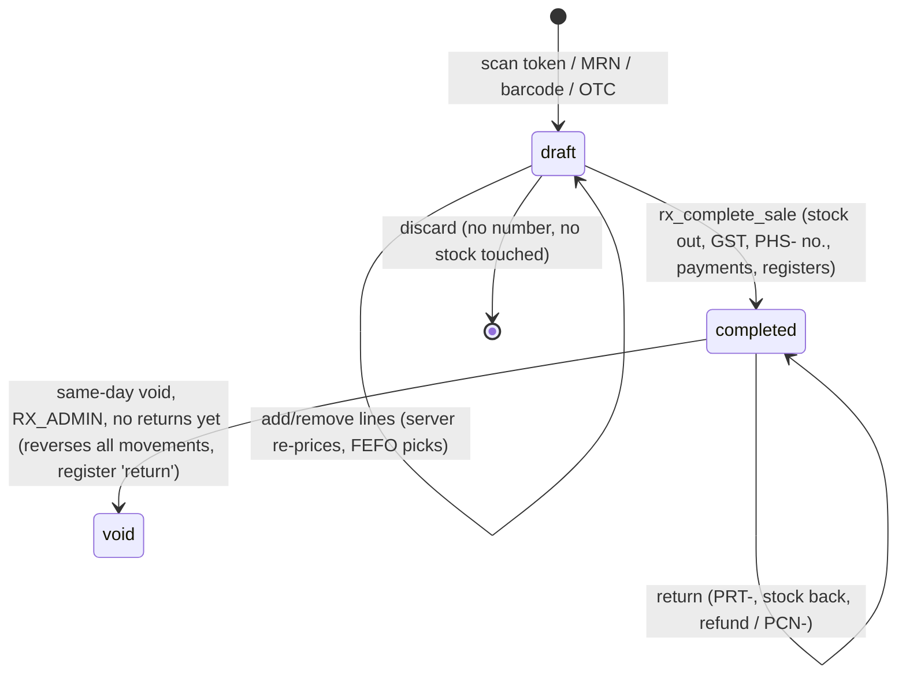
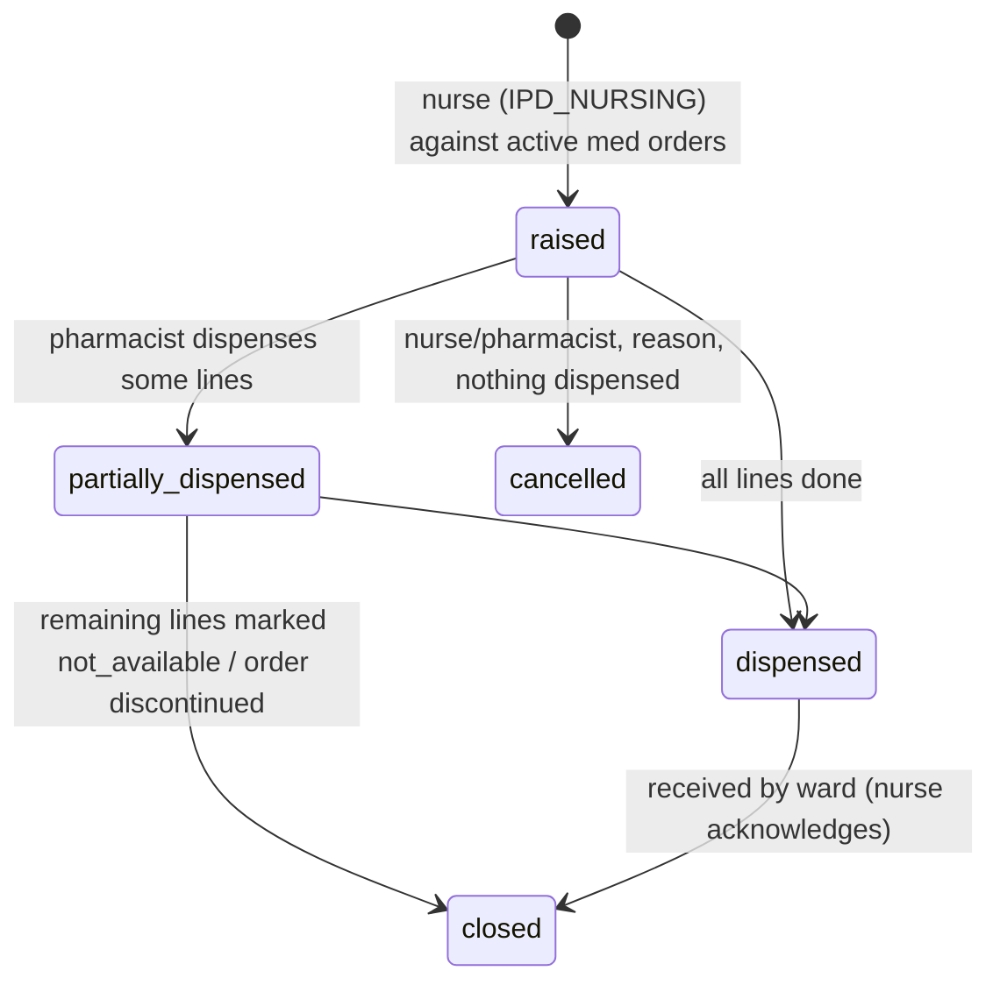

# Kriya Pharmacy OS — Architecture

> Part of the Pharmacy OS set: start at [status.md](status.md). Decisions: [ADR.md](ADR.md). Schema:
> [DATA-MODEL.md](DATA-MODEL.md). Evidence for every reuse claim: [AUDIT.md](AUDIT.md).

## 1. Position in Kriya
Pharmacy OS (lane prefix **RX**, tables `rx_*`, routes `/admin/rx/*`) is the fourth owner-opt-in module after OPD
(103), IPD (111) and Diagnostics (125–133). It **reads** OPD prescriptions and IPD medication orders, **writes** IPD
charges through a widened but otherwise unchanged contract, and **reuses** the patient registry (MRN), branches,
cashier shifts, number counters, GST helpers, audit log, WhatsApp sender, consent service and Kriya Ketu.

## 2. Process topology
No new process. Routes run in the existing FastAPI web container; jobs register in the existing APScheduler
(`app/services/scheduler.py`) with the distributed CAS lock (`scheduler_locks`), so one replica runs each job.

| Component | File (new) | Notes |
|:-|:-|:-|
| Router | `app/routers/rx.py` | `prefix="/admin/rx"`, every route: permission → `_rx_scope` (tenant + `rx_access`) → store scope → wind-down rule |
| Core service | `app/services/rx.py` | settings, stores, provisioning, deactivation preview |
| Catalogue | `app/services/rx_catalogue.py` | items, generics, barcodes, aliases, CSV import, mapping search |
| Stock | `app/services/rx_stock.py` | FEFO reads, ledger reads, transfers, audits, `rpc()` wrappers |
| Purchase | `app/services/rx_purchase.py` | suppliers, PO, GRN |
| POS | `app/services/rx_pos.py` | Rx load, draft, complete, returns, receipts |
| Tax | `app/services/rx_tax.py` | pure functions mirroring SQL (ADR-RX-08) |
| IPD | `app/services/rx_ipd.py` | indents, dispense, ward issue, returns |
| Registers | `app/services/rx_registers.py` | list, verify, PDF/CSV export |
| Refills & alerts | `app/services/rx_refills.py`, `rx_alerts.py` | jobs + WhatsApp template send |
| PDF | `app/services/rx_pdf.py` | 80 mm and A5 receipts, register PDFs (reuses the `opd_pdf.py` renderer) |

Every Supabase call: `await sb(...)` (AGENTS.md §1.2). Multi-row state changes are **one SQL function per
transition** called via `rpc()` — never a sequence of PostgREST writes (a crash mid-sequence would leave stock and
bill disagreeing).

## 3. Multi-store architecture

- Store scope: a staff login with `branch_id` sees only stores of that branch; a login may be pinned to stores via
  `clinic_admins.permissions` entries `RX_STORE:<store_id>` (SECURITY §3.3). A ward nurse sees only the sub-store of
  the ward they are working.
- Replenishment suggestion (per store): `reorder_level_units` vs `rx_v_item_stock` → draft transfer from parent store,
  or draft PO when the store is central.

## 4. Stock movement engine

Movement types and who writes them:

| Type | Sign | Written by |
|:-|:-|:-|
| `opening` | + | `rx_import_opening_stock` (ROLLOUT §4) |
| `grn_in` | + | `rx_post_grn` |
| `sale_out` / `sale_return_in` | − / + | `rx_complete_sale` / `rx_record_return` |
| `ipd_dispense_out` / `ipd_return_in` | − / + | `rx_dispense_indent` / `rx_ipd_return` |
| `ward_issue_out` | − | `rx_ward_issue` |
| `transfer_out` / `transfer_in` | − / + | `rx_dispatch_transfer` / `rx_receive_transfer` |
| `supplier_return_out` | − | `rx_supplier_return` |
| `adjust_in` / `adjust_out` | + / − | `rx_post_audit`, `rx_void_grn` |
| `expiry_writeoff_out` / `damage_writeoff_out` | − | `rx_writeoff` |

Valuation: each movement carries the batch's landed unit cost (×100 for sub-paise precision); stock value =
Σ(balance × cost). COGS per sale line = Σ(out movement cost). Margin reports read these, never recompute.

## 5. POS transaction lifecycle

- Draft lines **do not reserve stock** (no holds that expire and confuse counts). Completion re-checks; if a parallel
  counter took the last unit, completion fails with the line named and the drawer offers the next FEFO batch.
- Latency budget (status §6 NFR-1): scan → line rendered < 300 ms p95; Enter → receipt ready < 1.5 s p95; the
  "3-second checkout" is measured from first scan to printed receipt for a 3-line Rx.
- Idempotency: the client generates `idempotency_key` per checkout; a retried POST returns the same sale.

## 6. IPD indent state machine

Line states: `open → partial → done`, or `cancelled` / `not_available`. When the doctor discontinues the order
(existing route, AUDIT A18), open lines of that order become `cancelled` by trigger `rx_order_end_to_indent`
(AFTER UPDATE OF status ON ipd_orders, only when RX tables have rows for that order — zero cost otherwise).

## 7. Integration contracts with existing modules (all additive)
| Existing object | Change | Backward compatibility |
|:-|:-|:-|
| `clinics` | + `rx_state`, `rx_settings` | defaults `OFF`, `{}` |
| `ipd_charges.source` CHECK | widened to add `'pharmacy'` | existing values still valid; no reader switches on `source` except 115's void (`source='order'`), unaffected |
| `ipd_med_administrations` | + nullable `rx_dispense_line_id` (composite FK) | 111 insert path unchanged; `ipd_guard_clinical_record` already locks it after insert |
| `ipd_orders` | AFTER UPDATE trigger `rx_order_end_to_indent` | no-op when no indent lines reference the order; does not modify `ipd_orders` |
| `opd_cashier_shifts` | referenced by `rx_sale_payments.shift_id` | `close_shift` summary adds `pharmacy_*` keys (RX-34); existing keys and totals unchanged |
| `opd_next_counter` | new keys `rx_sale`, `rx_return`, … | per-key rows; existing keys untouched |
| GSTR-1 export | + pharmacy sections (RX-52) | only when `rx_access`; otherwise identical output (golden-file test) |
| `TENANT_OWNED_TABLES` | + 36 names | lint covers them |
| `admin/index.html` | `<!-- RX:… -->` blocks, `data-rx` gating | hidden unless `rx_access`; no existing element edited except the `loaders` map line (append inside `/* RX:…*/`) |
| `/admin/me` | + `rx_access`, `rx_state`, `rx_store_ids` | additive keys |
| Platform purge | `rx_purge_clinic` first | no-op on clinics without RX rows |

## 8. Zero-impact guarantees for clinics without Pharmacy OS
1. **No new code on hot paths.** Webhook, booking, voice, OPD billing and IPD charge routes do not import `rx_*`.
   The only shared-path additions are: one trigger on `ipd_orders` status change (early-exit `IF NOT EXISTS (SELECT 1
   FROM rx_indent_lines WHERE clinic_id=… AND ipd_order_id=…)` on an index), and the `close_shift` summary union
   (one indexed `SUM` returning 0 rows).
2. **Router mounted but gated.** Every `/admin/rx/*` route returns 403 `pharmacy_not_enabled` before any DB read
   (except the clinic row already loaded for auth).
3. **Scheduler jobs filter first.** `rx_*` jobs select `clinics WHERE rx_state <> 'OFF'` — an indexed predicate; zero
   clinics → zero work.
4. **UI.** Pharmacy nav group is `hidden` until `applyRxGates()` sees `rx_access`; loaders never called.
5. **Proof.** DG5 (status §4): the full existing test suite passes **unedited** after each RX migration; latency
   gate DG7 compares p95 of `/webhook`, `/admin/opd/invoices`, `/admin/ipd/admissions/{id}` before/after on the
   seeded perf fixture (≤ 5% regression).

## 9. Failure modes
| Failure | Behaviour |
|:-|:-|
| Two counters sell the last strip | one commits; the other gets 409 `rx_insufficient_stock` naming the item; drawer shows next batch |
| Network drop after Enter | client retries with same idempotency key → same sale returned, no double stock-out |
| Printer offline | sale completes; receipt queued in browser; reprint from Sales history (no state change) |
| WhatsApp send fails for refill | `rx_refill_plans.status` stays `scheduled`, retried next day; 3 failures → `expired`, no spam |
| Supabase timeout mid-function | transaction rolls back; nothing partial; client retries |
| Item schedule changed after sale | register keeps the snapshot from sale time |
| Clock skew client vs server | all expiry/business dates use DB `now()` in IST |
