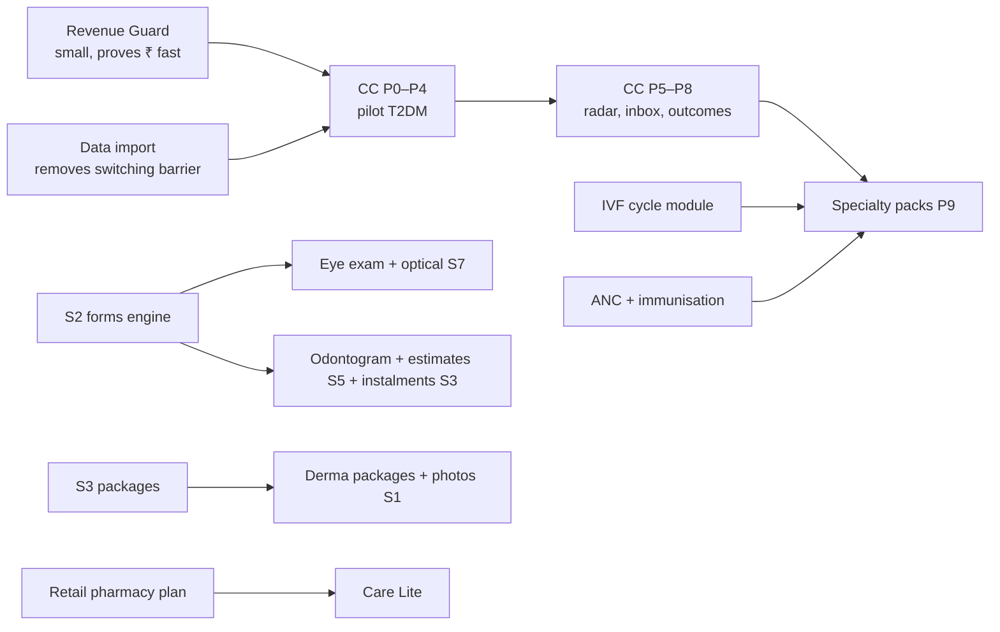

# Kriya Specialty OS — Gap Analysis across plans

> Scope: the specialty and hybrid plans Kriya sells today — `derma`, `eye`, `dental`, `ivf`, `multispecialty`,
> `womenchild` — plus the diagnostic plans (`diagstream`, `diagbooking`) and the new standalone **pharmacy** plan
> ([../pharmacy-os/RETAIL-PLAN.md](../pharmacy-os/RETAIL-PLAN.md)). Evidence for "Kriya has" is in the per-plan docs.
> Competitor notes describe what hospitals in each segment typically run; **verify any named-product claim with a live
> demo before it goes into sales material.**

## 1. Where every specialty plan stands today

The specialty plans (migrations 077–082, 089, 094) are a strong **front door**: treatment catalogue with AI-drafted
2-line descriptions, concern search, care pathway (patient-decided vs doctor-decided), service lines, callback leads,
paid consultation booking, branches, and — for dental only — multi-sitting treatment plans, sitting photos, reviews and
quotas. The hospital OS modules (OPD, IPD, OT, LIS, radiology + PCPNDT Form F, insurance, GST, Pharmacy, Diagnostic)
are **specialty-neutral**. What specialty hospitals buy specialty software for is missing:

| Capability | derma | eye | dental | ivf | womenchild | multispecialty | Build once as |
|:-|:-|:-|:-|:-|:-|:-|:-|
| Structured specialty exam record (not free text) | lesion/body map, PASI/SCORAD | VA, refraction, IOP, slit lamp, fundus, biometry/IOL | odontogram (FDI), perio chart | couple record, cycle chart | ANC record, growth chart | per department | **S2 Specialty forms engine** on `opd_encounters` |
| Clinical photos with consent, before/after compare | ●● | ● (fundus/anterior) | ●● (intraoral) | — | ● (wound) | ● | **S1 Clinical media vault** (generalise `dental_sitting_photos`, 094) |
| Multi-session packages, prepaid courses, wallet | ●● (laser ×6) | ● (anti-VEGF series) | ●● (ortho, implants) | ●● (cycle packages) | ● (ANC/delivery packages) | ● | **S3 OPD packages & instalments** |
| Treatment estimate / quotation accepted on WhatsApp | ● | ●● (IOL options) | ●● | ●● | ● (delivery package) | ● | **S5 Estimates** |
| Procedure consent forms | laser, isotretinoin | cataract/IOL, LASIK | implant, extraction | ART forms (couple, donor, witness) | C-section, procedures | all | `clinical_consents` (119) + **S4 specialty consent templates** |
| Specialty store / workshop | cosmeceutical retail | **optical shop** (frames, lenses, job orders) | **dental lab orders** | **embryology lab + cryo inventory** | vaccine stock | pharmacy | S7 optical store, S8 dental lab orders, IVF lab (IVF.md), Pharmacy OS stores |
| Device / imaging link | dermoscope images | OCT, fundus camera, perimeter, biometer | RVG/OPG | USG follicle scans, time-lapse | USG (Form F) | PACS | **S6 imaging links** (extend radiology PACS link, 123) |
| Recall / continuous care | ● isotretinoin, MTX, series | ●● post-op, anti-VEGF, glaucoma, DR screen | ●● recall, ortho | ●● cycle dates, beta-hCG, cryo renewal | ●● ANC, immunisation, growth | ●● NCDs | **Continuous Care packs** (docs/continuous-care/PROTOCOLS.md §6) |
| Regulatory registers | GST 18 % on cosmetic | NPCBVI camp reporting | AERB X-ray registration | **ART Act 2021 / ART Rules 2022**, Surrogacy Act, PCPNDT | PCPNDT Form F (exists), birth reporting, U-WIN/RCH | NABH indicators | per plan |
| Camps / outreach | skin camps | **cataract camps** | school dental camps | — | immunisation drives | health camps | **S9 camp module** (registration → screening → referral → surgery tracking) |

● useful · ●● decisive for winning that segment.

## 2. Shared building blocks (build once, every plan benefits)

| ID | Block | What it is | Reuses | Zero-impact rule |
|:-|:-|:-|:-|:-|
| S1 | Clinical media vault | consented photos/scans per encounter or treatment; private bucket, signed URLs, side-by-side compare, never sent on WhatsApp without an explicit share action | 094 storage pattern, `lab-reports` bucket conventions | new table; no existing table changed |
| S2 | Specialty forms engine | versioned JSON-schema forms (code-defined) attached to an encounter; validated; frozen when the encounter is signed; printable on the prescription PDF | DX template schema approach (`app/services/dx_template_schema.py`), OPD encounter signing | `opd_encounter_forms` new table; prescription PDF prints the forms block only when rows exist |
| S3 | OPD packages & instalments | sell a course (N sessions / a cycle / a delivery package) once, consume per visit; instalment schedule with payment links; GST per line | OPD invoices/receipts (103, 117), payment links (Razorpay/PhonePe) | new tables; invoices unchanged: the package sale (and any extras) is an ordinary invoice; each session is consumed in a package ledger linked to the visit — **no zero-value invoice lines** (VERIFICATION D15) |
| S4 | Specialty consent templates | text templates per procedure (en/hi/te), recorded through `clinical_consents` | 119 | templates only |
| S5 | Estimates | itemised estimate with options (e.g. IOL types), validity date, WhatsApp accept/decline buttons, converts to package / IPD package | dental plan quote, 116 packages | new table |
| S6 | Imaging links | per-encounter link to an external viewer (OCT, RVG, fundus, USG) with modality and device id | radiology PACS link (123) | additive column/table |
| S7 | Optical store | Pharmacy OS store kind `optical`: frames, lenses, contact lenses as items; spectacle job orders (Rx → lab → ready → delivered) with WhatsApp "spectacles ready" | RX catalogue, ledger, POS (134–138) | RX lane change, gated by `rx_access` + plan `eye`/hybrids |
| S8 | Dental lab orders | crown/bridge/denture/aligner work sent to an external lab: shade, tooth numbers, due date, received, fitted, remake | dental treatment plans (089) | dental only |
| S9 | Camp module | outreach camps: registration list → screening form (S2) → referral → booked surgery/visit → verified | CC radar + verification | new tables; opt-in |

## 3. Plan-by-plan priority (what to build first to sell or prove results)
| Plan | First (sell) | Second (prove) | Later |
|:-|:-|:-|:-|
| eye | S2 eye exam form (VA/refraction/IOP) + S7 optical store | CC `eye_post_cataract` (voice for elderly) + `eye_dr_screen` referrals from diabetes clinics | S6 OCT links, S9 cataract camps |
| dental | S2 odontogram + S5 estimates + S3 instalments | CC `dental_recall` (6-month recall is the dental revenue engine) | S8 lab orders, S6 RVG |
| derma | S3 session packages + S1 before/after photos | CC series + isotretinoin monitoring | S2 lesion map |
| ivf | IVF cycle module (IVF.md) + ART registers | CC `ivf_cycle` (trigger-time ack, beta-hCG) | embryology witness |
| womenchild | ANC record + immunisation module | CC `anc` + `child_immunisation` | growth charts, U-WIN export |
| multispecialty | Continuous Care core packs (t2dm, htn) | Revenue Guard (RI) | camps |
| diagstream / diagbooking | CC-D5 Care Lite (periodic tests + home sample) | outcome: repeat-test rate | — |
| pharmacy (new) | Retail plan (RETAIL-PLAN.md) | refill + adherence (Care Lite) | distributor e-ordering |

## 4. What makes Kriya different in every segment (the "AI-advanced" layer, inside the safety rules)
1. **The patient's channel is the product.** Every specialty workflow ends in a WhatsApp/voice touchpoint the patient
   actually answers (estimate accept, session left in package, spectacles ready, scan date, vaccine due), in en/hi/te.
2. **Continuous Care packs per specialty** turn one-off procedures into followed courses, with verified returns in ₹.
3. **Voice for patients who do not read** — elderly cataract and diabetic patients, rural mothers — through the
   existing receptionist, never a separate app.
4. **AI where it is safe:** drafting patient-friendly descriptions (exists), translating staff notes into the
   patient's language for **staff review before sending**, summarising a case for the coordinator (labelled), Ketu
   answering staff questions. **Never** AI reading a skin photo, a fundus image, a scan or an embryo to decide anything
   — that is diagnosis (NMC; CDSCO would treat it as a medical device).
5. **Cross-specialty referrals inside one hospital or a partner network**: diabetes → eye screening, pregnancy → GDM
   screening, IVF positive → ANC, newborn → immunisation, with consent and verification.

## 5. Delivery order across lanes (recommended)

RI, MI and the retail pharmacy plan can start in parallel with CC P1 (no shared files except the registries — merge
carefully). S2 is the most leveraged shared block: build it before any specialty exam form.
